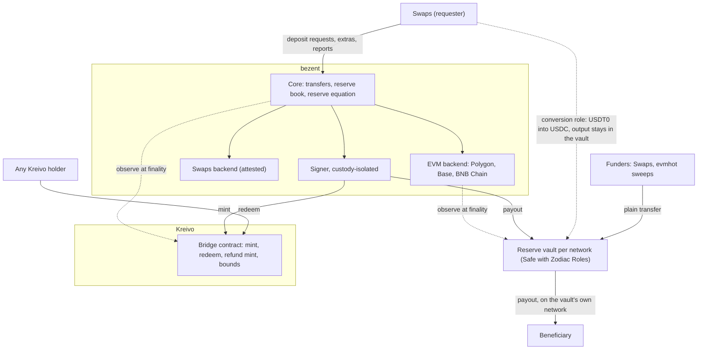
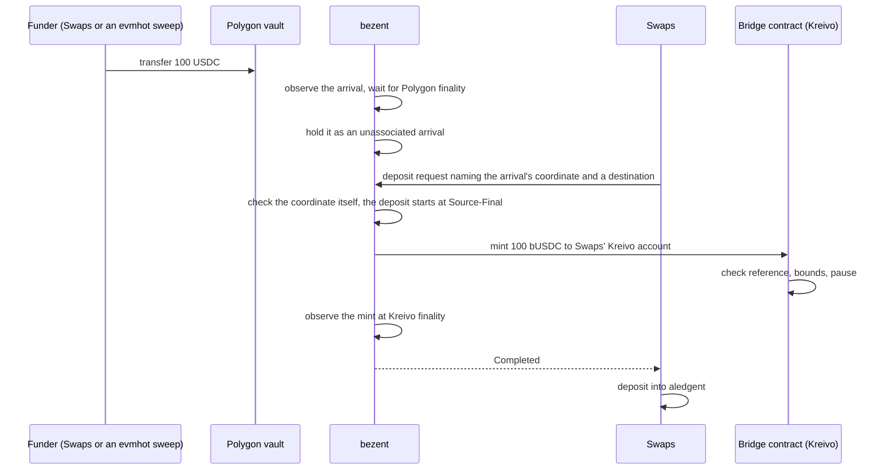
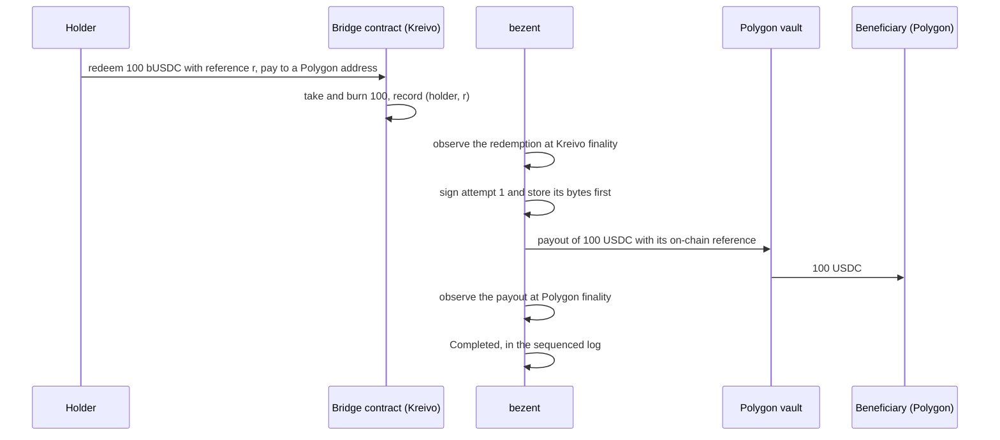
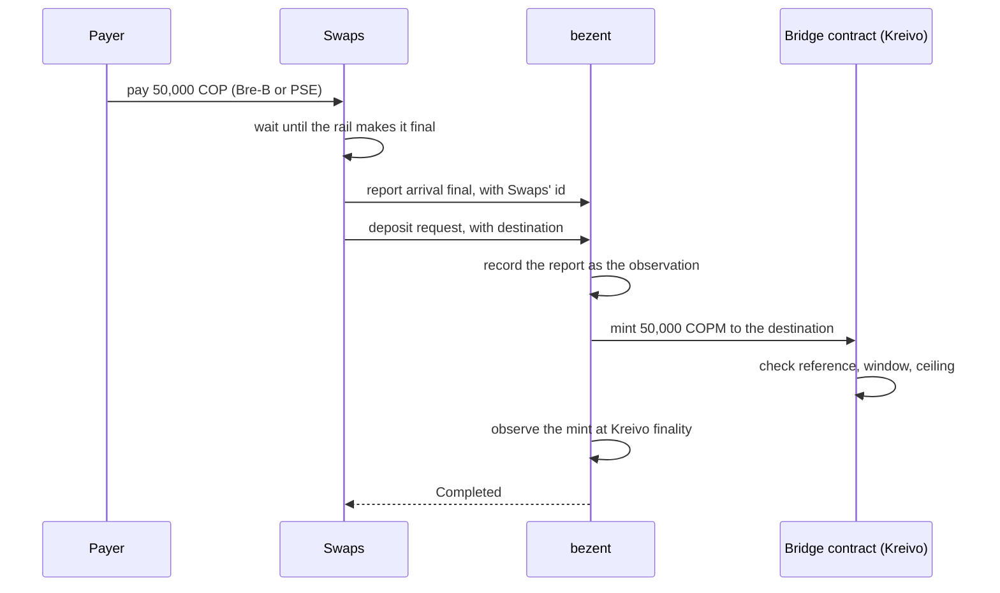
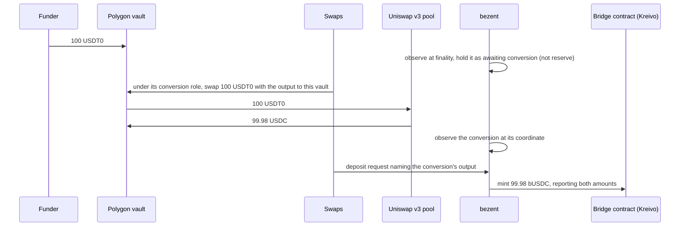
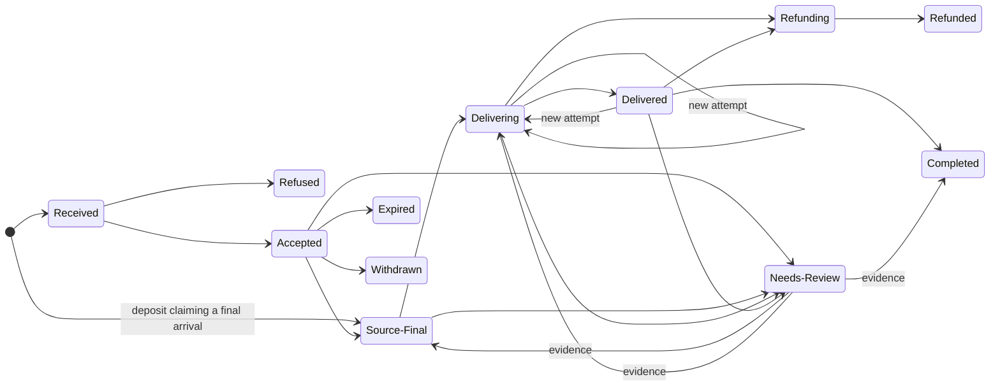

# bezent — Design overview

This document states **how the problem is understood and what the specification now says**, in plain
language, for the owner and a reviewer: the problem, the shape, the Kreivo contract, the reserves, how
value flows, the trust it asks for, and what is ruled and what comes next.

`SPEC.md` names no network or product. This overview does, because a discussion needs them; the names and
figures come from `PLAN.md`. The table below maps one vocabulary onto the other. Identifiers in `code`
point back to `SPEC.md` or `PLAN.md`; every sentence says what they require first, so neither document is
needed to follow it.

| `SPEC.md` says | Today that means |
|---|---|
| **Issuing network** | Kreivo |
| **Backend** (public) | An EVM network: Polygon for bUSDC, Base for bEURC, BNB Chain for bBTC (backed by BTCB) |
| **Backend** (attested) | Swaps, over its bank rails, for COPM, MXNB and BRLB |
| **Bridged asset** | bUSDC, bEURC, bBTC, COPM, MXNB, BRLB: local assets on Kreivo |
| **Origin token** (what the reserve holds) | Native USDC on Polygon, EURC on Base, BTCB on BNB Chain; for fiat, the pesos and reais in Swaps' bank accounts |
| **Treasury** (the reserve address) | One vault per EVM network: a Safe smart account whose outflows a Zodiac Roles module limits by on-chain code |
| **Funder** (whoever sends value to a reserve) | Swaps, or evmhot, Bloque's service for EVM deposit addresses, which now sweeps straight into the vault |
| **Convertible token** | Only USDT0 on Polygon (Tether's token, to which Polygon's USDT was upgraded). Swaps converts it into USDC inside the Polygon vault; it is never reserve |
| **On-chain component** | One ink! contract for every bridged asset, in a dedicated ContractsStore community on Kreivo (mint and burn from kreivo#512) |
| **Requester** | Swaps today; rutent, the ramp that succeeds it, later |
| **Protocol venue** (on-chain code that converts, every step on chain) | Uniswap v3 on Polygon, which Swaps uses for its USDT0 → USDC conversions. CCTP, Circle's USDC transfer protocol, is now Swaps' own tool, outside bezent |
| **Custodial venue** (an exchange that holds the value off chain) | None in V0. No Binance: custodial venues are deferred |
| **Custody capability** | AWS KMS for the keys that move value; HashiCorp Vault for the others, read only by the signer |
| **Ledger** | aledgent, which settles on Kreivo. bezent never calls it |

### Terms used below

| Term | Meaning |
|---|---|
| **Finality** | The point after which a network can no longer revise what it showed, by its own finality signal. Being included in a block comes earlier and is not final |
| **Coordinate** | What names an on-chain event exactly: network, block number, block hash and position in the block. A transaction hash alone is not one |
| **Arrival** | Value bezent observed coming into a reserve address. It is evidence that value came in, not yet an instruction to mint |
| **Unassociated arrival** | An arrival no deposit has claimed yet, or one that can never become a deposit (a token not admitted, an amount outside the route's limits). It waits with a named owner and is never minted, kept or dropped |
| **Disposition** | What is known about one leg of a transfer: **executed**, **provably not executed**, or **unknown**. bezent derives it only from what it observed itself |
| **Proof of non-execution** | Final public chain data showing that a signed transaction can never execute: on Kreivo, an expiring transaction whose window has ended; on an EVM chain, its nonce (the sender's transaction counter) used up by a different transaction. Anyone can check it |
| **Attempt** | One signed transaction that tries to deliver a transfer. If it is proven never to execute, a new, numbered attempt may follow |
| **Assurance class** | What a backend's facts rest on. **Public**: anyone can check arrivals, the reserve and proofs from public chain data. **Attested**: they come from a named party's reports, here Swaps' |
| **Named condition** | A reason a transfer is held that clears by itself or with evidence, such as a short reserve. It sits on top of a state and is never a failure |
| **On-chain reference** | A fixed digest of bezent's own identifier for a movement, written on chain with it, so each movement is matched exactly once and never by amount or time |
| **Supply ceiling, mint window, per-transfer maximum** | Limits the Kreivo contract enforces by its own code: how much of an asset may exist, how much may be minted in each 24-hour window, and the largest single mint |
| **Refund mint** | A mint that makes a redeemer whole when every payout attempt of their redemption is proven never to execute. One per redemption, counted against the mint window |
| **Commitment** | A hash of a redemption's payout instructions. For fiat, only the hash goes on chain; bezent accepts the bank details later only if they hash to it |
| **Surplus** | Bloque's own value held in a reserve beyond what supply needs. It absorbs every cost and shortfall, may never go negative, and is kept above a floor Bloque declares |
| **Reserve book** | bezent's own record of what backs each asset: double-entry, append-only, and never the authority (§5.1) |
| **Statement** | A signed claim, published daily per asset, of every term of the reserve equation (§5), naming the final blocks it rests on. A claim, not a proof of solvency |

### What changed since edition 4 (2026-10-11)

- **A narrower job.** bezent now moves value only between each asset's reserve and Kreivo. It issues no
  deposit addresses and sweeps nothing: evmhot sweeps into the vault, Swaps routes value in, and Swaps claims
  each arrival by pointing at its coordinate (§1.6, §2, §6.1).
- **Conversions are Swaps', inside the vault.** Swaps holds a role on the Polygon vault that can only turn
  USDT0 into USDC, with the output landing back in the vault. bezent mints what that conversion delivered
  (§6.4).
- **Payouts only on the reserve's own network.** A bUSDC holder who wants USDC on Base is paid on Polygon to
  Swaps, which bridges it with CCTP from its own funds (§3, §6.2).
- **A fiat payment reversed after Swaps reported it final is Swaps' to cover**, within one business day.
  Holders are never clawed back, and mints pause while surplus is below its floor (§2.1, §6.3).
- **Keys, book and precision.** The keys that move value sign inside AWS KMS (§8). bezent keeps its own
  reserve book, which is never the authority (§5.1). bBTC keeps bitcoin's 8 decimals, and the sub-satoshi
  remainder of a BTCB deposit goes to surplus (§3).
- **The contract and the lifecycle, tightened.** A redemption is identified by its redeemer together with
  the reference it chose (§4). Which state may follow which is now normative, with ways out of review and
  numbered retry attempts that keep their reference (§7.1). Three gaps in the request surface are closed
  (§7.2).
- **Vault owners are limited, and the first bounds are set.** A Safe guard stops the owners from moving the
  vault's tokens, and widening changes wait out a delay (§8). Starting limits exist for bUSDC and COPM (§4.1).
- **Nothing is open on the decision form.** Every open question in the spec is closed (§10).

---

## 1. The problem, as understood

### 1.1 What is needed

Bloque's money is being rebuilt around **one book on one network**. aledgent keeps the book, and Kreivo is
its only settlement network. The ramp was ruled on 2026-09-29 to hold no minting rights.

But the value people and partners actually hold lives **elsewhere**: USDC and USDT on Polygon and Base,
EURC on Base, BTC tokens, and pesos and reais in bank accounts. Something has to make that value exist on
Kreivo one to one, pay it back out of the reserve when someone redeems, keep a reserve that anyone can
compare with supply, and **observe every outcome, never assume it**. That something is bezent.

### 1.2 What happens today

There is no bridge in that sense. There is a chain of third parties, run by Swaps' graphs:

| Route | Path today |
|---|---|
| USDC on Polygon/Base → Kreivo | Sweep to Brale → DUSD on Asset Hub → a batched XCM transfer to Kreivo → a transfer to the user |
| USDT on Polygon/Base → Kreivo | Sweep to Binance → convert → withdraw USDC on Solana to Brale → DUSD → XCM → transfer |
| Kreivo → USDC on a user's address | **No registered route** |

Every arrow is a leg on someone else's system, glued together with lanes, batches, a cron and callbacks.

### 1.3 Why it fails

`notes/BRIDGE-REQUIREMENTS.md` §5 lists sixteen incidents in six classes. Each is a requirement now:

| Class | What happened | What the spec requires |
|---|---|---|
| **"Failed", then paid** | Ten cash-outs succeeded after a failure signal; 443.44 USD absorbed | Every leg is executed, provably not executed, or unknown. A refund needs a final proof that the leg did not execute: never a timer, never an unknown (`REQ-NX-*`, `REQ-RF-1`) |
| **Non-execution never provable** | No expiry on any transaction; a nonce released on a timer broke another operation | Every signed transaction can be proven not executed in bounded time: on Kreivo it expires; on EVM another final transaction uses up its nonce (`REQ-NX-1`) |
| **Re-signing on silence** | A quiet submission was signed again: double execution | Store the exact signed bytes before sending. After a restart, re-send them or check their status. A second attempt keeps the first one's on-chain reference and is signed only once the first is proven never to execute (`REQ-EO-1`, `REQ-EO-6`) |
| **"Could not look" read as "did not happen"** | An RPC rotation quarantined a successful transfer | A timeout, a lost connection, a node's "not found" or an event that cannot be read is unknown, never failed. During an incident, transfers in flight are reported unknown or delayed and never refunded (`REQ-NX-3`, `REQ-IC-3`) |
| **Blocks skipped, clocks rewritten** | A watcher skipped blocks; a payout booked as failed for 12 h | Read every block in order, and never move past a range that failed to read: record it as a gap and fill it. Times are written once, from chain data, and never overwritten (`REQ-OB-3`, `NFR-3`) |
| **Limits found too late** | A withdrawal below an exchange minimum failed after earlier legs ran | Each route declares its limits up front (minimum, maximum, window, cut-offs, capacity). What cannot execute is refused before any value moves. A cut-off, a time when the route does not run, holds a transfer until the route reopens and never refuses one (`REQ-LM-*`) |

### 1.4 What bezent must guarantee

1. **One to one, provably.** Every unit of a bridged asset is backed by a unit of its origin token.
2. **Certainty of outcome.** Executed, provably not executed, or explicitly unknown. Never guessed.
3. **Exactly once.** A deposit is minted once; a withdrawal is paid once; a lost database changes neither.
4. **Payout from the one reserve.** Each asset has one reserve and is paid out on that reserve's network.
   Delivery to any other network is Swaps', from what it receives.
5. **Controlled, but not trusted, by its requester.** On a public backend, Swaps cannot make bezent
   mint value that did not arrive, nor take value out of a vault. On an attested backend, its report is the
   evidence, bounded on chain.
6. **A known worst case.** A stolen key or a defective component has a bounded, stated loss.

### 1.5 Why trusted, and why now

A message-backed bridge (the Kreivo Bridge spec, 2026-09-19) removes the custodian, but needs
infrastructure per network that does not exist yet. Its own first release, **R0**, is a trusted issuer:
Bloque minting against reserves it holds and publishes. **This bridge is that R0, built as a system.** Bloque
is the custodian of every reserve; in return the design is simple and reaches any network where Bloque can
hold a token. A later binding can take an asset over with its identity unchanged and without holders
having to act (`REQ-AS-6`).

**Asset Hub is out** (ruling, 2026-10-01). Asset Hub ⇄ Kreivo already moves over XCM, which is trustless.
A custodian on that path would only add trust.

### 1.6 What bezent is not

**Not a router:** it issues no deposit addresses, sweeps nothing and moves nothing between networks. evmhot
sweeps into the vault, Swaps routes value in, and Swaps carries a payout on to another network.
**Not an exchange:** it never converts and never prices; Swaps converts inside the vault, and bezent mints
what the conversion delivered. **Not a ledger:** it holds reserves, not balances for people. **Not a
workflow engine:** Swaps orchestrates. **Not trustless:** it states its trust and makes it checkable. **Not
an eligibility check:** it holds no personal data.

---

## 2. The shape: one core, many backends

The part that makes a bridge safe is the same for every asset. What changes per asset is the **backend**:
how arrivals are seen, what "final" means, how a payout is made and proven, and who can check the reserve
(`REQ-BE-1`).

| Part | What it does | Holds keys |
|---|---|---|
| **Core** | Takes requests in durably; holds transfer state and the reserve book; computes the reserve equation | No |
| **EVM backend** | Watches only the reserve vault: arrivals into it, Swaps' conversions inside it, payouts from it. Reads each chain at its finalized block through two independent providers; if they disagree, the outcome is unknown | No; asks the signer |
| **Swaps backend** | Records Swaps' reports of arrivals, payouts, balances and reversals, with Swaps' own identifiers | No |
| **Signer** | Signs only transactions that match an intent the core recorded durably, and logs every signature. Keys never sit where the state is held (`REQ-AR-3`) | **Yes**, through AWS KMS and Vault |
| **Reserve vault** | Holds the reserve on its network. bezent's delivery role pays out within an allowance; Swaps' conversion role, on Polygon only, turns USDT0 into USDC that stays in the vault | Its role keys; its owners are limited (§8) |
| **Kreivo contract** | Mints, takes redemptions, refuses by its own rules (§4) | Its community holds the asset roles |

### 2.1 Assurance classes

Every backend declares its assurance class, public or attested (`REQ-BE-2`), and the statement names each
asset's backend and class (`REQ-BE-3`).

| | **Public** (EVM) | **Attested** (Swaps) |
|---|---|---|
| An arrival is final when | the chain's own finality signal says so | Swaps reports the payment final under its rail's rules (`REQ-OB-7`) |
| Who can check the reserve | anyone, from the published vault addresses and public chain data (`REQ-BK-6`) | nobody but Swaps. bezent records each report with Swaps' own identifiers, and the statement says the reserve is attested (`REQ-BE-4`) |
| Proof of a failed payout | the payout's nonce used up by another transaction at a final block, checkable by anyone (`REQ-NX-2`) | Swaps' report |
| Can the requester cause a mint? | **No.** It only says where value goes | **Yes.** Its report counts as the evidence that value arrived (`REQ-BE-5`) |
| A payment undone after it was final | Cannot happen: a final chain transfer is not reversed | Swaps covers it within one business day (`REQ-BE-6`) |

**What "attested" costs, stated plainly.** For COPM, MXNB and BRLB, the chain bounds how much can be minted.
It cannot tell a real payment from a reported one. What limits a bad report is the contract's mint window and
supply ceiling, and the statement, which names Swaps as the party whose word backs the asset.

**A payment reversed later** (ruled 2026-10-13, `REQ-BE-6`). A mint always waits for the rail's own
finality, since no rail settles instantly. What remains is a reversal after that, such as a chargeback or a
fraud recall. Swaps reports it; bezent records the report as an observation; the reserve falls by that
amount and the shortfall is charged to the asset's surplus. Swaps must restore the reserve within one
business day. Nobody's balance of the bridged asset is reduced, and nothing already minted is taken back. If
the shortfall takes the surplus below its floor, new mints of that asset pause until the reserve is
restored.

**Relying on Swaps** (ruling of 2026-10-01) still holds, and Swaps now does more of the work around bezent:
it funds the vaults, converts USDT0 inside the Polygon vault, and carries payouts to other networks from its
own funds. On a public backend it is still never trusted for an outcome. Its one role on a vault cannot
spend the origin token or send anything out of the vault, and it never mints, asserts an EVM arrival, or
holds bezent's keys.

---

## 3. One reserve per asset

Each bridged asset has exactly one reserve backend, and for a network backend, exactly one network
(`REQ-AS-8`). Tokens of different issuers never back one asset (`REQ-AS-3`). Every payout is made on the
reserve's network (`REQ-OT-4`).

| Asset on Kreivo | Backend | Class | Reserve | Decimals | Paid out |
|---|---|---|---|---|---|
| **bUSDC** | EVM | public | native USDC in the **Polygon** vault | 6, as USDC | on Polygon only |
| **bEURC** | EVM | public | EURC in the **Base** vault | 6, as EURC | on Base only |
| **bBTC** | EVM | public | **BTCB** in the **BNB Chain** vault | 8, as bitcoin (BTCB has 18) | on BNB Chain only |
| **COPM**, **MXNB**, **BRLB** | Swaps | attested | Swaps' bank accounts, each position itemised | 2, as today | over Swaps' bank rails |

- **Where they live on Kreivo** (ruled 2026-10-13). bUSDC is local asset `Here(101)`, bEURC `Here(102)`,
  bBTC `Here(103)`, and COPM already exists at `Here(100)`. MXNB and BRLB will be created at `Here(104)` and
  `Here(105)` when their attested backend goes live. All are "not sufficient": holding them alone does not
  keep an account in existence.
- **bBTC is "Binance's BTC".** BTCB is a claim on Binance's custody of BTC, so bBTC carries that issuer
  (`REQ-AS-3`). BNB Chain is EVM, so no Bitcoin backend is needed.
- **Less precision than the reserve, and the dust rule** (`REQ-AS-9`, `REQ-AS-10`). One bBTC unit is one
  satoshi (a hundred-millionth of a bitcoin); one BTCB unit is 10⁻¹⁸ of a bitcoin, so every bBTC unit is
  10¹⁰ BTCB units. A BTCB deposit mints the arrival divided by 10¹⁰, rounded down. The remainder, always
  less than one satoshi, is recorded as surplus with the deposit's reference: it is never minted, dropped or
  returned. A payout pays exactly the redeemed amount times 10¹⁰, so it never leaves a remainder. A depositor
  therefore gives up less than one satoshi per deposit, and each route's minimum is at least one unit of the
  bridged asset.
- **One reserve means nothing to rebalance.** If the reserve cannot cover a withdrawal, it waits under a
  named condition (`CND-ReserveShort`): it never fails, is never refunded and never moves to another network,
  and it resumes by itself when the reserve recovers (`REQ-OT-5`).
- **Another network is Swaps' job** (ruled 2026-10-13). A bUSDC holder who wants USDC on Base redeems with
  Swaps' own Polygon account as the beneficiary. bezent pays Swaps on Polygon, and Swaps bridges the USDC to
  Base with CCTP from its own funds. bezent observes only the Polygon payout. *Why:* a role on the vault
  could not tell a payout a redemption funded from one no redemption funded, so every outflow stays one kind,
  signed by bezent. *Cost:* a Base user's withdrawal takes one more hop, and Swaps carries the CCTP float.

---

## 4. The Kreivo contract

The Kreivo end is **one ink! contract**, alone in a **dedicated ContractsStore community**. kreivo#512 lets a
contract mint and burn a local asset when its community account is the asset's Issuer and Admin. The
community is dedicated, so no other contract and no other holder can use that authority. Its governance is
the upgrade authority: an upgrade passes that published process, with a delay before it takes effect
(`REQ-HN-10`, `REQ-GV-3`).

**One contract serves every bridged asset**, each with its own bounds (ruled 2026-10-13). That means one
community, one deployment and one governance. It also means a defect in the contract, or a stolen delivery
key, reaches every asset at once; each asset's own bounds cap what it can lose.

| Operation | Who may call | What it does | Refuses when |
|---|---|---|---|
| **Mint** | The delivery role | Mints to the address named in the order, with an on-chain reference | That mint reference was used before; above the per-transfer maximum, the mint window or the ceiling; paused |
| **Redeem** | **Anyone** | Takes the asset from the caller and burns it in the same call; records the backend, the payout instructions or their commitment, and a reference the redeemer chooses | Paused; below the route's minimum; instructions do not fit the backend; this redeemer has used this reference before |
| **Refund mint** | The delivery role | Mints once to the redeemer of a redemption whose every payout attempt is proven never to execute | That redemption was refunded before; the mint window would be exceeded |
| **Pause, set bounds** | The pause role or governance; only governance raises a bound | Stops new work; sets ceiling, window, per-transfer maximum | A raise without the governance delay |

- **Mint goes where the order says**: an address on Kreivo (`REQ-IN-5`). For aledgent, that is Swaps' Kreivo
  account; Swaps then deposits into aledgent. bezent never calls aledgent, holds its keys or reports to it
  (`REQ-LG-1`).
- **Recipients are responsible for receiving.** bezent does not check whether a destination can receive a
  "not sufficient" asset. If Kreivo refuses a mint because of its destination, nothing is minted and the
  deposit waits under a named condition (`CND-DestinationRefused`), then goes to review past its deadline
  (`REQ-IN-9`).
- **Redeem is permissionless**, so any Kreivo account or DAO can exit. kreivo#512's burn can take from any
  account, so the contract pulls the amount into itself first and burns only what it holds (`REQ-HN-8`).
- **A redemption is identified by its redeemer and its reference together** (amendment 0008). The
  contract's review found a hole in a single shared set of references: a mint's reference can be computed
  from public data, so anyone could redeem the minimum using it first and block that mint forever. Now mint
  references and redemption references are kept apart, and a redemption is named by (redeemer, reference).
  A payout is bound to its redemption by that pair, never by amount or time (`REQ-OT-2`, `REQ-ID-2`).
- **Payout instructions** (`REQ-RQ-9`). For EVM, the destination address goes inline: it is public on the
  destination chain anyway. For fiat, only the **commitment** (a hash) goes on chain. Swaps relays the bank
  details later, and bezent accepts them only if they hash to it. No personal data goes on any network
  (`REQ-PV-1`).
- **Burnt at once, refunded by mint.** A failed payout is made whole by the mint authority: one refund mint
  per redemption, within the mint window, and only once every payout attempt is proven never to execute
  (`REQ-OT-6`, `REQ-RF-4`, `INV-8`). bezent may instead try the payout again until the deadline
  (`REQ-RF-5`).

> `notes/GENERALISATION.md` §9 proposed escrow until the payout is final. The owner chose to burn at once
> (2026-10-11), and `SPEC.md` follows that.

### 4.1 Starting bounds

The spec says each asset's limits are sized from Swaps' current volumes and recorded in the plan. The owner
ruled the first values on 2026-10-13 (`DEC-17`), from a measurement of Swaps' production volumes:

| Asset | Supply ceiling | Mint window (24 h) | Largest single mint |
|---|---|---|---|
| **bUSDC** (in USD) | 360,000 | 120,000 | 50,000 |
| **COPM** (in pesos) | 90,000,000 | 30,000,000 | 16,000,000 |

The volume bezent must sustain without redesign is ten times what Swaps does today (`NFR-10`); the figures are
kept privately. The other assets had no orders in that period, so bEURC and bBTC take the bUSDC figures, and MXNB and BRLB the COPM figures, converted at the day's
exchange rate when their bounds are configured; the rate and its source are recorded with each
configuration.

---

## 5. Reserves and the reserve equation

For each bridged asset, at a final point on every network (`SPEC.md` §5.3):

    Σ Reserve + InTransit = Supply + OwedMint + OwedPayout + Surplus

| Term | Meaning |
|---|---|
| **Reserve** | What bezent holds of the origin token at the asset's one reserve address: the vault, or Swaps' itemised accounts for fiat |
| **InTransit** | Value bezent has sent through a protocol venue that has not yet been delivered. In V0 it is always zero: bezent sends nothing through a venue, since Swaps converts inside the vault and carries cross-network payouts itself. The term stays for later |
| **Supply** | The asset in existence on Kreivo |
| **OwedMint** | Final arrivals of the origin token not yet minted, whether a deposit request has claimed them yet or not |
| **OwedPayout** | Final redemptions whose payout is not yet final. The holder's asset is already burnt; the reserve still owes them |
| **Surplus** | Bloque's own value in the reserve. Never negative. Absorbs every cost and shortfall |

**A worked example, for bUSDC.** The Polygon vault holds 1,000 USDC. Supply on Kreivo is 940. A 30 USDC
arrival is final but not yet minted. Two redemptions are final and unpaid: a 15 payout signed but not yet
final, and a 5 waiting its turn. Then:

    1,000 + 0 = 940 + 30 + (15 + 5) + 10

Surplus is **10**. When the 30 is minted, supply becomes 970 and OwedMint 0. When the 15 payout is final, the
vault holds 985 and OwedPayout drops to 5. If the 5 payout is proven never to execute, its refund mint moves
5 from OwedPayout back to supply. Costs and shortfalls fall on surplus: a COPM payment reversed after Swaps
reported it final lowers both the reserve and the surplus until Swaps restores it; a bBTC deposit's
sub-satoshi remainder raises surplus. A delivery always equals the transfer's amount and is never reduced
(`REQ-BK-4`, `REQ-TR-5`).

The equation is **checked at least once a minute, at zero tolerance**; any divergence, to the smallest
unit, pauses the asset's routes and pages a human (`REQ-BK-1`, `NFR-5`). OwedMint and OwedPayout are each a
list of the transfers that make them up, never a figure left over from a subtraction (`REQ-BK-2`). Every
reserve address is published (`REQ-BK-5`). Unconverted USDT0 sits outside the equation and backs nothing; it
is itemised and published in the statement (`REQ-CV-4`).

**The statement** is published at least daily per asset, signed by a key used for nothing else, and kept in
a public, append-only bucket with object lock, so a later revision is detectable without bezent's help. It
names every term with the final blocks it rests on, each asset's backend and assurance class, and which
terms anyone can recompute from public data and which rest on Swaps' reports. It says it is a signed claim,
not a proof of solvency (`REQ-PR-1`, `REQ-PR-2`, `REQ-BE-3`).

### 5.1 The reserve book

bezent keeps its own **reserve book** per asset (amendment 0003): a double-entry, append-only record of every
movement into, out of and between the reserve, the owed amounts and surplus, and of supply as Kreivo reports
it. A correction is a new entry; nothing is ever changed or deleted (`REQ-BK-7`, `INV-17`). It lives in
bezent's own database, whose triggers refuse any change or deletion; there is no separate aledgent deployment
for it.

**The book is working state, never the authority.** Each minute's check re-derives every term from the
networks and Swaps' reports at final points and compares it with the book; any difference is a divergence
(`REQ-BK-8`). **The book itself is not provable to outsiders**, and the statement says so; what outsiders can
check is the chain data and, for fiat, Swaps' reports (`REQ-BK-9`).

### 5.2 The surplus floor

Bloque declares a floor for each asset's surplus, an alert fires before the surplus reaches it, and Bloque
tops it up from its own funds (`REQ-BK-10`). For an attested asset, a reversal that takes the surplus below
the floor also pauses new mints of that asset until Swaps restores the reserve (§2.1).

---

## 6. How value flows

### 6.1 Deposit: USDC on Polygon → bUSDC on Kreivo

- **Nothing is minted before the arrival is final** (`INV-6`). On Polygon that takes seconds.
- **Value comes in by a plain transfer into the vault.** bezent issues no deposit addresses and sweeps
  nothing. evmhot is being revamped to sweep its deposit addresses straight into the vault, and Swaps may
  also transfer in directly. bezent sees only arrivals at the vault.
- **Swaps claims an arrival by pointing at it.** Its deposit request names the arrival's coordinate, a
  destination on Kreivo and a refund destination (`REQ-RQ-3`). bezent checks that coordinate itself, at
  finality; it is consumed once, so one arrival backs one deposit (`INV-2`). Nothing is matched by amount or
  time, and there are no standing instructions any more.
- **Stray value is never lost and never kept.** An arrival that nobody claims by the route's deadline, or
  that can never become a deposit (a token not admitted, an amount outside the route's limits), stays an
  unassociated arrival (`CND-Unassociated`) owned by Bloque's operations function, which acts within one
  business day. It is never minted, absorbed into reserve or dropped; releasing it needs a second approver
  (`REQ-IN-6`, `REQ-RV-1`).

### 6.2 Redemption: bUSDC on Kreivo → USDC on Polygon

- **Nothing is paid before the redemption is final** (`INV-7`). The payout is bound to the redemption by
  the pair (redeemer, reference), never by amount or time (`REQ-OT-2`).
- **Value and reference move together.** The vault executes, in one transaction, the USDC transfer and a
  call to a tiny contract whose only job is to emit the reference, so the payout and its reference are
  atomic. The delivery role may do exactly that, within its allowance, and nothing else (`DEC-10`).
- **To another network.** A holder who wants USDC on Base names Swaps' Polygon account as the beneficiary;
  Swaps then bridges with CCTP from its own funds (§3). bezent's part ends at the Polygon payout.
- **If the payout is proven never to execute**, the holder gets one refund mint, or bezent makes a new
  attempt until the withdrawal's deadline. Each attempt is numbered, keeps the same on-chain reference, and
  is signed only once the previous one is proven never to execute (`REQ-EO-6`). A refund never happens on a
  timer or on an unknown outcome; a payout still unknown past its deadline goes to review, owned by Bloque's
  operations within one business day (`REQ-RF-1`, `REQ-RF-5`, `REQ-RV-1`).

### 6.3 Deposit: pesos → COPM on Kreivo, attested by Swaps

- **Swaps' report is the evidence** (`REQ-BE-5`), recorded with Swaps' own identifiers (`REQ-BE-4`). Only a
  requester holding the attesting grant may report. The contract's mint window and supply ceiling limit a
  wrong report.
- **Swaps must not report a payment final before its rail guarantees it** (`REQ-OB-7`). The owner's note:
  whether by Bre-B, PSE, a payment link or a bank deposit, the payment must clear before issuance is ordered.
- **A reversal after that** (a chargeback, a fraud recall) is Swaps' to cover within one business day,
  charged meanwhile to surplus, with holders never clawed back and mints paused under the surplus floor
  (§2.1).
- **Redeeming COPM** works like §6.2, with a hash on chain instead of an address. Swaps relays the bank
  details, bezent checks them against the hash and refuses them if they do not match, and Swaps pays out on
  its rail and reports the payout.

### 6.4 USDT0 in, converted by Swaps

USDT0 on Polygon is the one convertible token, admitted only for bUSDC (ruled 2026-10-13). bEURC and bBTC
have none, so the Base and BNB Chain vaults carry no conversion role.

- **USDT0 is never reserve.** Until converted it backs nothing; it waits under a named condition
  (`CND-AwaitingConversion`), itemised outside the equation and listed in the statement (`REQ-CV-1`,
  `REQ-CV-4`).
- **Swaps converts, inside the vault** (`REQ-CV-7`). Its role allows one thing: an exact-input swap through
  Uniswap v3's router on the pinned 0.01 % USDT0/USDC pool, with the vault as recipient, within an allowance
  per window. Zodiac Roles enforces on chain that the role spends only USDT0, never USDC, and sends the
  output only to the same vault. It cannot move value out by any other path.
- **bezent mints what the swap delivered**, at its observed amount, and the deposit records both amounts
  (`REQ-CV-2`). Price, slippage and minimum output are Swaps'; bezent never mints up to a quoted amount
  (`REQ-CV-5`).
- **Payouts are always in the origin token.** A requester that wants USDT converts what it receives.
- **A conversion not done by its deadline** goes to review; its USDT0 stays itemised, never written off and
  never counted as reserve (`REQ-CV-6`).

---

## 7. The lifecycle of a transfer

### 7.1 States, and which may follow which

| State | Meaning | Terminal |
|---|---|---|
| `Received` → `Accepted` → `Source-Final` | Taken in → within route rules → source final and consumed for this transfer | |
| `Delivering` → `Delivered` | A destination transaction is signed and stored → it is included, not yet final | |
| `Completed` | Destination final and executed in full | Yes |
| `Refunding` → `Refunded` | Destination proven not executed; the refund runs → the refund is complete | Yes (Refunded) |
| `Refused`, `Expired`, `Withdrawn` | Refused at request; source never arrived in time; or the source stopped matching the chain before finality. Nothing moved | Yes |
| `Needs-Review` | A leg is still unknown past its deadline, an execution was partial or of the wrong amount, or a condition that blocks delivery is past its deadline. A named owner resolves it within one business day. Never refunded, retried or failed by default | |

The spec now fixes which state may follow which (amendment 0009, `REQ-TR-6`). A transfer moves only along
these edges:

- **A deposit that claims a final arrival starts at `Source-Final`**, because its source is already final;
  nothing else skips straight there.
- **A new attempt** loops back to `Delivering` only after the previous attempt is proven never to execute.
  Each attempt is numbered and recorded and keeps the same on-chain reference, since a reference is used up
  only by a leg that actually executed (`REQ-EO-6`).
- **Leaving review takes evidence.** A transfer leaves `Needs-Review` only by one ordinary step from the
  state it held before review, and only on a coordinate that settles what happened, which bezent verifies
  itself. A resolution that moves value needs a second approver (`REQ-RV-2`, `REQ-GV-5`). The diagram shows
  the usual exits; the rule allows any one ordinary step.
- **A refund has its own lifecycle and review**, so `Refunding` never goes to `Needs-Review` itself.
- **A terminal state never changes** (`INV-5`).

**Named conditions** sit on top of a state and clear by themselves or by evidence. None is a failure. The
ones that matter most here (`SPEC.md` §10):

- `CND-Unassociated`: a final arrival nobody has claimed yet, or one that can never become a deposit; it has
  an owner.
- `CND-ReserveShort`: the asset's reserve cannot yet cover a withdrawal.
- `CND-MintWindow`: the mint window is spent; minting resumes when the window rolls over.
- `CND-DestinationRefused`: Kreivo refused a mint because of its destination; nothing was minted.
- `CND-AwaitingConversion`: a USDT0 arrival waiting for Swaps' conversion; it is never reserve.
- `CND-CutOff`: the transfer's next step falls outside a time its route does not run; it resumes when the
  route reopens.
- `CND-FeeShort`: an address lacks the network's native token to pay for its next transaction.
- `CND-Paused`: new work on this route waits; work in flight continues.

Included, final and completed are kept apart, each with its own time taken from chain data (`REQ-TR-4`).
Latency uses only those write-once times (`NFR-3`), against each route's published completion budget: a
p99 target and ceiling, measured from the source leg's final block to the destination leg's, first measured
on a test network that reproduces the route and then published (`NFR-2`).

### 7.2 The request surface

Swaps talks to bezent over HTTP with JSON, using scoped service credentials. Each kind of request needs its
own grant (`REQ-PN-2`):

- **Request a deposit:** the coordinate of a final arrival at a reserve, a destination on Kreivo and a
  refund destination (`REQ-RQ-3`).
- **Add a redemption's extras:** a refund destination, an expiry and, for fiat, the relayed bank details.
  The redemption itself is the request; the extras are attached to it by its reference (`REQ-RQ-4`).
- **Request a refund of an unassociated arrival:** its coordinate and a destination, with a second approver
  at Bloque (`REQ-RQ-6`).
- **Attest, for fiat:** Swaps' reports of arrivals, payouts, balances and reversals (`REQ-BE-5`).

Every request carries the requester's own reference, scoped to that requester. Repeating a request with the
same body returns the original's status; the same reference with a different body is refused. Nothing a
request says about a chain is believed: it is a pointer bezent checks itself (`REQ-RQ-7`). Every state
change and condition is appended to a gapless, numbered log that Swaps can read from its last position, so a
lost notification is never fatal; notifications are signed webhooks delivered at least once (`REQ-ST-4`,
`REQ-ST-5`).

Building the ingress found three gaps, closed on 2026-10-13 (amendment 0010):

- **Extras are written once.** For fiat, only the requester holding the attesting grant may add them. For a
  chain asset, any requester holding the withdrawal grant may, and the first accepted wins; a later,
  different version is refused.
- **Cut-offs hold, never refuse.** Refusing makes no sense for a deposit whose value is already in the
  reserve, so a transfer that meets a cut-off waits under `CND-CutOff` and resumes by itself.
- **Two refusals now have names:** a request that does not parse or lacks a required field
  (`ERR-Malformed`), and relayed bank details that do not hash to the redemption's commitment
  (`ERR-CommitmentMismatch`).

---

## 8. Trust, stated plainly

| Question | Answer |
|---|---|
| Can Swaps make bezent mint bUSDC, bEURC or bBTC that did not arrive? | **No.** A mint needs a final, unconsumed arrival bezent observed itself, and the contract refuses a reused reference (`INV-2`, `INV-6`). |
| Can Swaps make bezent mint COPM, MXNB or BRLB that did not arrive? | **Yes, up to the mint window and the ceiling.** For these, Swaps' word is the observation. The statement names Swaps as the party it rests on (`REQ-BE-5`). |
| Can Swaps take value out of a vault? | **No.** Its only role, on the Polygon vault, swaps USDT0 into USDC that lands back in the same vault, within an allowance. On-chain code stops it from spending USDC or sending anything elsewhere (`REQ-CV-7`). |
| Can Swaps send someone's deposit to the wrong place? | **Yes.** Where a deposit goes is Swaps' decision. It can misdirect value; on a public backend it cannot create it. |
| Who covers a fiat payment reversed after Swaps reported it final? | **Swaps, within one business day.** Surplus absorbs it meanwhile; holders keep what they hold; mints pause if surplus falls below its floor (`REQ-BE-6`). |
| Can Bloque mint unbacked supply? | **Yes, up to the contract's bounds.** Kreivo cannot see Polygon. The ceiling and window cap it; the reserve equation shows it to anyone who checks. Until the asset referendum moves bUSDC, bEURC and bBTC to the dedicated community, a Bloque account still holds their Issuer and Admin roles; any supply it created would show as a divergence and pause the asset. |
| What can a stolen delivery key do? | Mint up to the window on Kreivo, refund mints included: one per redemption, so refunds cannot exceed the window. Pay out up to the vault's delivery allowance per period on an EVM chain (`REQ-KY-3`). Delivery keys sign inside AWS KMS and never leave it, so "stolen" means someone gained the right to ask KMS to sign, not a copy of the key (`REQ-CU-1`). |
| Can the vault's owners move the reserve? | **Not directly.** A Safe guard refuses any owner transaction that transfers or approves the vault's tokens. Widening changes (a new role or member, a higher allowance, a new module, new owners) take effect only after a delay; narrowing ones are immediate, like a pause. No vault is funded before both are in place. |
| Can value be lost at a venue? | **Not reserve.** bezent sends no value through a venue. Swaps' conversions spend only USDT0, which backs nothing, and their output lands in the same vault. |
| Who is the custodian? | **Bloque, on every backend.** A bridged asset is a claim on Bloque's reserves; for fiat, they sit in Swaps' accounts. |
| Can governance move reserves? | **Through upgrade, yes.** On Kreivo that is the dedicated community's governance, with a published delay (`REQ-HN-10`, `REQ-GV-3`); on an EVM network, it is the vault owners' widening changes, each behind the delay. |
| What can nobody check? | That Bloque will honour a withdrawal; for attested assets, that a reported payment was real; and the reserve book itself, which the statement says is not provable. |

---

## 9. Scope

**V0:** one issuing network; one or more backends; each asset on one reserve backend; protocol venues
only; no fast path (nothing is minted or delivered before its source is final). It is proven first on a
test network that reproduces Kreivo, before any value: zombienet with Kreivo 0.17.1, plus Polygon Amoy,
Base Sepolia, BNB Chain testnet and local forks of each.

**V0 exits when:** the reserve equation holds at exactly zero divergence, sustained; every final source leg
is delivered, refunded or held in a named condition with an owner; every runbook has been exercised.

**Someone else's work, around bezent:**

- Deposit addresses and sweeps: evmhot.
- Getting value into a reserve, from any network: Swaps, later rutent.
- Converting other tokens into the origin token: Swaps, inside the vault, under its role.
- Delivering to a network other than the reserve's: Swaps, from what it receives.

**Deferred:**

- A fast path (`DEF-1`): minting or delivering before the source is final, from Bloque's own inventory,
  with a capped exposure that is Bloque's loss if the source reverts. Ruled out for V0 on 2026-10-13.
- Several attesters per mint (`DEF-2`): k of n independent parties confirming an arrival before the
  contract mints, so no single key is trusted.
- Bridge fees (`DEF-4`): charging requesters. Pricing is the requester's; bezent charges nothing.
- Automatic return of stray deposits (`DEF-5`): the sender is often an exchange's shared address, where
  returned value can be lost.
- Custodial venues (`DEF-8`): an exchange such as Binance, for conversion.

Tokens of a different precision were deferred until 2026-10-13; they are now in scope, with the dust rule
of §3.

**Out for good:** Asset Hub, or any network with a trustless channel to Kreivo; pricing; holding balances
for people; eligibility.

---

## 10. Rulings and open questions

### 10.1 Ruled by the owner

The last column says whether each ruling still holds and, where it changed the spec, which amendment wrote
it in (in `amendments/`); a ruling that binds only how bezent is built names its plan decision (`DEC-*` in
`PLAN.md`).

| Date | Ruling | Now |
|---|---|---|
| 2026-09-29 | The ramp holds no minting rights; a separate bridge does | Current |
| 2026-09-30 | A mirrored, trusted bridge; mint and burn on Kreivo; Swaps controls it; zombienet first | Current |
| 2026-10-01 | Rely on Swaps at plan level; Asset Hub is out; USDT is never reserve | Current |
| 2026-10-01 | One ingress and three components; CCTP for netting | Reshaped by one core with backends and one reserve per asset |
| 2026-10-03 | USDB as a new local asset, Here(103) | Superseded: USDB is gone |
| 2026-10-04 | Convert at a DEX, no Binance in V0; core plus Swaps as operator | No Binance still holds; since 2026-10-13 Swaps does the conversion, inside the vault |
| 2026-10-04 | Mint to Swaps' Kreivo account, not straight into aledgent; 6 decimals, not sufficient | Current; decimals are now per asset (bBTC has 8) |
| 2026-10-04 | One USDC reserve on Polygon; Base served through CCTP | The reserve holds; since 2026-10-13 CCTP is Swaps', run from its own funds |
| 2026-10-04 | No Kreivo contract; a relayer account mints | Superseded on 2026-10-11 |
| 2026-10-07 | bUSDC, bEURC, bBTC; COPM, MXNB, BRLB book-only in aledgent | Book-only superseded on 2026-10-11 |
| 2026-10-11 | Fiat-backed assets live on Kreivo (a deployment decision) | Current |
| 2026-10-11 | Recipients are responsible for receiving; assets stay not sufficient | Current (amendment 0001) |
| 2026-10-11 | One core, a backend per asset class; the reserve book in the core | Current (amendment 0001) |
| 2026-10-11 | bEURC on Base; bBTC as BTCB on BNB Chain; COPM, MXNB, BRLB through Swaps | Current (amendment 0001) |
| 2026-10-11 | The contract is the mint authority, in a dedicated community | Current (amendment 0001) |
| 2026-10-11 | Burn at once, refund by one mint; instructions inline for chains, a hash for fiat | Current (amendment 0001) |
| 2026-10-11 | Trust Swaps' reports for bank backends; licences already covered | Current (amendment 0001) |
| 2026-10-13 | bezent keeps its own reserve book inside its store, never the authority and not provable to outsiders | Current (amendment 0003) |
| 2026-10-13 | bBTC has 8 decimals; a deposit's sub-satoshi remainder goes to surplus | Current (amendment 0004) |
| 2026-10-13 | No fast path in V0 | Current (amendment 0005) |
| 2026-10-13 | Bloque's operations function owns review and stray value, within one business day | Current (amendment 0005) |
| 2026-10-13 | Contract limits are sized from Swaps' volumes and recorded in the plan | Current (amendment 0005); values below |
| 2026-10-13 | Each route's time budget is measured on a test network, then published | Current (amendment 0005) |
| 2026-10-13 | Bloque keeps each surplus above a declared floor, with an alert, and tops it up | Current (amendment 0005) |
| 2026-10-13 | A daily statement, signed by a key used for nothing else | Current (amendment 0005) |
| 2026-10-13 | bezent must sustain ten times Swaps' volume at the start of V0 without redesign | Current (amendment 0005) |
| 2026-10-13 | Keys that mint, pay out or refund sign inside a key-management service; others may come from a secrets vault | Current (amendment 0006; AWS KMS and Vault, `DEC-11`) |
| 2026-10-13 | bezent moves value only between reserves and Kreivo; Swaps converts inside the vault under a role | Current (amendment 0007) |
| 2026-10-13 | A fiat payment reversed after Swaps reported it final is Swaps' to cover; mints pause under the floor | Current (amendment 0007) |
| 2026-10-13 | Payouts only on the reserve's network; Swaps bridges onward from its own funds | Current (amendment 0007, ruled in chat) |
| 2026-10-13 | A redemption is identified by its redeemer and its reference; mint and redemption references kept apart | Current (amendment 0008) |
| 2026-10-13 | The transfer state graph is normative, with exits from review and numbered attempts | Current (amendment 0009) |
| 2026-10-13 | Extras written once; cut-offs hold and never refuse; two new named refusals | Current (amendment 0010) |
| 2026-10-13 | Plain Rust services around one PostgreSQL store for V0, not a VOS deployment | Current (`DEC-2`) |
| 2026-10-13 | One contract for every bridged asset, with bounds per asset | Current (`DEC-6`) |
| 2026-10-13 | bUSDC at Here(101), bEURC at Here(102), bBTC at Here(103); MXNB and BRLB recreated at Here(104) and Here(105) later | Current (`DEC-7`) |
| 2026-10-13 | Each EVM reserve is a Safe vault with a Zodiac Roles module | Current (`DEC-10`) |
| 2026-10-13 | Vault owners limited by a guard that stops token moves and a delay on widening changes | Current (`DEC-10`) |
| 2026-10-13 | Only USDT0 on Polygon may be converted into a reserve | Current (`DEC-13`) |
| 2026-10-13 | Each EVM network read through two independent providers, cross-checked | Current (`DEC-12`) |
| 2026-10-13 | The statement is kept in a public, append-only bucket with object lock | Current (`DEC-16`) |
| 2026-10-13 | Starting bounds for bUSDC and COPM as measured; the other assets converted from them | Current (`DEC-17`, §4.1) |
| 2026-10-13 | The code goes open source (2026-10-17: before mainnet, the remaining work done in public), from a public repository whose history starts at the import; Bloque keeps its internal documents and deployment definitions in a private companion | Current (`DEC-20`) |

### 10.2 Still open

**Nothing is open on the decision form** (2026-10-13), and every open question that `SPEC.md` §14 listed is
now closed; the table above gives each answer. Two things remain, neither a design question:

1. **Where Swaps writes its orders.** If Swaps records orders somewhere the volume measurement did not read, the
   bounds are measured again before production.
2. **A wording clean-up in `SPEC.md`.** Some text still describes value bezent sends through a venue (the
   InTransit term, "venue delivery" in a few requirements), left over from before amendment 0007. It changes
   no behaviour; this overview reads InTransit as zero in V0.

---

## 11. Next steps

The plan (`PLAN.md` v0.5.0) is signed off, and the work is in its first two milestones. **M-0** makes
bezent's parts exist with the contract working on a local Kreivo. **M-1** makes a bUSDC deposit and
withdrawal work end to end between Polygon Amoy and zombienet.

**Merged on main:**

- **The store** (`F-001`): bezent's PostgreSQL schema, whose triggers refuse any change to observations,
  to the reserve book and to a finished transfer.
- **The ingress, M-0 part** (`F-002`): durable intake, status lookups, the route table and the sequenced
  log. Webhooks follow for M-1, with a follow-up for amendment 0010's fixes.
- **The signer, as a stub** (`F-005`): it signs only recorded intents, with test keys. Signing for both
  kinds of network comes by M-1.
- **The Kreivo contract** (`F-006`): mint, redeem and refund mint, merged with its unit tests; it already keys
  redemptions by redeemer and reference. Deploying it on zombienet, as on mainnet, comes next.
- **The EVM vault** (`F-008`): the Safe, its roles and the reference emitter, with tests on forks of the
  real networks. The owners' guard and delay come before any vault is funded.
- **The volume measurement** (`F-016`, first half), which produced the starting bounds.

**In progress:**

- **The lifecycle** (`F-003`): the state graph of §7.1, the named conditions, deadlines and review.
- **The Kreivo endpoint** (`F-007`): reading Kreivo through a light client, and submitting mints and refund
  mints through the signer after a dry run.
- **The test bed** (`F-013`): zombienet with Kreivo 0.17.1 and the asset ids in genesis, beside forks of
  Polygon, Base and BNB Chain. The EVM part passes; the zombienet job needs a self-hosted pool and is opt-in.

**Then, to finish M-1:** the reserve book, check and statement (`F-004`, after the lifecycle), the EVM
endpoint on Polygon (`F-009`), the first `bezent` module in Swaps (`F-012`), and the test environment
(`F-014`). Later milestones add bEURC, bBTC and the USDT0 conversions (M-2), the fiat assets with a reversal
exercised end to end (M-3), production on Kreivo mainnet (M-4) and the open-source release (M-5).

**What production waits on, outside this repository:** Kreivo 0.17.1 enacted on mainnet by referendum; the
Root referendum that moves the assets to the dedicated community; review of the `bezent` module in
the Swaps platform; and evmhot's revamp to sweep into the vaults.
