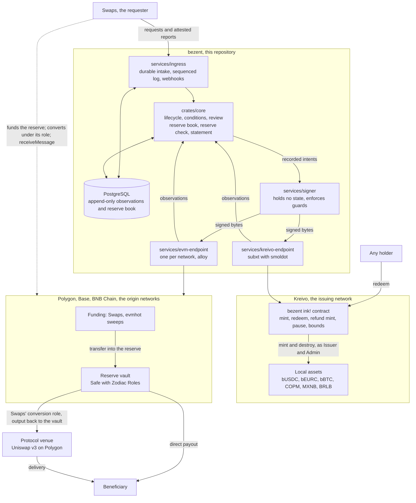

# bezent — Implementation Plan

This plan says *how* bezent is built. `SPEC.md` says what bezent guarantees, and it wins any disagreement. Nothing
here changes a requirement. Every decision, feature and milestone below names the parts of the spec it serves; work
that serves nothing in the spec is not in this plan.

## 0. How to read this document

| Prefix | Meaning |
|---|---|
| `DEC-*` | A technical decision: what we do, why, which requirements it serves, and what it costs |
| `F-*` | A feature: a bounded unit of work, one directory under `features/` each. Its tasks are `T-<feature>-<seq>` |
| `M-*` | A milestone: a set of features that together make a stated claim true, with exit criteria |
| `RISK-*` | A risk to the plan, with its mitigation |

1. **The plan never contradicts the spec.** It binds `SPEC.md` v0.5.4. If a technical fact makes a requirement
   impossible to meet, that becomes a spec amendment first (`amendments/`), and the plan follows it. A gap in the spec
   is handled the same way: we stop, propose an amendment, and do not fill the gap in code.
2. **Facts come from the notes.** Numbers and properties of Kreivo, the EVM networks, CCTP, evmhot and Swaps come from
   `notes/CONSTRAINTS-FOR-PLAN.md` and the research notes it cites (`research/01`–`07`). None is invented here.
3. **`[PENDING pl-…]` means not ruled.** The decision is an item on @pandres95's form ("bezent Decisions",
   kept in Bloque's private companion repository) under that id. The plan writes the recommended option as its working assumption and
   plans against it, but does not treat it as decided. Items marked *reserved* are security trade-offs @pandres95
   keeps; they carry no default. When @pandres95 rules, the plan is revised and the marker goes. A ruling that would
   change the spec goes through an amendment first.

### Change history

| Version | Date | Change |
|---|---|---|
| 0.6.2 | 2026-10-29 | The plan binds `SPEC.md` v0.5.4 (amendment 0015: `REQ-CU-1` names a boundary, not a store). @pandres95's ruling `d-delivery-keys` (2026-10-29) moves both delivery keys off AWS KMS: `DEC-11` names the store per key, and `RISK-7` is closed. The signer gets one `SigningEngine` interface (`F-005`) |
| 0.6.1 | 2026-10-22 | The plan binds `SPEC.md` v0.5.3 (amendments 0013 and 0014; no requirement the plan relies on changes). @pandres95's rulings of 2026-10-22: the 48-hour mainnet soak exercises tiny synthetic transfers within the bounds between Polygon and Kreivo (his option A; `DEC-19`, `M-4`); the vault guard's bounds are confirmed: a delay cooldown from 1 hour to 30 days and an expiration from 1 day to 90 days, with a deployment default of a 24-hour cooldown and a 7-day expiration (`DEC-10`); and the guardian key is replaced by a key held by an independent party before the vault is funded, the holder still to be decided, a hot key until then (`DEC-10`, `RISK-10`) |
| 0.6.0 | 2026-10-20 | @pandres95's rulings of 2026-10-15 to 2026-10-20; `SPEC.md` is unchanged. The repository is public now, and one mainnet instance serves Bloque Test and Bloque: the separate test environment is gone, the test bed stays, and a 48-hour soak runs on mainnet before bUSDC goes live (`DEC-15`, `DEC-18`, `DEC-19`, `DEC-20`, `F-014`, `F-017`, `M-1`, `M-4`, `M-5`). Kreivo is set up with no Root referendum: community 4243, the contract's roles and the hand-over of the asset roles (`DEC-6`, `DEC-7`, `F-015`; `RISK-6` closed). The vault gains a guardian (`DEC-10`). Polygon conversions move before the bUSDC launch gate (`DEC-13`, `F-010`, `M-2`, `M-4`). The delivery account carries a KSM float (`DEC-18`, `F-014`). Block-denominated constants use 41,739 blocks a day (`DEC-6`). New `RISK-9` and `RISK-10` |
| 0.1.0 to 0.5.0 | 2026-10-13 | The first draft (0.1.0), the plan rulings (0.2.0), the sign-off, the EVM test harness and the open-source release (0.3.0), the scope narrowed to the reserves and Kreivo (0.4.0), and the bounds, the vault guard and delay, and USDT0 only (0.5.0). `git log -- PLAN.md` has each |

## 1. Shape of the system

bezent is four kinds of process around one database, one contract on Kreivo, and a small set of contracts on each EVM
origin network. Swaps is the requester. It asks for addresses, deposits and withdrawals, drives the steps anyone may
perform, and for the fiat assets it is the attesting party.

The spec's components (§4.1) map onto these processes: the request and query surfaces are the ingress, the coordinator
is the core, the observers are the endpoints, and the signer is the signer (`DEC-3`).

### Binding of the spec's capabilities (§4.4)

| Spec capability | Realisation in V0 |
|---|---|
| The issuing network, §4.4(a) | Kreivo, runtime 0.17.1 or later, which lets a contract mint and destroy local assets its community administers (kreivo#512, merged 2026-10-11; `DEC-5`, `DEC-6`, `DEC-7`) |
| The on-chain component, §7.F | One ink! contract on pallet-contracts 49, deployed through ContractsStore by a community dedicated to it (community 4243, contract app 5, set up on 2026-10-20; `DEC-6`) |
| Network backends, §4.4(b), all public | Polygon (bUSDC, native USDC), Base (bEURC, EURC), BNB Chain (bBTC, BTCB). Each has one reserve vault; value reaches it from Swaps and from evmhot's sweeps, never through bezent (`DEC-8`, `DEC-9`, `DEC-10`, `DEC-12`) |
| The attested backend, §4.4(b) | Swaps' bank rails, for COPM, MXNB and BRLB; Swaps' signed reports are the observations (`DEC-14`) |
| Custody, §4.4(c) | Vault for every key, behind the signer process: Transit for the Kreivo delivery key, a signing plugin for the Polygon one (`DEC-11`) |
| Protocol venues, §4.4(d) | Uniswap v3 on Polygon for USDT0 → USDC conversions, run by Swaps under its role on the vault; bUSDC for Base users bridged by Swaps itself (`DEC-13`) |
| The requester, §3 | Swaps (`the Swaps platform's swap service`), through a `bezent` instruction module (`DEC-15`) |
| The test network, §15 | zombienet from aledgent's harness, with Polygon Amoy, Base Sepolia and BNB Chain testnet, and local anvil forks (`DEC-19`) |

### Assets in V0 (constraints note, "Assets and backends"; `DEC-7`)

| Bridged asset | Backend and assurance | Reserve | Precision |
|---|---|---|---|
| bUSDC | Polygon, public | native USDC on Polygon; paid out on Polygon only (Swaps bridges to Base) | 6, as USDC |
| bEURC | Base, public | EURC on Base; payouts on Base only | 6, as EURC |
| bBTC | BNB Chain, public | BTCB on BNB Chain (issuer Binance); payouts on BNB Chain only | 8; BTCB has 18, so a ratio of 10¹⁰ and the dust rule (`REQ-AS-9`) |
| COPM, MXNB, BRLB | Swaps' bank rails, attested | Swaps' accounts, itemised | 2, as today |

## 2. Decisions

### DEC-1 Repository and languages

**One Rust workspace in this repository holds the core and the four services; the Kreivo contract and the EVM
contracts sit in workspaces of their own, and the Swaps module lives in the Swaps platform.**

- Layout: `crates/core` (lifecycle, reserve book, reserve check, statement), `services/ingress`,
  `services/kreivo-endpoint`, `services/evm-endpoint`, `services/signer`, `tools/`. The ink! contract is in
  `contracts/bezent/`; the vault glue (role configuration, the reference emitter) is a Foundry project in `contracts/evm/`. The Swaps module is
  TypeScript in the Swaps platform, under that repo's review rules.
- One language for the core and the endpoints means one set of types for amounts, references and coordinates.
- A separate process for the signer keeps key material out of the process that holds state.
- This repository is `bloque-app/bezent`, public. CI runs on GitHub-hosted runners: build, lints, unit tests, the
  store tests, the contract and EVM suites, and the image builds.
- Bloque keeps a separate private repository for its internal working documents and for the deployment definitions
  (infrastructure wiring, key custody configuration, environment configuration, release intake). It deploys from
  the public code by the pinned digest of a public release's images; nothing private is built into a public image (`DEC-20`).

*Serves:* the component split of §4.1, keys outside the stateful process (`REQ-AR-3`), mint authority only in on-chain
code (`REQ-AR-4`), and exact integer amounts (`INV-11`). *Cost:* four toolchains (Rust, cargo-contract, Foundry, and
TypeScript in another repository). The module's pace follows the Swaps platform's reviews (`RISK-8`).

### DEC-2 Runtime: plain Rust services for V0

**bezent V0 runs as plain Rust services with one PostgreSQL-backed core, not as a VOS deployment.**
Ruled by @pandres95 (`pl-runtime`, 2026-10-13).

- bezent is mostly chain I/O and signing. VOS restricts chain I/O to Local roots, so most of bezent would sit outside
  VOS anyway.
- One Postgres-backed core is expected to be enough at ten times Swaps' volume; `F-016` records the figures.
- The core alone could move to VOS later without changing the endpoints or the signer.

*Serves:* sustained volume (`NFR-10`), no lost requests and a restore that re-derives state (`NFR-7`), and upgrades
that lose nothing in flight (`REQ-GV-4`). *Cost:* Bloque runs a second service style beside aledgent's VOS core.

### DEC-3 Process shape

**Requests flow ingress → core → endpoints → signer; the core alone decides, the endpoints only observe, and the
signer signs only what the core recorded.**

- The ingress takes every request in durably before answering it.
- The core runs the state machine, the named conditions, review, the reserve book, and the reserve check every minute.
- Each backend has its own endpoint process that reports observations at coordinates and decides nothing.
- **Delivery takes two steps** (decided at plan level, 2026-10-13, from `F-007`): the core records a delivery order
  (what, to whom, amount, on-chain reference, attempt); the endpoint prepares it (builds the transaction, dry-runs
  it, stores the exact bytes, and decodes them to check they match the order); the core then records the signing
  intent over those bytes, and verifies the signature the signer returns. Only the core records intents; the
  endpoint still decides nothing.
- The signer is a separate process that holds no state. It signs only intents the core recorded, and it refuses any
  intent outside its guards: window caps, one-time references, and destroying only the contract's own holdings. These
  guards are a second line; the contract stays the layer that enforces single use and the caps (`INV-2`, `INV-3`, as
  `REQ-AR-5` requires).

*Serves:* durable intake (`REQ-RQ-1`), progress without any requester (`REQ-AR-1`), dispositions only in the
coordinator (`REQ-AR-2`), the custody-isolated signer (`REQ-AR-3`, `INV-9`), and the reserve check cadence (`NFR-5`).
*Cost:* four processes to deploy and watch instead of one.

### DEC-4 Store

**One PostgreSQL database holds bezent's state; observations and the reserve book are append-only tables whose
triggers refuse UPDATE and DELETE.**

- Enforcing append-only in the store, not in application code, is the layer the spec names for these invariants.
- Latency milestones (source leg final, destination leg included, destination leg final) are write-once columns, each
  with network, block number, block hash and block time.
- One database means one backup and one restore drill.

*Serves:* each observation applied once (`INV-10`), the append-only reserve book (`INV-17`, `REQ-BK-7`), no recorded
time overwritten (`REQ-TR-2`), latency from write-once milestones (`NFR-3`), and restore without loss (`NFR-7`).
*Cost:* a single database is a single point of failure for intake; the ingress refuses with `ERR-Overloaded` rather
than accept what it cannot store (`REQ-LM-4`).

### DEC-5 Kreivo endpoint

**The Kreivo endpoint is a Rust service using subxt with its embedded smoldot light client, built on aledgent's
settlement-adapter patterns; Kreivo's own RPC is never trusted for an outcome.**

- It reuses aledgent's patterns: eras born at the finalized head (`max_era` 64), nonce lanes, reads at the finalized
  head, and a dry run before every signature (constraints note, "The issuing network: Kreivo").
- It uses aledgent's patched smoldot (the child-trie-root fix, aledgent#121), because the contract writes child
  storage.
- A light client verifies the relay-chain-finalised head itself; Kreivo has reorganised up to six blocks deep in
  testing. Dry runs through smoldot matched the archive node byte for byte on mainnet (research 06); the contract's
  own mint dry runs are still to prove on zombienet.

*Serves:* expiring transactions and their proof (`REQ-HN-3`, `REQ-NX-1`, `REQ-NX-2`), finality with the block hash
re-checked (`REQ-OB-2`), decisions only at final blocks (`REQ-OB-5`), exact bytes kept before submission (`REQ-EO-1`),
declared signing lanes (`REQ-EO-4`), and no caller asserting an outcome (`REQ-AR-2`). *Cost:* bezent depends on a
patched smoldot until the fix lands upstream (`RISK-2`).

### DEC-6 The contract

**One ink! contract on Kreivo mints, redeems and refund-mints every bridged asset, with bounds kept per asset, and
holds its authority through a community dedicated to it.** Ruled by @pandres95 (`pl-contract-scope`, 2026-10-13): one
contract for every bridged asset, with per-asset bounds.

- It runs on pallet-contracts 49 and needs Kreivo 0.17.1 or later: kreivo#512 (merged 2026-10-11) gives contracts
  `assets__mint` and `assets__burn` for local assets whose Issuer and Admin is the contract's community account.
- Its messages are mint, redeem, refund mint, pause and unpause, set bounds, and view bounds, with the callers and
  refusals of §7.F. Every message emits an event with its on-chain reference, in order.
- Redeem pulls the amount from the caller into the contract, checks the contract's balance, and destroys only from
  itself. Admin on Kreivo can destroy from any account, and `call_runtime` reports only success or failure, so this
  order matters (constraints note).
- It is deployed through ContractsStore by a dedicated community, whose governance is the upgrade authority.
- **Mainnet setup** (ruled by @pandres95, 2026-10-15 to 2026-10-20; done on 2026-10-20). There is no Root referendum.
  - Community 4243, "bezent", was registered with a dedicated first-admin account, made for the purpose. While that
    account could still sign, the contract was published (ContractsStore app 5) and instantiated on Kreivo mainnet, from
    the build that the public repository's CI produces (code hash `0xe89943fb…24ad`), so that anyone can rebuild it and
    compare. Bloque's production escrow account was then added as the community's only member, and the community was set
    as its own admin, so the first-admin account kept no control. Last, the roles of `Here(101)`–`Here(103)` were handed
    to the community account by signed calls from the Bloque account that held them (`DEC-7`).
  - Roles on the contract: delivery is the Kreivo delivery account, whose key moves from KMS to Vault Transit (`DEC-11`); pause is
    @pandres95's account for now; governance is the community account. The raise delay is 24 hours, 41,739 blocks.
  - Launch mints bUSDC only: the ceilings for bEURC and bBTC start at 0 (`DEC-17`).
- **Block time.** Kreivo makes a block about every 2.07 s, as measured; the first draft of the contract assumed 6 s (fixed;
  issue #37). Every block-denominated constant in the contract uses `BLOCKS_PER_DAY` = 41,739.
- **Voting speed.** With one member on the default voting track, a community vote can pass within a few blocks.
  @pandres95 accepted this risk (2026-10-20; `RISK-9`). A second voting member, Bloque Test in a separate cloud account, is an
  optional hardening for later.

*Serves:* the on-chain component's surface (§7.F), mint authority only in the component (`REQ-AR-4`, `REQ-HN-1`,
`REQ-HN-5`), ordered events (`REQ-HN-7`), destroying only its own holdings (`REQ-HN-8`), separate roles (`REQ-HN-9`),
the dedicated group (`REQ-HN-10`), instructions or their commitment in the redemption (`REQ-RQ-9`), one refund mint
per redemption (`REQ-OT-6`, `REQ-RF-4`), and the chain-layer invariants (`INV-2`, `INV-3`, `INV-4`, `INV-8`).

> **Trade-off, stated plainly.** One contract means one community, one deployment and one governance. It also means a
> defect in the contract, or a stolen delivery key, reaches every bridged asset at once; each asset's own bounds cap
> what it can lose. One contract per asset would confine a defect to one asset, at a community and a governance each.

### DEC-7 Assets on Kreivo

**bUSDC, bEURC and bBTC are local assets at `Here(101)`–`Here(103)`, all "not sufficient", whose roles (Owner, Issuer,
Admin and Freezer) belong to the contract's community account.** Ruled by @pandres95 (`pl-asset-ids`, 2026-10-13): bUSDC
`Here(101)` with 6 decimals, bEURC `Here(102)` with 6, bBTC `Here(103)` with 8 and the dust rule; MXNB moves to
`Here(104)` and BRLB to `Here(105)`. The roles reach the community with no Root referendum (@pandres95, 2026-10-19 and
2026-10-20).

- The three assets already existed on mainnet. Read on 2026-10-13 (spec 133, by the `F-013` helper): `Here(101)`–`Here(103)`
  carried bUSDC, bEURC and bBTC metadata, with a Bloque account as their Owner, Issuer, Admin and Freezer.
- That account moved the four roles of each asset to the community account by signed calls (`REQ-HN-10`), as the last
  step of the setup in `DEC-6`: the community was already its own admin and the contract was live, so no other account
  kept the power to mint these assets outside the contract. The supply was zero before and after.
- Only Root creates assets on Kreivo. MXNB and BRLB do not yet exist at `Here(104)` and `Here(105)`; they are created
  when their attested backend goes live (`M-3`). COPM `Here(100)` already exists; its issuer moves to the community when
  its attested backend goes live (`M-3`).
- New identities encode neither an origin network nor bezent.

*Serves:* one fixed identity per bridged asset (`REQ-AS-1`), precision equal or greater on the origin (`REQ-AS-4`),
the dust rule (`REQ-AS-9`), issuance held by one on-chain program (`REQ-HN-1`), the dedicated group (`REQ-HN-10`), and
a later hand-over without holders acting (`REQ-AS-6`). *Cost:* "not sufficient" means a mint to an account that cannot
receive the asset is refused by Kreivo. bezent does not check the destination first; the deposit holds
`CND-DestinationRefused`, and past its deadline goes to review (`REQ-IN-9`).

### DEC-8 EVM endpoint

**The EVM endpoint is a new Rust service in this repository, built on alloy, one instance per network; it shares
none of evmhot's code; it watches only the reserve vault.** Ruled by @pandres95 (`pl-scope`, 2026-10-13; amendment 0007):
bezent observes arrivals at the vault, conversions there and payouts from it; deposit addresses and sweeps are
evmhot's, and routing value to the vault is Swaps' (then rutent's).

- It observes with `eth_getLogs` over contiguous ranges up to the `finalized` tag. It stores block number, block hash
  and log index for every event and re-checks the hash until final.
- It persists the exact signed bytes before sending, and proves non-execution by the nonce being consumed at a final
  block by a different transaction.
- An arrival is any final transfer of an admitted token into the vault, keyed by its coordinate (block, transaction,
  log index). It waits as unassociated until Swaps requests a deposit naming that coordinate (`REQ-IN-3`, `REQ-RQ-3`).
- evmhot's own observer is not reused: it uses a fixed 20-block offset, keeps no block hash, and has five silent ways
  to skip a range (constraints note, "evmhot"). Its sweeps land in the vault and are observed like any arrival.

*Serves:* the network's own finality rule (`REQ-OB-1`, `REQ-RN-1`), finality with the hash re-checked (`REQ-OB-2`,
`REQ-IN-2`), contiguous ranges with visible gaps (`REQ-OB-3`, `REQ-RN-6`), re-checks until final (`REQ-OB-4`,
`REQ-IN-7`), arrivals keyed by coordinate (`REQ-IN-1`, `INV-10`), exact bytes stored first (`REQ-EO-1`, `INV-9`), and
provable or forced non-execution (`REQ-NX-1`, `REQ-NX-4`). *Cost:* a new service to build and run three times, instead
of reusing code that already detects deposits.

### DEC-9 Funding the reserve

**bezent issues no deposit addresses. Value reaches a reserve by a plain transfer into its vault, from Swaps or from
evmhot's sweeps; Swaps then requests the deposit by naming the arrival's coordinate.** Ruled by @pandres95
(`pl-scope`, 2026-10-13; amendment 0007 A1).

- A coordinate is consumed once (`INV-2`), so an arrival can back one deposit only. An arrival nobody claims by the
  route's deadline stays unassociated with an owner (`REQ-IN-6`).
- Nothing is matched by amount or time: the request names the coordinate, and bezent checks it itself at finality.
- A convertible token that arrives (for example USDT on Polygon) is itemised outside the reserve until Swaps converts
  it under its role (`DEC-10`, `DEC-13`), and the deposit is minted against the converted output.
- evmhot is revamped (outside this plan) to sweep deposit addresses straight into the vault.

*Serves:* deposits bound by coordinate (`REQ-IN-3`, `REQ-RQ-3`, `REQ-IN-4`), arrivals de-duplicated by coordinate
(`REQ-IN-1`, `INV-10`), unassociated arrivals with an owner (`REQ-IN-6`), and conversions before minting (`REQ-CV-1`,
`REQ-CV-2`). *Cost:* a deposit needs a request after its arrival; a standing-instruction path no longer exists.

### DEC-10 Vault

**Each origin network's treasury is a contract vault whose outflows are bounded on chain.** Ruled by @pandres95 (`pl-vault`, 2026-10-13): a Safe with a Zodiac Roles v2 modifier.

- Allowances refill per period. Two roles:
  - **Delivery** (bezent's signer): the MultiSend of a reserve-token transfer and its reference (below), within the
    allowance. Nothing else: no CCTP, no swaps.
  - **Conversion** (Swaps' key, amendment 0007 `REQ-CV-7`): exact-input single swaps through the DEX router only, on
    the pinned pool, with `tokenIn` one of the asset's admitted convertible tokens, `tokenOut` the origin token, the vault as
    recipient, and an allowance per window. It can never spend the origin token or send value elsewhere.
- **The owners are limited too** (`pl-vault-delay`, ruled 2026-10-13: guard and delay). A Safe guard refuses any owner
  transaction that transfers or approves the vault's tokens, so no administrative path moves value (`REQ-GV-5`).
  Widening changes (adding a role or a member, raising an allowance, adding a module, changing owners or threshold)
  go through a Zodiac Delay module and take effect only after its cooldown (`REQ-GV-3`). Narrowing changes (revoking
  a role, lowering an allowance) stay immediate: they are pauses. No vault is funded before the guard, the delay and the
  guardian are in place.
- **The guardian** (ruled by @pandres95, 2026-10-20). One more key, independent: neither an owner nor the delivery key. It
  holds a second Roles instance scoped to two calls: `Delay.setTxNonce` (the veto: it skips the queue of pending
  widening changes) and `Safe.disableModule` on the main Roles module (the pause: the delivery role stops working).
  Either call stops value moving, and one party suffices (`REQ-GV-2`). The owner quorum cannot remove the guardian
  instantly. The delay's cooldown and expiration are deployment parameters, and the deployment accepts a cooldown from
  1 hour to 30 days and an expiration from 1 day to 90 days, with a default of a 24-hour cooldown and a 7-day
  expiration: proposed in pull request #41 and **confirmed by @pandres95 on 2026-10-22**. The starting guardian is a software key held by @pandres95; before the vault is funded it is replaced by
  a key held by an independent party (the holder is still to be decided; a 2-of-N multisig or a hardware key are the candidates) (`RISK-10`).
- An externally owned account cannot bound its own outflows, so a contract is needed whichever option is chosen.
- The alternative is a small custom vault, which needs its own audit.

*Serves:* outflows restricted by on-chain code (`REQ-RN-4`), every key bounded on chain (`REQ-KY-3`), separate roles
(`REQ-KY-4`), several signers for large or administrative actions (`REQ-KY-5`), value sent only to declared venue
addresses (`REQ-VN-4`), named upgrade authority (`REQ-GV-3`), a pause by one party (`REQ-GV-2`), and value leaving only by referenced movements
(`INV-14`).

> **Trade-off, stated plainly.** Safe and Roles are widely used and audited, but a role configuration is itself code,
> and a mistake in it is a hole. A custom vault is smaller and easier to read, and nobody else has tested it. Either
> way, every outflow must carry its on-chain reference atomically with the value (`REQ-RN-5`, `REQ-ID-2`). The roles
> above leave how a plain token transfer carries it. Decision: the Safe executes, in one transaction, a MultiSend of
> the token transfer and a call to a stateless reference emitter (a contract whose only function emits
> `Reference(bytes32)`); Roles allow exactly that pair. The transfer and its reference are then atomic.

### DEC-11 Custody

**No delivery key stays on AWS KMS. The Kreivo delivery key is a Vault Transit ed25519 key, and the Polygon delivery
key is held by the Vault signing plugin `blockchain-signer-vault-plugin`.** Ruled by @pandres95 (`d-delivery-keys`,
2026-10-29), who replaced the ruling of 2026-10-13 (`pl-custody`, amendment 0006): DevOps asked to avoid KMS where Vault
offers the capability, and KMS rotation is hard. Amendment 0015 rewrote `REQ-CU-1` as a boundary, so this is a plan
change and no store is named in the specification.

| Key | Store |
|---|---|
| Kreivo delivery key | Vault Transit, ed25519. A new key and so a new account, because the current one is ECDSA in KMS; the contract's delivery role moves to it |
| Polygon delivery key | The Vault signing plugin (secp256k1, which Transit cannot hold), behind the sidecar signer in the EVM endpoint's task. Vault KV read by the sidecar stays only as a fallback |
| Pause and statement keys | Unchanged: read from Vault by the signer process |
| Existing KMS keys | Left unused, not deleted |

- The signer holds every engine behind one `SigningEngine` interface (`services/signer/src/engine.rs` in the public
  repository, PR #65), modelled on aledgent's signature engines (`F-042`). An engine answers a key's scheme, public key
  and address, and signs; it has no way to be asked for a secret. Engines: the test-key file, Vault KV, Vault Transit,
  the Vault plugin and, for the keys already made, AWS KMS. Changing where a key rests is a change of engine, and
  a later move of the Polygon key to a full signing service needs no new interface.
- A key that never leaves a signing service meets `REQ-CU-1` more strictly than one read into a signer. Whichever the
  store, `REQ-AR-3`, `REQ-KY-1` and `REQ-KY-3` bound the key as before.

*Serves:* keys in the custody capability (`REQ-CU-1`, `REQ-KY-1`), separate keys per network and role with rotation
(`REQ-CU-2`, `REQ-KY-4`), no test key with production power (`REQ-KY-6`), and the isolated signer (`REQ-AR-3`).
*Cost:* a new Kreivo delivery account and the hand-over of its roles; the plugin is third-party code, built from a pinned
commit in CI.

### DEC-12 RPC for EVM networks

**Each EVM network is read through two independent paid providers, cross-checked at the finalized block; when they
disagree, the disposition is unknown, never a mint.** Ruled by @pandres95 (`pl-rpc`, 2026-10-13).

- There is no light client for these networks in our stack, so a single provider could lie or fail unseen. A
  disagreement is treated like any other read bezent cannot trust: unknown, not proof.
- Alternatives: one provider, or our own nodes.

*Serves:* finality with the hash re-checked (`REQ-OB-2`), decisions only at final blocks (`REQ-OB-5`), unknown rather
than guessed (`REQ-NX-3`, `AC-C1.2`), and filling gaps from history (`REQ-RN-6`). *Cost:* two subscriptions per
network, three networks, and twice the calls.

### DEC-13 Venues

**Swaps runs conversions on the Polygon vault under its conversion role: USDT0 into USDC through Uniswap v3
SwapRouter02, exact-input single hop, on the 0.01 % pool. bezent pays every withdrawal on the reserve's own network;
a bUSDC withdrawal meant for Base is paid to Swaps on Polygon, and Swaps bridges it with CCTP from its own funds.**
Ruled by @pandres95 (`pl-scope`, 2026-10-13; `pl-cross-network`, in chat, 2026-10-13; amendment 0007 A3, A5). The only
admitted convertible is USDT0 on Polygon for bUSDC (`pl-convertibles`, 2026-10-13); bEURC and bBTC have none, so
the Base and BNB Chain vaults carry no conversion role.

- The minimum output of a conversion is Swaps' own. bezent mints what the swap delivered into the vault.
- CCTP stays Swaps' own: no Circle account is needed, standard transfers carry no Circle fee, and Polygon to Base
  takes seconds (constraints note). bezent observes only the Polygon payout to Swaps.
- In V0, bEURC pays out only on Base and bBTC only on BNB Chain.
- Polygon conversions are built, and pass their tests, before the bUSDC launch gate (@pandres95, `pl-busdc-first`, 2026-10-15:
  "Build Polygon conversions before launch"): `US-A5` stays in V0, and the Polygon vault carries Swaps' conversion role
  at launch (`F-010`, `M-4`). Base and BNB Chain, with bEURC and bBTC, come after the launch (`M-2`).

*Serves:* conversions at protocol venues by the requester (`REQ-CV-2`, `REQ-CV-7`), price and slippage left to the requester
(`REQ-CV-5`), venue properties (`REQ-VN-1`, `REQ-VN-2`, `REQ-VN-3`), declared venue addresses (`REQ-VN-4`), payouts on the
reserve's network only (`REQ-OT-4`), costs against surplus (`REQ-BK-4`), and protocol venues only
(`DEF-8`). *Cost:* a Base user's withdrawal takes one more hop, Swaps', and Swaps carries the CCTP float.

### DEC-14 Attested backend: Swaps

**For COPM, MXNB and BRLB, Swaps posts signed reports (arrival final, payout final, account positions) to the ingress
under its own identifiers, and the core records them as observations; fiat payout instructions travel only as a
commitment.**

- A report is accepted only from a requester holding the attesting grant.
- The redemption carries a blake2-256 commitment of the SCALE-encoded payout instructions. Swaps relays the
  instructions, and the core accepts them only if they hash to the commitment. Personal and bank data never reach
  Kreivo.
- A reversal after a payment Swaps reported final is Swaps' to cover within one business day; the book charges it
  against surplus, holders are never clawed back, and mints pause while surplus is under its floor (`REQ-BE-6`,
  amendment 0007 A6, closing `OQ-14`).

*Serves:* the assurance class (`REQ-BE-2`, `REQ-BE-3`), reports recorded with the party's own ids (`REQ-BE-4`), the
report as the observation (`REQ-BE-5`, `REQ-OB-7`), the commitment (`REQ-RQ-9`), the attesting grant (`REQ-PN-2`), no
personal data on chain (`REQ-PV-1`), and a statement that says what rests on reports (`REQ-BK-9`).

> **Trade-off, stated plainly.** For these three assets, Swaps can cause a mint. The contract's mint window and supply
> ceiling bound it, and the statement names Swaps as the party whose word backs them.

### DEC-15 Requester interface

**Requesters use an HTTP and JSON ingress with scoped service credentials, a gapless sequenced log, and at-least-once
HMAC-signed webhooks; Swaps uses them through a `bezent` instruction module.**

- A request reference is scoped to its requester: idempotency (`REQ-ID-1`) keys on (requester, reference), so one
  requester never learns, or collides with, another's references (`REQ-ID-4`). Decided at plan level, 2026-10-13
  (review of `F-001`); with Swaps the only requester in V0 it changes nothing observable until Bloque Test and Bloque both use the one mainnet instance (next).
- One mainnet instance takes requesters from both of Swaps' environments, Bloque Test and Bloque (@pandres95, 2026-10-16;
  decided at plan level, 2026-10-20). Their request references stay apart as above, and each is granted only what it
  needs (`REQ-PN-2`). Bloque Test's access is a grant on the production instance, not a key from a test environment, so
  `REQ-KY-6` holds (`DEC-18`).
- Grants are per kind: requesting deposits, attesting. The module pauses with a callback token and
  hands the callback URL over only in `afterPersist()`. bezent's notifications resolve it. It joins Swaps'
  stall-alarm list.
- The sequenced log is the safety net for lost callbacks: Swaps can read everything since its last position.
- Swaps names its own Kreivo account as a deposit's destination and moves value into aledgent itself; bezent never
  mints to aledgent's contract account, and the ingress refuses a destination on a declared list of ledger contract
  accounts (`REQ-IN-5`; `notes/ALEDGENT-INTERPLAY.md`).
- A route's deadline is its completion budget's ceiling (`REQ-LM-1`, `NFR-2`): a transfer whose leg is unknown past it
  goes to review. Decided at plan level, 2026-10-13 (`F-003`).
- At that deadline, on an origin network, the core also orders the cancel that forces non-execution (`REQ-NX-4`) at the
  same time as it opens the review (`REQ-RV-1`); the cancel's finalized proof is attached to the review as evidence
  (`REQ-RV-2`), and a value-moving resolution still has a second approver (`REQ-GV-5`). On Kreivo, era expiry is the
  evidence. Decided at plan level, 2026-10-15 (`#41`).
- Webhooks (decided at plan level, 2026-10-15, from `#2`): a transfer's callback URL may be replaced by its own
  requester, every change recorded; condition notices go to every requester granted on the affected route, once when
  the condition starts and once when it clears; delivery is at-least-once within a declared retry bound, then
  dead-lettered and visible, and the sequenced log stays the source of truth (`REQ-ST-4`, `REQ-ST-5`, `REQ-IC-5`).
- Two habits of Swaps' current bridge subsystem do not carry over: pro-rata splitting of a batch delivery, and
  `fees_deducted`.

*Serves:* requests (`REQ-RQ-1`–`REQ-RQ-4`, `REQ-RQ-6`), queries (`REQ-RQ-8`), authenticated and scoped requesters
(`REQ-PN-1`, `REQ-PN-2`), retries (`REQ-ID-1`), the log (`REQ-ST-4`), notifications (`REQ-ST-5`, `REQ-IC-5`), intake
latency (`NFR-1`), one outcome per transfer (`REQ-EO-5`), and no fee from a delivery (`REQ-TR-5`). *Cost:* the module
is reviewed on the Swaps platform's schedule (`RISK-8`).

### DEC-16 Reserve check and statement

**The core evaluates the reserve equation every minute per asset, and publishes a daily JSON statement signed with a
dedicated ed25519 key.** Ruled by @pandres95 (`pl-statement-host`, 2026-10-13): a public, append-only bucket with object
lock.

- Each evaluation re-derives every term from the networks and Swaps' reports at final points and compares it with the
  reserve book. Any difference pauses the asset's routes and pages a human.
- The statement names each asset's backend and assurance class, lists unconverted holdings outside the equation, says
  it is a signed claim and not a proof of solvency, and says which terms rest on reports.
- An append-only bucket with object lock keeps every statement, so a later revision is detectable without bezent.
- Decided at plan level (2026-10-14, from `F-004`): each asset declares its surplus alert level beside its floor
  (`REQ-BK-10`); the statement is signed by the signer process through a recorded intent of purpose `statement`, so the
  statement key also lives only behind the signer (`REQ-AR-3`); the statement lists surplus contributions and
  withdrawals beside the equation's terms; InTransit is always empty in V0, since no route leaves value in transit.
- Decided at plan level (2026-10-15, from `#42`): when the contract's own supply counter and the chain's issuance of a
  bridged asset differ, the chain's issuance is the supply (`REQ-BK-8`), and the difference itself means something
  minted or burned outside the contract (`INV-4`): it raises the key-compromise alert and pauses the asset.

*Serves:* the reserve equation at zero tolerance (`REQ-BK-1`, `NFR-5`, `INV-1`), re-derivation from the networks
(`REQ-BK-8`), the statement (`REQ-PR-1`, `REQ-BE-3`, `REQ-BK-9`, `REQ-CV-4`), retention (`REQ-PR-2`), and pausing on
an unexplained divergence (`REQ-IC-2`). *Cost:* one more key to keep, used for nothing else.

### DEC-17 Bounds and volume

**Each asset's supply ceiling, mint window and per-transfer maximum, and the ten-times volume figures, come from
Swaps' production volumes per asset class, read without writing; `F-016` measures them and they are recorded here before
`M-4`.**

- Sizing from the requester's current volumes is what the spec decided (`OQ-6`, closed by amendment 0005). The figures
  are not known yet; `F-016` measures them.

Ruled by @pandres95 (`pl-bounds`, 2026-10-13), from `F-016`'s report on the requester's production volumes (the
report and the volume figures it rests on are kept privately): **the bounds are configuration values, not part of
this plan or of the code.** Each asset has a supply ceiling, a mint window (an amount per window length), a
per-transfer maximum and a redemption minimum, and a raise delay applies to the contract as a whole
(`REQ-GV-3`). They are set when the contract is instantiated and raised or lowered only through the contract's own
roles; `config/bounds.example.toml` carries the recommended starting values, commented. For an asset that had no
orders in the measured window the figures are converted from another asset's at the day's exchange rate when its
bounds are configured ("around equivalent exchanges"); the rate used and its source are recorded with each
configuration. The ten-times volume figures that `NFR-10` asks for are recorded privately with the report.
At launch only bUSDC mints (@pandres95, `dec-launch-assets`, 2026-10-20): the supply ceilings of bEURC and bBTC start at 0,
since their reserves do not exist yet and their exchange rates would be invented numbers in a production limit. They are
set when their reserves exist (`M-2`).

*Serves:* the bounds of §7.F and their on-chain enforcement (`INV-3`), declared route limits (`REQ-LM-1`), and
sustained volume with the figures in the plan (`NFR-10`). *Cost:* reading production data needs care to stay
read-only; nothing in bezent writes to Swaps' database.

### DEC-18 Deployment

**bezent deploys as a set of container services on a managed container platform, as aledgent does, with infrastructure
as code and secrets in a secret manager, as one instance on mainnet. The deployment definitions are private to the
operator and are not part of this repository.** Ruled by @pandres95 (2026-10-16): Kreivo exists only as a mainnet, so there is
one bezent, in the operator's production cloud account, serving both Bloque Test and Bloque. The separate test
environment is not built; a testnet instance comes later.

- Infrastructure changes are reviewed by the operator before they are applied.
- Test keys never reach production: the signer's published fixtures and the keys of the test bed (`DEC-19`) exist only
  there and hold no authority on mainnet (`REQ-KY-6`). Bloque Test reaches the instance as a requester (`DEC-15`).
- The Kreivo delivery account needs a KSM float. Kreivo charges a storage deposit: 0.0133 KSM on the first mint and about
  0.0067 KSM for each new reference after it. Topping the float up is a runbook item (`F-014`), and its balance has an
  alert floor, set in configuration and not in this plan (ruled by @pandres95, 2026-10-20).

*Serves:* no test key with production power (`REQ-KY-6`), upgrades that lose nothing in flight (`REQ-GV-4`), and
restore without loss (`NFR-7`). *Cost:* every infrastructure change waits for the operator's review; and Bloque Test's flows run on mainnet with real assets, under the same bounds.

### DEC-19 Test bed and release gate

**The test bed is zombienet from aledgent's end-to-end harness, with Kreivo 0.17.1 and the asset ids in genesis, plus
Polygon Amoy, Base Sepolia, BNB Chain testnet and local anvil forks for fault injection; release waits on the
end-to-end suite being green and every runbook exercised.**

- aledgent's `e2e/network` starts `rococo-local` with Kreivo (para 2281); its test assets are a genesis override,
  which we fork to add ours, and contracts deploy there as on mainnet. Its CI uses Kreivo 0.17.0; we need 0.17.1.
- Polygon Amoy and Base Sepolia both have Circle's test USDC and CCTP. Local forks inject reorganisations, provider
  disagreement and dropped transactions.
- The EVM side has no zombienet of its own: Polygon PoS and BNB Chain cannot be started as local multi-node
  networks, and the closest tools (Kurtosis' ethereum-package for Ethereum, supersim for OP Stack chains such as
  Base) each cover one family. The harness therefore starts one anvil fork per origin network (Polygon, Base, BNB
  Chain) next to zombienet, from one command, at pinned blocks. The forks keep the real USDC, EURC, BTCB, Safe,
  Zodiac Roles, Uniswap, Aerodrome and CCTP contracts.
- CCTP runs locally too, for Swaps' end-to-end flows only (bezent pays out on the reserve's network; amendment 0007
  A5): on each fork the harness impersonates the MessageTransmitter's attester manager
  (`anvil_impersonateAccount`), enables a test attester and sets the threshold to one, and a small relay in the
  harness signs and delivers messages. A burn on one fork then mints on the other with no Circle service involved.
  Real attestation timing comes only from the public testnets.
- In the Swaps platform's CI (ruled by @pandres95, `pl-pr-e2e`, 2026-10-15: both): every PR runs the `bezent-sidecar`
  image (ingress, core, signer stub) next to Postgres with no chain; a test-only driver inside the sidecar injects
  chain events, and the sidecar refuses it outside test mode. Before a release, a full-chain job runs bezent with
  zombienet and the anvil forks on a self-hosted pool, reusing this harness. aledgent joins that pre-release run on the same
  Kreivo (bezent mints → Swaps deposits into aledgent → aledgent withdraws → bezent redeems); the network definition
  stays upstream in aledgent's public harness with bezent's contract and assets as an optional layer, and the combined
  job lives in the Swaps platform (`notes/ALEDGENT-INTERPLAY.md`, 2026-10-15).
- The gate also carries the spec's three exit criteria for V0 (§15): the reserve equation at exactly zero divergence,
  sustained; every final source leg delivered, refunded, or held in a named condition with an owner; and every runbook
  exercised.
- **The soak** (@pandres95, `pl-soak`, 2026-10-15). Before bUSDC goes live, bezent runs for 48 hours on mainnet, as the single
  instance ruled on 2026-10-16 (`DEC-18`), with the bounds as ceilings and no real user flow. Zero reserve divergence
  holds throughout, with at least two daily statements published and verified; a divergence restarts the clock. The
  soak is a gate on top of the test bed, not instead of it: the criteria of §15 and the runbook exercises of `NFR-9` are
  proven on the test bed above, on a test network, as the spec says.

The soak exercises tiny synthetic transfers within the bounds between Polygon and Kreivo (@pandres95's option A,
2026-10-22), so the reserve check and the statements run on real movement and not on an idle bezent. It does not stand
in for any part of §15 or `NFR-9`, which would need an amendment to the spec.

*Serves:* route budgets measured on a test network first (`NFR-2`), runbooks exercised before value (`NFR-9`,
`REQ-IC-6`), and the release scope (§15). *Cost:* a fork does not reproduce a network's real finality timing, so
budgets come from the public testnets.

### DEC-20 Open-source release

**bezent is open source, with the remaining work done in public, by the same process as aledgent: a redacted
public tree, an IP and licence review, a trademark check, and a public repository whose history starts at the
import.**

- Timing: the repository is public now, before production (@pandres95, 2026-10-17), and the work that remains
  (`M-1` onwards) is done in it. It does not wait for the mainnet release (`M-4`).
- The public repository is `bezent`. Bloque's private companion repository keeps everything internal and the
  deployment definitions (`DEC-1`); the public tree leaves out operational addresses beyond the published ones,
  runbook details that would help an attacker, the requester's internal identifiers, volumes, and anything that names
  counterparties. Design documents stay in it, redacted, as aledgent's do.
- Licence: GPL-3.0-or-later for the services and the ink! contract; Apache-2.0 OR MIT for reusable crates and the
  EVM contracts; CC-BY-4.0 for documents; GPL-3.0-only for Kreivo's chain specification, kept verbatim. Every file
  carries an SPDX header and the tree a `REUSE.toml`. The services and the contract are GPL rather than AGPL: @pandres95's rule is the GPL wherever it is
  possible. The built ink! contract is a GPL-3.0-only combined work (`docs/oss/LICENSING.md` §4.3). @olanod signed
  the table off on 2026-10-17.
- IP: the same review aledgent had (2026-10-12): one chain of title to Pagos Cube LLC, AI co-authorship noted, third-party code and pinned forks listed with their licences. A DCO check is required on `main` once
  public. @olanod signed off the IP review and the trademark position on 2026-10-17.
- Trademark: @olanod's sign-off (2026-10-17) covers the name "bezent" on the repository.

*Serves:* nothing in the spec requires it; it is @pandres95's direction, and it adds no behaviour. Being
public also lets holders check the contract and the statement format themselves (`REQ-PR-*`). *Cost:* a redaction
pass and a review per release; the GPL obliges source for anyone who distributes the services.

## 3. Dependencies: what we wait on

| What | State on 2026-10-13 | Blocks | Meanwhile |
|---|---|---|---|
| Kreivo 0.17.1 on mainnet (kreivo#512) | Merged and released 2026-10-11; mainnet upgrade on 2026-10-13 (@pandres95); confirm the runtime version on chain before `M-4` | Production (`M-4`) | Everything runs on zombienet with 0.17.1 |
| The smoldot child-trie-root fix (aledgent#121) | Patched fork in aledgent's tree | Reading the contract's storage through the light client (`F-007`) | Use aledgent's patched build |
| Community, contract and asset roles on Kreivo mainnet (`F-015`) | Done on 2026-10-20, with no referendum (`DEC-6`, `DEC-7`) | Nothing | — |
| Review of the `bezent` module in the Swaps platform | Not started | Swaps driving bezent (`F-012`) | bezent's own suite drives the request surface directly |
| evmhot revamped to sweep into the vaults (outside this plan) | Not started | Deposits from evmhot's addresses (`M-1`) | Swaps funds the vault directly in tests |

## 4. Features

Each feature is done when its tests pass and name the acceptance criteria or invariants they verify, at the layer §9
names. A feature depends only on features of its own or an earlier milestone, in the order under the table of §5.

| F | Name | Milestone | Spec it serves | Depends on |
|---|---|---|---|---|
| `F-001` | Repository, workspace, store schema, append-only enforcement | skeleton, `M-0` | append-only observations and book, no loss on restore (`INV-10`, `INV-17`, `NFR-7`) | nothing |
| `F-002` | Ingress and requester API, sequenced log, webhooks | skeleton, `M-0`; webhooks by `M-1` | request, query and event surfaces (`REQ-RQ-*`, `REQ-ST-*`, `REQ-ID-*`, `REQ-PN-*`) | the store (`F-001`) |
| `F-003` | Core lifecycle, conditions, review | skeleton, `M-0`; complete by `M-1` | transfer states (§5.4, `REQ-TR-*`), review (`REQ-RV-*`), named conditions (`CND-*`) | the store (`F-001`) |
| `F-004` | Reserve book, reserve check, statement | bUSDC on the test bed, `M-1` | the reserve equation and statement (`REQ-BK-*`, `REQ-PR-*`, `INV-1`) | lifecycle (`F-003`), both endpoints (`F-007`, `F-009`) |
| `F-005` | Signer and guards | stub in `M-0`; complete by `M-1` | isolated signer, keys and their bounds (`REQ-AR-3`, `REQ-KY-*`, `INV-9`) | the store and lifecycle (`F-001`, `F-003`) |
| `F-006` | Kreivo contract | skeleton, `M-0` | the on-chain component (§7.F, `REQ-HN-*`, `INV-2`, `INV-3`, `INV-4`, `INV-8`) | the test bed and genesis assets (`F-013`, `F-015`) |
| `F-007` | Kreivo endpoint | bUSDC on the test bed, `M-1` | observation, non-execution, exactly once (`REQ-OB-*`, `REQ-NX-*`, `REQ-EO-*`) | the signer and the contract (`F-005`, `F-006`) |
| `F-008` | EVM contracts: vault, roles, reference emitter | bUSDC on the test bed, `M-1` | bounded outflows, the requester's conversion role, references on outflows (`REQ-RN-4`, `REQ-RN-5`, `REQ-KY-3`, `REQ-CV-7`, `INV-14`) | nothing |
| `F-009` | EVM endpoint | Polygon in `M-1`; Base and BNB Chain in `M-2` | arrivals, payouts, observation, non-execution (`REQ-IN-*`, `REQ-OT-*`, `REQ-OB-*`, `REQ-NX-*`) | the signer and the EVM contracts (`F-005`, `F-008`) |
| `F-010` | Venues: Swaps' conversions on the vault | Polygon conversions before the bUSDC launch, `M-4` | conversions and protocol venues (`REQ-CV-*`, `REQ-VN-*`) | the EVM endpoint (`F-009`) |
| `F-011` | Attested backend: Swaps reports, commitments | attested fiat, `M-3` | the attested class and commitments (`REQ-BE-*`, `REQ-RQ-9`) | ingress and lifecycle (`F-002`, `F-003`) |
| `F-012` | Swaps integration in the Swaps platform | first module in `M-1`; reports in `M-3` | the requester's side (§3, `REQ-RQ-*`) | ingress (`F-002`) |
| `F-013` | Test bed, end-to-end suite, release gate | zombienet and anvil forks in `M-0`; gate in `M-4` | runbooks before value, release scope (`NFR-9`, §15) | nothing |
| `F-014` | Operations: deployment, alerts, runbooks | runbooks and alerts on the test bed from `M-1`; the one mainnet instance in `M-4` | incidents, governance, observer lag, pause latency (`REQ-IC-*`, `REQ-GV-*`, `NFR-5`, `NFR-6`, `NFR-8`) | ingress, core, signer and endpoints (`F-002`–`F-009`) |
| `F-015` | Assets and governance on Kreivo: community, contract, roles | genesis in `M-0`; mainnet done 2026-10-20 | asset identity, the dedicated group, upgrade governance (`REQ-AS-*`, `REQ-HN-10`, `REQ-GV-3`) | nothing |
| `F-016` | Measurements: Swaps volumes, route budgets | before production, `M-4` | bounds sized from volumes (`OQ-6`, closed), ten-times volume (`NFR-10`), route budgets (`NFR-2`) | the endpoints, for route timing (`F-007`, `F-009`) |
| `F-017` | Open-source release | done 2026-10-17 (`M-5`) | nothing in the spec; @pandres95's direction (`DEC-20`) | nothing |

**`F-001` Repository, workspace and store.** Sets up the repository and CI. Creates the Rust workspace of `DEC-1` and the PostgreSQL schema of `DEC-4`. Triggers
refuse UPDATE and DELETE on observations and on the reserve book, and refuse any change to a terminal state, since
`INV-5` is also a store invariant. Amounts are exact integers in every column. Done when tests show each refusal at
the store (`INV-5`, `INV-10`, `INV-17`, `INV-11`) and a restore drill re-derives state (`NFR-7`).

**`F-002` Ingress and requester API.** Durable intake, status by request reference, bridge reference and coordinate,
the route table, the sequenced log, and signed webhooks (`DEC-15`). Done when retries and conflicts (`AC-D1.1`,
`AC-D1.2`), status and log reads (`AC-H1.1`, `AC-H1.2`, `AC-H1.3`) and limits (`AC-G1.1`–`AC-G1.3`) pass, and intake
latency is measured against `NFR-1`.

**`F-003` Core lifecycle.** The states of §5.4, the conditions of §10, deadlines, and review with its owner and
service level. Done when every transition has a test and deposits (`AC-A2.1`–`AC-A2.3`, `AC-A4.1`, `AC-A4.2`),
withdrawals (`AC-B1.1`–`AC-B1.4`, `AC-B3.1`, `AC-B3.2`) and dispositions (`AC-C1.1`, `AC-C1.2`) pass, with `INV-6`,
`INV-7` and `INV-16` checked in the service.

**`F-004` Reserve book, check and statement.** The double-entry book per asset, the one-minute evaluation with pause
and page on divergence, the surplus floor alert, and the daily signed statement (`DEC-16`). Done when `AC-E1.1`,
`AC-E1.2`, `AC-E2.1` and `AC-E2.2` pass, `INV-1` is checked every minute, and a bBTC remainder lands in surplus
(`REQ-AS-9`).

**`F-005` Signer and guards.** The stateless signer and its guards (`DEC-3`) on the custody of `DEC-11`: a stub with
test keys in `M-0`, and the Transit and plugin engines behind the `SigningEngine` interface by `M-1`. Done when no unrecorded intent is signed (`INV-9`), a
restart re-sends recorded bytes (`AC-D2.1`), an unrecorded signature starts the compromise path (`AC-I1.2`), and a
test key holds no production authority (`AC-I4.2`).

**`F-006` Kreivo contract.** The ink! contract of `DEC-6`, deployed on zombienet through ContractsStore as on mainnet.
Done when a redemption destroys in the same call and records its reference and instructions (`AC-B5.1`), a reused
reference is refused (`AC-B5.2`, `AC-D2.2`), pauses and bounds behave as §7.F says (`AC-I2.1`, `AC-I2.2`), and the
contract's own tests cover `INV-2`, `INV-3`, `INV-4` and `INV-8`.

**`F-007` Kreivo endpoint.** The light-client endpoint of `DEC-5`. Done when mints and refund mints run through the
signer after a dry run, a Kreivo non-execution proof is checkable from chain data (`AC-C2.1`), a read gap is visible
and filled (`AC-D2.3`), and the wrong network fails closed at start-up (`AC-I4.1`).

**`F-008` EVM contracts.** The vault and roles of `DEC-10` and the reference emitter, with Foundry tests on the forks
of `DEC-19`. Done when the allowance bounds every outflow (`AC-I1.1`), every outflow carries its on-chain reference
(`INV-14`), and the conversion role can neither spend the origin token nor send output anywhere but the vault
(`REQ-CV-7`).

**`F-009` EVM endpoint.** The alloy service of `DEC-8`, first on Polygon Amoy, then on Base Sepolia and BNB Chain
testnet, with the provider cross-check of `DEC-12`. Done when arrivals at the vault wait until a request names their
coordinate (`REQ-IN-3`), arrivals are minted only after finality (`AC-A2.1`–`AC-A2.3`), reports carry coordinates
(`AC-C1.3`), a forced non-execution is checkable (`AC-C2.1`), and gaps are filled (`AC-D2.3`).

**`F-010` Venues.** Swaps' conversions on the vault: the role configuration, observing them, and minting against
the output
(`DEC-13`). A gate of the bUSDC launch (`M-4`), by ruling (`pl-busdc-first`). Done when a convertible deposit is minted for what Swaps' swap delivered into the vault (`AC-A5.1`–`AC-A5.3`).

**`F-011` Attested backend.** Swaps' reports as observations, the instruction commitment, and the statement's attested
wording (`DEC-14`). Done when a report without the attesting grant is refused, a report becomes an observation with
Swaps' own ids (`REQ-BE-4`, `REQ-BE-5`), instructions that miss their commitment are refused (`REQ-RQ-9`), and
a reversal follows `REQ-BE-6`: charged against surplus, mints paused under the floor, nothing clawed back.

**`F-012` Swaps integration.** The `bezent` module in the Swaps platform (`DEC-15`): pause with a callback token, resume on
bezent's notification, read the log when a callback is lost, and later relay fiat instructions and post reports. Done
when Swaps drives a bUSDC deposit and withdrawal on the test bed, and the module is merged under the Swaps platform's own review.

**`F-013` Test bed and release gate.** The zombienet fork, the anvil forks (local CCTP for Swaps' flows), the testnet wiring, the anvil fault scenarios, and the
end-to-end suite that names every V0 acceptance criterion (`DEC-19`). Done when the suite is green and the gate of §15
holds.

**`F-014` Operations.** Deployment (`DEC-18`), the observables of `REQ-ST-6`, alerts and pages, the operator surface
with its append-only record, and one runbook per incident class and named condition, among them the top-up of the Kreivo
delivery account's KSM float, with an alert floor on its balance (`DEC-18`). Done when `AC-H3.1`, `AC-I2.1`,
`AC-I3.1`, `AC-I3.2` and `AC-I4.1` pass on the test bed, observer lag stays within 60 s (`NFR-6`), a pause
takes effect within its bound (`NFR-8`), and every runbook has been exercised (`NFR-9`).

**`F-015` Assets and governance on Kreivo.** The dedicated community, the contract's setup and the hand-over of the asset
roles, with no referendum, and the community's published governance with its 24-hour raise delay (`DEC-6`, `DEC-7`). Done
when the assets exist in zombienet genesis with the community as Issuer and Admin and, for `M-4`, the mainnet setup has
run: done on 2026-10-20 (community 4243, contract app 5, the roles of `Here(101)`–`Here(103)` handed over, supply zero).

**`F-016` Measurements.** A read-only pass over Swaps' production volumes per asset class, and the completion budget
of each route measured on the test networks. Done when the figures of `DEC-17` are recorded and every route has a
published p99 target and ceiling (`NFR-2`).

**`F-017` Open-source release.** The public tree, licence headers and `REUSE.toml`, the IP review, the trademark
check, the public repository, and a private companion that holds the internal documents and deployment definitions,
following aledgent's run-book (`DEC-20`). Done when the IP and trademark sign-off (@olanod, 2026-10-17) is recorded, the public tree builds and passes
its tests on its own, and the public repository is open with the DCO check on `main`. **Done on 2026-10-17.** What continues is ordinary work in the
public repository, and the private repository's deployment from the pinned digest of a public release (`DEC-1`).

## 5. Milestones

| Milestone | Claim that becomes true | Features | Exit criteria |
|---|---|---|---|
| `M-0` Skeleton | bezent's parts exist and the contract works on a local Kreivo | `F-001`, `F-002`, `F-003` (core state machine), `F-005` (stub), `F-006`, `F-013` (zombienet), `F-015` (genesis) | Requests are taken in durably and appear in the log. Every state transition has a test. On zombienet the contract mints, redeems and refund-mints, and refuses a reused reference and a mint above its bounds. The stub signer signs only recorded intents |
| `M-1` bUSDC end to end on the test bed | A bUSDC deposit and withdrawal work between Polygon Amoy and zombienet | `F-004`, `F-007`, `F-008`, `F-009` (Polygon), `F-012` (first module), `F-014` (runbooks and alerts on the test bed) | An arrival at the vault, claimed by its coordinate, is minted only after Polygon's finality. A redemption is paid out from the vault. A payout proven not executed ends in one refund mint. The reserve check runs every minute at zero divergence, and a daily statement is produced and kept |
| `M-2` More assets, after the bUSDC launch | bEURC and bBTC work | `F-009` (Base, BNB Chain) | bEURC on Base Sepolia and bBTC on BNB Chain testnet pass the `M-1` criteria. A bBTC deposit's remainder lands in surplus and a payout scales exactly (`REQ-AS-9`, `REQ-AS-10`) |
| `M-3` Attested fiat | COPM, MXNB and BRLB move through Swaps' reports and commitments | `F-011`, `F-012` (reports) | A reversal is exercised end to end (`REQ-BE-6`). Reports become observations with Swaps' ids. Relayed instructions match their commitment. The statement says the reserve is attested and names Swaps |
| `M-4` Production | bezent carries value on Kreivo mainnet, bUSDC first | `F-010` (Polygon conversions), `F-013` (gate), `F-014`, `F-015` (mainnet, done), `F-016` | Bounds and budgets measured and recorded (`DEC-17`). Every runbook exercised (`NFR-9`). Kreivo 0.17.1 or later enacted on mainnet. The community owns the asset roles (done 2026-10-20). Every `[PENDING]` decision in this plan ruled. The §15 criteria hold on the test bed: zero divergence, sustained; every final source leg delivered, refunded, or held with an owner; every runbook exercised. A convertible deposit reports both amounts and is minted for what Swaps' swap delivered (`AC-A5.1`–`AC-A5.3`). Only bUSDC mints at launch (`DEC-17`). The 48-hour soak of `DEC-19` has passed on mainnet |
| `M-5` Open source | bezent's code and design are public (reached 2026-10-17) | `F-017` | The public tree builds and passes its tests alone. The IP review and trademark sign-off are recorded (@olanod, 2026-10-17). The public repository is open under the licences of `DEC-20`, with the DCO check on `main`. The private companion keeps every internal document and deploys from the public code by pinned commit |

**Order in time** (@pandres95, `pl-busdc-first`, 2026-10-15; the milestones keep their numbers): `M-0`, `M-1`, then `M-4` with bUSDC
alone, then `M-2` and `M-3`. `M-4` depends on the Polygon part of `F-009` and on `F-010`, and on nothing in `M-2` or `M-3`.
`M-5` was reached on 2026-10-17, when the repository opened (`DEC-20`): open source is how the remaining work is done, no
longer a gate that waits for production.

## 6. Risks

| ID | Risk | Mitigation |
|---|---|---|
| `RISK-1` | Kreivo 0.17.1 is enacted on mainnet later than we need, since it waits on a referendum | All work runs on zombienet with 0.17.1. Mainnet enactment is only an `M-4` gate |
| `RISK-2` | bezent depends on aledgent's smoldot fork until the child-trie-root fix lands upstream | Pin aledgent's patched build and test the contract's child-storage reads in `F-007`. The fix is upstreamed through aledgent#121 |
| `RISK-3` | *Withdrawn (amendment 0007 A5):* bezent no longer pays through CCTP; Circle's attestation delays are Swaps' | — |
| `RISK-4` | BTCB's issuer (Binance) freezes, depegs or changes the token | bBTC is backed only by BTCB (`REQ-AS-3`), and the statement names the backend and the token (`REQ-BE-3`). The asset's own bounds cap the exposure |
| `RISK-5` | The fiat assets rest on Swaps' reports | The mint window and supply ceiling bound what a wrong report can mint (`REQ-BE-5`). The statement says the reserve is attested (`REQ-BE-4`). A reversal is Swaps' to cover, with mints paused under the floor (`REQ-BE-6`) |
| `RISK-6` | *Closed 2026-10-20 (no referendum):* Issuer and Admin of `Here(101)`–`Here(103)` sat with a Bloque account | That account handed the four roles of each asset to the community account by signed calls, once the community was its own admin and the contract was live; the supply was zero. The reserve check still sees any supply minted outside the contract as divergence and pauses (`INV-1`) |
| `RISK-7` | *Closed 2026-10-29:* The key custody choice was open, and two of its options needed an amendment | Ruled (`d-delivery-keys`); amendment 0015 reworded `REQ-CU-1` to a boundary, so the plan names the store per key (`DEC-11`) and needs no further amendment |
| `RISK-8` | Changes to the Swaps platform land on someone else's review schedule | Keep the module small and put it up for review early. bezent's own suite drives the request surface directly, so `M-0` to `M-2` do not wait on it |
| `RISK-9` | A community with one member on the default voting track can pass a vote, for example a contract upgrade, within a few blocks. | Accepted by @pandres95 (2026-10-20). Optional hardening for later: a second voting member, Bloque Test, in a separate cloud account. The raise delay holds any raise of a bound for 24 hours (`REQ-GV-3`) |
| `RISK-10` | The starting guardian of the vaults is a hot key held by @pandres95, so one stolen key could veto a pending change or pause a vault | A guardian can only veto a queued change or pause; it cannot move value (`DEC-10`). It is replaced by a key held by an independent party, a 2-of-N multisig or a hardware key, before real funds |

## 7. What to do first

1. **`F-001` and the zombienet part of `F-013`.** Create the workspace and the store schema with its append-only
   triggers, and fork aledgent's harness to start Kreivo 0.17.1 with the working asset ids in genesis (`F-015`).
2. **`F-006`.** Write the contract's mint, redeem and refund mint, with on-chain tests for single use, the bounds and
   destroying only its own holdings, and prove its dry runs through smoldot on zombienet. That also proves the patched
   smoldot on child storage (`RISK-2`).
3. **`F-016`, the volume half.** Read Swaps' production volumes per asset class, read-only, so the bounds of `DEC-17`
   and the ten-times figures exist before the contract is configured. At the same time, open the `bezent` module's
   design with the Swaps platform's reviewers (`RISK-8`).

No ruling is pending; all three steps are under way (2026-10-13).

## 8. Traceability

| Spec | Plan |
|---|---|
| Parties and grants (§3, `REQ-PN-*`) | Requester interface and scoped credentials (`DEC-15`), built in the ingress (`F-002`) |
| Architecture rules (§4.1, `REQ-AR-*`) | Layout, runtime and process shape (`DEC-1`, `DEC-2`, `DEC-3`), the signer (`F-005`) |
| The issuing network (§4.4(a), `REQ-HN-*`) | Kreivo endpoint, contract and assets (`DEC-5`, `DEC-6`, `DEC-7`), built in `F-006`, `F-007`, `F-015` |
| Backends (§4.4(b), `REQ-RN-*`, `REQ-BE-*`) | EVM endpoint, vault, providers, attested reports (`DEC-8`, `DEC-9`, `DEC-10`, `DEC-12`, `DEC-14`), built in `F-008`, `F-009`, `F-011` |
| Custody (§4.4(c), `REQ-CU-*`) | Signing engines behind the signer (`DEC-11`), built in `F-005` |
| Venues and conversions (§4.4(d), §5.10, `REQ-VN-*`, `REQ-CV-*`) | Swaps' conversion role (`DEC-10`, `DEC-13`), built in `F-008`, `F-010` |
| Privacy (§4.5, `REQ-PV-*`) | Fiat instructions only as a commitment (`DEC-14`), checked in `F-011` and the contract (`F-006`) |
| Provability (§4.6, `REQ-PR-*`) | Daily signed statement and its host (`DEC-16`), built in `F-004` |
| Assets and routes (§5.1, `REQ-AS-*`, `REQ-LM-*`) | Asset ids, precision, dust rule, bounds (`DEC-7`, `DEC-17`), built in `F-015`, `F-004`, `F-016` |
| Funding the reserve (§5.2 withdrawn by amendment 0007; §5.5) | Plain transfers into the vault, claimed by coordinate (`DEC-9`), observed in `F-009` |
| Reserve equation and book (§5.3, `REQ-BK-*`) | Append-only store and the reserve check (`DEC-4`, `DEC-16`), built in `F-001`, `F-004` |
| Transfers, refunds and review (§5.4–§5.9) | Process shape and store (`DEC-3`, `DEC-4`), lifecycle (`F-003`) |
| Epic A, deposits | Lifecycle, EVM endpoint, Swaps' conversions (`F-003`, `F-008`, `F-009`, `F-010`) |
| Epic B, withdrawals | Lifecycle, contract, both endpoints, venues (`F-003`, `F-006`, `F-007`, `F-009`, `F-010`) |
| Epic C, outcomes and proof | Light client, EVM finality, provider cross-check (`DEC-5`, `DEC-8`, `DEC-12`), built in `F-007`, `F-009` |
| Epic D, exactly once | Store, stored bytes, nonce lanes (`DEC-4`, `DEC-5`, `DEC-8`), built in `F-001`, `F-002`, `F-005` |
| Epic E, reserves and supply | Reserve check and statement (`DEC-16`), built in `F-004` |
| Epic F, venues | Withdrawn by amendment 0007 (A5): delivery to another network is Swaps' |
| Epic G, limits | Bounds from measured volumes (`DEC-17`), route table in `F-002`, figures from `F-016` |
| Epic H, status | Sequenced log and webhooks (`DEC-15`), built in `F-002`; observables in `F-014` |
| Epic I, custody, governance, incidents | Contract roles, vault, custody, deployment (`DEC-6`, `DEC-10`, `DEC-11`, `DEC-18`), built in `F-005`, `F-006`, `F-014`, `F-015` |
| Surfaces (§7, `CTR-REQ`, `CTR-QRY`, `CTR-EVT`, `CTR-OPS`, `CTR-PRF`, `CTR-HOME`, `CTR-VEN`) | Ingress (`F-002`), operations (`F-014`), statement (`F-004`), contract (`F-006`), venues (`F-010`) |
| The ledger boundary (§7.G, `CTR-LED`, `REQ-LG-*`) | Nothing to build: bezent never calls a ledger; the end-to-end suite (`F-013`) shows no such call exists |
| Invariants at the chain and custody (`INV-2`, `INV-3`, `INV-4`, `INV-8`, `INV-9`, `INV-14`) | Contract, vault and signer (`F-006`, `F-008`, `F-005`) |
| Invariants at the store (`INV-5`, `INV-10`, `INV-11`, `INV-17`) | Schema and triggers (`F-001`) |
| Invariants at the service (`INV-1`, `INV-6`, `INV-7`, `INV-12`, `INV-15`, `INV-16`) | Lifecycle and reserve check (`F-003`, `F-004`) |
| Non-functional requirements (§11) | Intake (`F-002`, `NFR-1`), budgets and volume (`F-016`, `NFR-2`, `NFR-10`), milestones (`DEC-4`, `NFR-3`), reserve check (`DEC-16`, `NFR-5`), operations (`F-014`, `NFR-6`, `NFR-8`, `NFR-9`), restore (`F-001`, `NFR-7`) |
| Deferred scope and open questions (§12, §14) | No fast path (`DEF-1` stays deferred), no custodial venue (`DEF-8`, `DEC-13`), and reversals of attested fiat covered by Swaps (`REQ-BE-6`, `DEC-14`, `M-3`) |
| Release scope (§15) | Test bed and release gate (`DEC-19`, `F-013`, `M-4`) |
