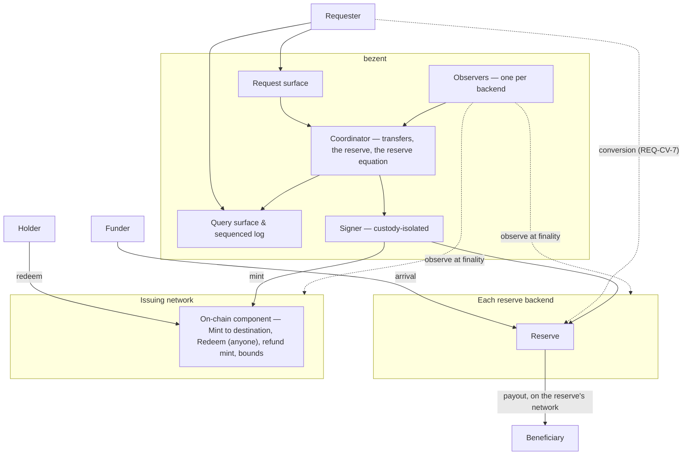

# bezent — System Specification

## 0. How to read this document

This document specifies bezent: what it is, what it guarantees, to whom, and under what conditions.
It is normative and self-contained. It does not say how bezent is built, which technologies
implement it, which networks it serves today, or why the project exists. `notes/` says why, and
`notes/CONSTRAINTS-FOR-PLAN.md` says what the plan is expected to bind.

Amendments 0001 to 0010 are applied (see `amendments/`).

### Change history

| Version | Date | Change |
|---|---|---|
| 0.5.2 | 2026-10-15 | Amendment 0012 (decision item `sp-payout-window`): new named condition `CND-PayoutWindow` — a withdrawal waits while the reserve's outflow allowance is spent and resumes when it refills. |
| 0.5.1 | 2026-10-13 | Amendment 0011 (decision item `sp-refund-dest`, ruled in chat): a withdrawal's refund always goes to its redeemer; the refund destination leaves a redemption's extras (`REQ-RQ-4`), and `REQ-RF-2` binds deposits. |
| 0.5.0 | 2026-10-13 | Amendment 0008 (decision item `sp-redemption-ref`): a redemption's on-chain reference is the redeemer together with the reference it chose, and mint and redemption references are separate namespaces (`REQ-OT-2`, `REQ-ID-2`, `AC-B5.2`). Amendment 0009 (`sp-transitions`): the transition table in §5.4 is normative (`REQ-TR-6`), and a new delivery attempt keeps its on-chain reference and waits for proof that the previous one did not execute (`REQ-EO-6`). Amendment 0010 (`sp-request-gaps`): who may add a redemption's extras (`REQ-RQ-4`); a cut-off holds a transfer and never refuses a request (`REQ-LM-1`, `CND-CutOff`); two named refusals (`ERR-Malformed`, `ERR-CommitmentMismatch`). Consistency, same rulings: `REQ-PN-2` lists the extras and refund grants that `REQ-RQ-4` and `REQ-RQ-6` use, and the `Needs-Review` state's meaning matches the transition table. |
| 0.4.0 | 2026-10-13 | Amendment 0007 (decision items `pl-scope`, `oq-14` and `pl-cross-network`): bezent moves value between each reserve and the issuing network; deposit addresses, sweeps and conversions are the requester's (`REQ-CV-7`); every payout is made on the reserve's network, and delivery to another network is the requester's (`REQ-OT-4`); a reversal after a reported-final payment is the attesting party's (`REQ-BE-6`), and `OQ-14` is closed. |

Earlier versions applied amendments 0001 to 0006; each amendment records what it changed.

### What each section answers

| Section | Question it answers | Read it if you are… |
|---|---|---|
| §1 Purpose and scope | What problem bezent solves, for whom, and where its boundary is | deciding whether bezent fits a need |
| §2 Glossary | What each term used normatively means | anyone. Terms are used exactly as defined |
| §3 Parties | Who interacts with bezent, in which role, with what powers | integrating, operating or auditing it |
| §4 Architecture | How responsibilities are separated, and what bezent requires of its environment | implementing or reviewing the design |
| §5 Domain model | The objects bezent holds, the reserve equation, and the lifecycles | integrating or implementing |
| §6 User stories | What each party can do, with acceptance criteria | anyone. This is the behaviour, seen from outside |
| §7 Surface contracts | The boundaries other parties build against | integrating |
| §8 Normative behaviour | Every request and query, with pre- and post-conditions | integrating or implementing |
| §9 Invariants | What is true at all times, and which layer keeps it true | implementing. Read it twice |
| §10 Errors and named conditions | Every refusal, and every non-terminal condition | integrating |
| §11 Non-functional requirements | Latency, durability, observation and custody bounds | implementing or operating |
| §12–§13 Deferred scope, non-goals | What is out, and why | anyone tempted to add something |
| §14 Open questions | What is undecided, and what each decision blocks | the owner |
| §15 Traceability and release scope | How stories, requirements and invariants map, and what the first release contains | planning |

### Normative language

The key words MUST, MUST NOT, SHOULD, SHOULD NOT and MAY are to be interpreted as described in RFC 2119.
They have that meaning only in:

- numbered requirements;
- invariants;
- contracts;
- acceptance criteria;
- tables marked normative.

Prose, rationale and "Trade-off, stated plainly" callouts explain a decision. They do not bind.

### Identifiers

| Prefix | Meaning |
|---|---|
| `US-*` | User story |
| `AC-*` | Acceptance criterion, scoped to its story |
| `REQ-*` | Normative requirement |
| `CTR-*` | Surface contract (§7) |
| `INV-*` | Invariant that MUST hold at all times |
| `ERR-*` | Named refusal |
| `CND-*` | Named condition: a non-terminal state that is not a failure |
| `NFR-*` | Non-functional requirement |
| `OQ-*` | Open question. One that blocks a V0 story or requirement MUST be closed before the V0 freeze, and any other before v1.0.0 |
| `DEF-*` | Explicitly deferred scope |

Identifiers are stable. Every family starts at 1 and is never renumbered. A withdrawn identifier is not
reused. So a gap in a sequence means a withdrawal recorded in an amendment, never an omission.

### Networks and backends

bezent connects exactly one **issuing network**, where it mints and destroys bridged assets, with
**backends**. A backend is the counterpart system for one class of origin: a network, or a financial rail
reached through a named party. Each backend declares an assurance class (`REQ-BE-2`). A network backend
is an **origin network**, where bezent holds the tokens that back a bridged asset. This document
defines the issuing network and origin networks only by the requirements they must satisfy (§4.4). In this text, "the issuing network" and "an origin
network" mean whatever satisfies those requirements, never a particular network.

---

## 1. Purpose and scope

### 1.1 The problem

**The domain.** Value that people and businesses want to use is issued on many networks. A stable token
issued on one network can be held, but not spent, on another. A system whose book of balances settles on
one network needs that value *there*, and needs to send it back out to whichever network the holder
names.

**What a bridge between them must give.**

1. **One to one, provably.** Every unit of a bridged asset is backed by one unit of its origin token,
   held by bezent, at every point anyone checks. Anyone can recompute the backing from public data.
2. **Certainty of outcome.** Every movement bezent makes is executed, provably not executed, or
   explicitly unresolved. It is never guessed. "I could not look" is never "it did not happen".
3. **Exactly once.** A deposit is minted once. A withdrawal is delivered once. Retries, restarts and
   lost databases change neither.
4. **Delivery where it is asked for.** bezent keeps one reserve per asset and pays out on the reserve's
   network, to the beneficiary the redemption names. Delivery to any other network is the requester's,
   from what it receives.
5. **Controlled, but not trusted, by its requester.** The system that asks for transfers decides what
   moves and to whom. On a public backend it cannot make bezent mint value that did not arrive. On an
   attested backend its report is the evidence, and the mint window and supply ceiling bound it
   (`REQ-BE-5`).
6. **A known worst case.** A stolen key, a defective component or a failed exchange has a bounded,
   stated maximum loss.

**The problem.** Moving value between networks through a chain of third parties (an exchange, an
issuer's custody, an intermediate network) turns one movement into many legs. Each leg is a place where
an outcome is assumed instead of observed, and where a timeout is read as a failure. Bloque's experience
with such paths is recorded in `notes/BRIDGE-REQUIREMENTS.md` §5. A message-backed bridge removes the
custodian, but it needs infrastructure that does not exist yet for every network.

bezent, as specified here, is the other option: a **trusted** bridge. The operator is the custodian of
every reserve. In return, it is simple, it reaches any network on which the operator can hold a token, and
it states its trust plainly (§4.3) and makes it checkable (§4.6).

### 1.2 What bezent is

bezent is a service with one on-chain component on the issuing network. It moves value between each
bridged asset's reserve and the issuing network: arrivals at a reserve, mints, redemptions, and payouts
from a reserve. Getting value into a reserve (deposit addresses, sweeps, routing between networks) and
converting other tokens into the origin token are the requester's. It provides:

- **Arrivals at a reserve.** bezent observes value that arrives at a reserve address, whoever sent it.
- **Deposits.** When an arrival is final on its backend and a requester binds it with a deposit request,
  bezent mints the same amount of the bridged asset on the issuing network, to the destination named in
  the order.
- **Withdrawals.** Anyone holding a bridged asset may redeem it on the issuing network. The redemption
  destroys it at once and records where the backend pays it out. bezent pays the origin token from the
  asset's reserve. If every payout attempt is proven never to execute, the redeemer gets one refund mint.
- **One reserve per asset.** Each bridged asset has one reserve, on one backend. Deposits fill it and
  withdrawals draw on it. Every payout is made on the reserve's network; delivery to another network is
  the requester's.
- **Backends with an assurance class.** Each backend is **public**, when its facts can be checked from
  public data, or **attested**, when they rest on a named party's reports.
- **Proof of reserves.** bezent publishes every address that holds reserve. Anyone can compare
  reserves with supply.
- **Outcomes, not verdicts.** Every report bezent makes is an observation at a coordinate, with
  finality as observed.

bezent does *not* know who a funder is, what product a holder uses, or what anything costs. It
sees addresses, tokens, amounts, references and networks.

### 1.3 Three kinds of fact

**A reserve fact** is a fact about custody. It says which addresses bezent controls on which
network, what they hold, and every movement in or out of them. Reserve facts are **public by
construction**, because they live on origin networks, and **authoritative there**.

**A supply fact** is a fact about the bridged asset on the issuing network. It says how much exists,
what was minted, redeemed or destroyed, and against which reference. Supply facts are public
and live on the issuing network.

**A requester fact** is everything else. It says who a funder or beneficiary is, which account a
deposit is for, what was quoted or charged, and whether a holder may transact. Requester facts live with
the requester. bezent does not hold them or need them.

bezent's own records join the first two kinds: which arrival backs which mint, which redemption funds
which payout. They are bezent's working state. They are never the authority on a reserve or
supply fact, and every one of them can be checked against the networks (`REQ-ST-1`).

### 1.4 Who it is for

- A **requester**: a system that asks bezent for deposits and withdrawals on behalf
  of the people and businesses it serves. The first requester is the operator's own ramp. Others may
  follow.
- A **ledger** that settles on the issuing network: value reaches it and leaves it through a requester.
  bezent never calls its contract, and it never calls bezent (`REQ-LG-*`).
- Anyone who wants to **check** that a bridged asset is backed.

End users never call bezent. Value they bring in reaches a reserve address through the requester, and
value they take out comes from a delivery.

### 1.5 In scope

- Arrivals at each bridged asset's reserve, and their observation. Deposit addresses, sweeps, routing
  between networks, delivery to another network and conversion are the requester's.
- Backends and their assurance classes.
- Deposits, minted to the order's destination; withdrawals, from a redemption by anyone; refunds and
  refund mints; and their lifecycles.
- One reserve per asset, supply, and the reserve equation.
- The on-chain component on the issuing network, and its bounds.
- The surfaces bezent exposes, and its boundary with a ledger on the issuing network, which it never
  calls.
- Key custody, governance, incidents and recovery.

### 1.6 Out of scope

- Who a funder or beneficiary is, and whether they may transact.
- Issuing deposit addresses and sweeping them: getting value into a reserve, and from where, is the
  requester's (§5.2).
- Prices, quotes and fees charged to anyone, including the price of a conversion (§5.10).
- Any book of balances: bezent holds no accounts for anyone.
- Orchestration across third parties: what a requester does with an exchange account or a venue is the
  requester's business (§5.7).
- Delivery to a network other than the reserve's: the requester's, from what it receives (`REQ-OT-4`).
- Any network that already reaches the issuing network through a trustless native transfer channel.
  Value between the two moves over that channel, not through a custodian (§13).

### 1.7 Standing assumptions

1. **One operator, one issuing network.** Exactly one operator runs a deployment. It mints on exactly one
   issuing network.
2. **Trusted custody.** The operator is the custodian of every reserve. The issuing network does not
   verify origin networks, and bezent does not claim that it does (§4.3).
3. **One bridged asset per origin token family, reserved on one backend.** Every payout is made on the
   reserve's network; delivery to any other network is the requester's (`REQ-OT-4`). Tokens of
   different issuers are never merged (`REQ-AS-3`).
4. **Same precision.** An origin token is admitted on an origin network only if its precision there
   equals the bridged asset's (`REQ-AS-4`).
5. **Successor backing.** A bridged asset may later be backed by something other than this bridge, such as
   an escrow governed by the issuing network. Nothing in this document may prevent that hand-over or
   require holders to act for it (`REQ-AS-6`).

---

## 2. Glossary

One canonical name per concept. This document uses each term only in the sense given here.

| Term | Definition |
|---|---|
| **bezent** | The service this document specifies. |
| **Operator** | The party that runs a deployment of bezent and is the custodian of its reserves (§3). |
| **Issuing network** | The one network on which bezent mints and destroys bridged assets. Defined by §4.4(a), never by name. |
| **Backend** | The counterpart system for one class of origin: a network, or a financial rail reached through a named party. Each backend declares an assurance class (`REQ-BE-1`, `REQ-BE-2`). |
| **Assurance class** | What a backend's facts rest on. **Public**: every observation, reserve balance and proof of non-execution can be checked from public data. **Attested**: they are taken from a named party's reports (`REQ-BE-2`). |
| **Origin network** | A network backend: a network on which bezent holds origin tokens. Defined by §4.4(b), never by name. |
| **Origin token** | A token on an origin network that backs a bridged asset. The same issuer's token on two origin networks is two origin tokens backing one bridged asset. |
| **Bridged asset** | The asset bezent mints on the issuing network for one family of origin tokens. Its identity encodes neither an origin network nor bezent. |
| **Route** | An (asset, origin network, direction) triple bezent serves, with its declared limits (`REQ-LM-1`). A venue route is (asset, from network, to network, venue). |
| **Requester** | A system authorised to ask bezent for transfers. It decides what moves and where. It never decides whether value arrived. |
| **Funder** | Whoever sends value to a reserve address. Never a caller of bezent. |
| **Beneficiary** | Whoever receives a delivery. Never a caller of bezent. |
| **Deposit address** | *Withdrawn by amendment 0007 (A1): deposit addresses are the requester's (§1.6).* |
| **Treasury** | The reserve address on an origin network: where bezent holds an asset's reserve, and from which it pays out. |
| **Reserve** | The amount of an origin token bezent holds at its reserve address on one origin network. |
| **Sweep** | *Withdrawn by amendment 0007 (A1).* |
| **Arrival** | Value observed at a reserve address. Evidence that value came in, not yet an instruction. |
| **Transfer** | One requested movement of value through bezent: a **deposit** (origin network → issuing network) or a **withdrawal** (issuing network → origin network). |
| **Convertible token** | A token admitted on an origin network for a bridged asset that is *not* its origin token. Accepted only through a conversion; never paid out, and never reserve. |
| **Conversion** | Exchanging a convertible token held at a reserve address for the origin token, executed by the requester at a protocol venue, with its output landing in the same reserve (`REQ-CV-7`, §5.10). bezent never sets its price. |
| **Refund** | A transfer of its own that returns value whose original transfer provably did not execute (§5.8). |
| **Leg** | The part of a transfer on one network: the **source leg** takes value in, the **destination leg** delivers it. |
| **Redemption** | A call to the on-chain component that takes a bridged asset from the caller, destroys it, and records where the backend pays it out. |
| **Mint** / **destroy** | Creating or destroying units of a bridged asset on the issuing network. Only the on-chain component does either. |
| **Supply** | The total amount of a bridged asset in existence on the issuing network. |
| **Surplus** | Value of an origin token the operator holds as reserve beyond what supply requires. It is the operator's own, and absorbs costs (`REQ-BK-4`). |
| **Venue** | A party or protocol through which a requester converts a token (`REQ-CV-7`): a **protocol venue** (on-chain code, such as an issuer's transfer protocol, every step on chain) or a **custodial venue** (an exchange; deferred, `DEF-8`). |
| **Request reference** | The requester's identifier for a transfer. Unique forever. Opaque to bezent. |
| **Bridge reference** | bezent's own identifier for a transfer or arrival. Derived by bezent, unique forever. Never replaces the request reference. |
| **On-chain reference** | A fixed, one-to-one digest of a bridge reference, written on chain by the transactions of that movement. Never sequential, never derived from a person. |
| **Coordinate** | What names an event uniquely and stably: network, block number, block hash, and position in the block. A transaction hash alone is not a coordinate. |
| **Observation** | A recorded on-chain fact: an event at a coordinate, with the network's own data and error text, and whether it was final when seen. Evidence, not a verdict. |
| **Inclusion** | An observation establishing that a transaction is in a block. Not final, not executed in full. |
| **Finality** | The point after which a network cannot revise an observation, by its own finality signal. |
| **Disposition** | What is known about a leg: **executed**, **not executed** (proven), or **unknown**. |
| **Proof of non-execution** | Public chain data, final, showing that a signed transaction can never execute (`REQ-NX-1`). |
| **Ledger** | A ledger of record that settles on the issuing network. Value reaches it, and leaves it, through a requester. bezent never calls it (`REQ-LG-1`). |
| **Account reference** | Opaque bytes that name one account at a ledger. Only that ledger resolves it. |
| **Fee position** | The native token an address needs to pay network costs. The operator's own, never reserve. |

---

## 3. Parties

| Party | Who | Authority | Interacts through |
|---|---|---|---|
| **Requester** | A system the operator authorises | Request deposits, convert at a reserve address within its role (`REQ-CV-7`), add an expiry to a redemption, relay an attested backend's payout instructions, and attest for an attested backend, each within declared routes. Never mint. Never declare an outcome on a public backend (`REQ-BE-5`) | Request, query and event surfaces (§7.A–C) |
| **Operator** | The party running the deployment | Custodian of every reserve. Holds the keys, through the custody capability (§4.4(c)). Owns the surplus | Operator surface (§7.D) |
| **Governance** | The holders of administrative roles on the on-chain component and on reserve addresses | Pause, unpause, set bounds, upgrade, rotate keys: each a separate role (`REQ-GV-*`) | The issuing network, and the operator surface |
| **Ledger** | A ledger of record on the issuing network | None over bezent. bezent never calls it (`REQ-LG-1`) | A requester's account on the issuing network (§7.G) |
| **Funder / beneficiary / redeemer** | Anyone on a network | None over bezent. Anyone holding a bridged asset may redeem it | The networks, and the on-chain component's redeem call (§7.F) |
| **Venue** | A protocol venue: on-chain code, every step on chain | None over bezent. A requester converts through it (`REQ-CV-7`) | The networks (§7.H) |
| **Verifier** | Anyone checking backing | None | Published addresses and statements, and the networks (§7.E) |

**`REQ-PN-1`** Every request MUST record the requester that made it. A request whose requester cannot be
authenticated MUST NOT be accepted.

**`REQ-PN-2`** Requester authority MUST be scoped by kind: requesting deposits, adding a redemption's extras
(withdrawals, `REQ-RQ-4`), requesting refunds of unassociated arrivals (`REQ-RQ-6`), and attesting for an attested
backend are separate grants.

---

## 4. Architecture

### 4.1 Components

Five rules define the architecture.

**`REQ-AR-1`** bezent MUST NOT call a requester to decide an outcome. Every transfer MUST reach a
terminal state or a named condition even when every requester is unavailable.

**`REQ-AR-2`** Observers report observations at coordinates. Only the coordinator derives dispositions,
and only from observations it recorded. No requester, venue or ledger may assert an outcome to the
bridge.

**`REQ-AR-3`** Key material MUST NOT reside in the component that holds bezent's state. The signer
MUST sign only a transaction that matches an intent the coordinator recorded durably, and MUST log every
signature (`INV-9`).

**`REQ-AR-4`** Mint and destroy authority over a bridged asset MUST be held only by the on-chain
component. That component MUST enforce, by its own code and independently of any off-chain component:
single use of every source reference, the supply ceiling, the mint window, the pause, and the roles
(`INV-2`, `INV-3`, `INV-4`).

**`REQ-AR-5`** Each invariant in §9 names the layer that enforces it. An implementation MUST NOT satisfy
an invariant at a weaker layer than the one named. Any weakening is a specification amendment.

### 4.2 Responsibility allocation

The table below is normative. A capability MUST NOT be implemented at any layer other than the one named.

| Capability | Where | Rationale |
|---|---|---|
| Who a deposit is for; where a refund goes | Requester | Requester facts (§1.3) |
| Getting value into a reserve; converting other tokens into the origin token | Requester, converting under `REQ-CV-7` | §1.6, `REQ-CV-2` |
| Where a withdrawal goes | The redeemer, in the redemption; for an attested backend, the requester relays the instructions | `REQ-RQ-9` |
| Whether an arrival is final | Bridge (observer, coordinator); for an attested backend, the attesting party's report | Needs the backend's own finality (`REQ-OB-7`) |
| Whether a mint is backed by a final, unconsumed arrival | Bridge (coordinator) and on-chain component | The requester controls; it attests only for an attested backend (`REQ-BE-5`) |
| Minting to the order's destination; destroying each redemption in the call that makes it | On-chain component | §7.F, `REQ-HN-8` |
| Paying out from the reserve, on its network | Bridge (signer) | `REQ-OT-4` |
| Delivering to another network | Requester, from what it receives | `REQ-OT-4` |
| Single use of a source reference | On-chain component, and bezent's store | Must survive the loss of bezent's database |
| Supply ceiling, mint window, pause | On-chain component | A stolen key must have a known maximum loss |
| Reserve accounting, one reserve per asset, and the reserve equation | Bridge (coordinator) | One place computes it; anyone can recompute it |
| Signing and submitting every transaction | Signer | Custody isolation |
| Crediting or debiting an account at a ledger | The ledger | bezent never calls a ledger's contract; value passes through the requester (`REQ-LG-1`) |
| Public record of reserves and supply | The networks | Needs neutral third parties |

### 4.3 Trust model — stated plainly

| Question | Answer |
|---|---|
| Can the requester make bezent mint value that did not arrive? | **No.** A mint needs a final arrival bezent observed itself, unconsumed (`INV-2`, `INV-6`). The requester decides only where it goes. |
| Can the requester send someone else's deposit to the wrong place? | **Yes.** Where a deposit goes is a requester fact. bezent cannot know who a funder is. A compromised requester can misdirect value. It cannot create it. |
| Can the operator mint unbacked supply? | **Yes, up to the bounds.** The issuing network does not verify origin networks. The on-chain component caps supply and the mint rate (§7.F, `INV-3`), and the reserve equation shows any shortfall to anyone who checks (`REQ-BK-6`). |
| Can a stolen delivery key drain reserves? | **Up to the outflow bound of each address it controls,** enforced by the network, not by bezent (`REQ-KY-3`). On the issuing network, up to the mint window. |
| Can value be lost at a venue? | **Not reserve.** bezent sends no value through a venue. A requester's conversion spends only convertible holdings, which back nothing, and its output lands in the same reserve (`REQ-CV-4`, `REQ-CV-7`). V0 uses protocol venues only (`DEF-8`), and every step of one is observable on chain (`REQ-VN-3`). |
| Who is the custodian? | **The operator, on every origin network.** A bridged asset is a claim on the operator's reserves. |
| Can governance move reserves? | **Through upgrade, yes.** Whoever can upgrade the on-chain component or a reserve address's code can move what it holds. They are named, and an upgrade passes a published process with a delay (`REQ-GV-3`). On the issuing network, that is the governance of the group that holds the component's authority (`REQ-HN-10`). |
| What can anyone check without bezent? | Every reserve address and its balance; supply; every mint, redemption and refund mint, with its on-chain reference; for any request reference, the transactions on each network and their disposition (`REQ-ST-1`). |
| What can nobody check? | That the operator will honour a withdrawal. Custody is trust. The statement of §4.6 makes a breach visible; it does not prevent one. |

> **Trade-off, stated plainly.** A trusted bridge is only as good as its custodian and its keys. What it
> gains is reach and simplicity: any token the operator can hold, on any network it can observe, with
> no third-party messaging and no runtime changes on other networks. Successor backing (§1.7,
> assumption 5) is how that trust is reduced later without holders noticing.

### 4.4 Capability contracts

bezent is built from exactly four external capabilities. Nothing in §5–§8 may require more than
these. No requirement in this document names what supplies one.

#### (a) The issuing network

**`REQ-HN-1`** The issuing network MUST support assets with a fixed precision whose issuance and
destruction can be restricted to one account, and that account MUST be able to be an on-chain program
(the on-chain component).

**`REQ-HN-2`** It MUST provide a finality signal of its own, and coordinates for every event.

**`REQ-HN-3`** It MUST support transactions that expire: a transaction signed for a bounded window that
cannot execute after it, so that non-execution can be proven (`REQ-NX-1`).

**`REQ-HN-4`** *Withdrawn by amendment 0001 (A8).*

**`REQ-HN-5`** The on-chain component MUST be able to hold value, keep storage, emit events with
references, and refuse a call by its own rules.

**`REQ-HN-6`** *Withdrawn by amendment 0001 (A9).*

#### (b) Backends

`REQ-RN-1`–`REQ-RN-6` bind **network** backends.

**`REQ-RN-1`** An origin network MUST provide a finality signal of its own. A count of confirmations is
not one.

**`REQ-RN-2`** It MUST order each sender's transactions by a sequence number (nonce), so that a nonce
consumed by a final transaction proves every other transaction with that nonce can never execute.

**`REQ-RN-3`** It MUST emit, for every token movement, an event with a coordinate, the token, the
sender, the recipient and the exact amount.

**`REQ-RN-4`** It MUST allow an address whose outflows are restricted by on-chain code, in destination
and in amount per window: rules the network enforces, not bezent (`REQ-KY-3`, `REQ-CV-7`).

**`REQ-RN-5`** It MUST allow a movement to carry an on-chain reference atomically with the value
(`REQ-ID-2`), by the token itself or by on-chain code that moves the value and emits the reference
in one transaction.

**`REQ-RN-6`** Its history over any range bezent has not read MUST be retrievable, so that a gap can
be filled (`REQ-OB-3`).

**`REQ-BE-1`** Each backend MUST implement the backend contract. It MUST observe an arrival with a stable
identifier and its finality, deliver idempotently, give evidence of non-execution, and report the reserve
it holds.

**`REQ-BE-2`** Each backend MUST declare its **assurance class**. It is **public** when every observation,
reserve balance and proof of non-execution can be checked from public data. It is **attested** when they
are taken from a named party's reports.

**`REQ-BE-3`** The statement (`REQ-PR-1`) MUST name each bridged asset's backend and its assurance class.

**`REQ-BE-4`** `REQ-BK-6`, `REQ-NX-2` and `REQ-ST-1` bind public backends. For an attested backend, the
bridge MUST record each report of the attesting party with that party's own identifiers, and the
statement MUST say that the asset's reserve is attested.

**`REQ-BE-5`** For an attested backend whose attesting party is a requester, that requester's report of an
arrival, a payout or a reserve balance **is** the observation. `REQ-RQ-7` and `REQ-AR-2` ("no caller
asserts an outcome") bind public backends only.

> **Trade-off, stated plainly.** For an asset with an attested backend, the attesting requester can cause
> a mint. What bounds it is the on-chain component's mint window and supply ceiling (§7.F), and the
> statement, which names the party whose word backs the asset.

**`REQ-BE-6`** If a payment an attested backend reported final (`REQ-OB-7`) is reversed afterwards, the
attesting party MUST cover it. bezent records the attesting party's report of the reversal as an observation
(`REQ-BE-5`); the reserve falls by the reversed amount and the shortfall is charged against the asset's surplus
(`REQ-BK-4`). The attesting party MUST restore the reserve within one business day. Holders' balances of the
bridged asset MUST NOT be reduced, and nothing already minted is clawed back. If the shortfall takes the surplus
below its floor (`REQ-BK-10`), new mints of that asset MUST pause until the reserve is restored.

#### (c) Custody

**`REQ-CU-1`** Key material MUST never be readable outside the component that signs with it. **Delivery keys**
(those that mint, pay out from a reserve, or refund) MUST live in a key-management service or hardware security
module that signs on request and never releases them. Other keys (pause, statements) MAY be held in a
secrets vault and loaded only by the signer process (`REQ-AR-3`).

**`REQ-CU-2`** The custody capability MUST support separate keys per network and per role, and rotation
without stranding transfers in flight (`REQ-KY-4`).

#### (d) Venues

**`REQ-VN-1`** A venue MUST accept value at an address on one origin network and deliver it to a named
address on another, and its delivery MUST be observable on chain at a coordinate.

**`REQ-VN-2`** A venue MUST declare, per route, its minimum and maximum, and its fees, before a venue delivery
uses it.

**`REQ-VN-3`** A protocol venue MUST make every step observable on chain.

#### (e) Withdrawn

*§4.4(e) is withdrawn by amendment 0001 (A12): bezent calls no ledger's contract (`REQ-LG-1`).*

**`REQ-LC-1`** *Withdrawn by amendment 0001 (A12).*

**`REQ-LC-2`** *Withdrawn by amendment 0001 (A12).*

### 4.5 Privacy

**`REQ-PV-1`** Personal data MUST NOT appear on any network: not in a reference, memo, calldata or event.

**`REQ-PV-2`** On-chain references MUST NOT be sequential, and MUST NOT be derived from a person's
identifier or from an account reference.

**`REQ-PV-3`** A request MUST NOT need personal data. Eligibility checks belong to the requester.

**`REQ-PV-4`** bezent MUST treat an account reference as opaque bytes. It MUST NOT parse, derive,
alter or reuse one.

**`REQ-PV-5`** *Withdrawn by amendment 0007 (A1).*

### 4.6 Provability

What anyone can check, from public data alone:

- each bridged asset's one reserve backend and its assurance class, as the statement names them;
- for a public backend, every reserve address and every reserve-holding contract, per network and token;
- for an attested backend, the attesting party's reports, by that party's own identifiers;
- supply of each bridged asset, on the issuing network;
- every mint, redemption and refund mint, with its on-chain reference;
- for any request reference, the transactions of that transfer on each network (`REQ-ST-1`).

**`REQ-PR-1`** bezent MUST publish, at least daily, a statement per bridged asset, signed by a key used for nothing else, of:
reserve per origin network, value in transit, supply, owed mints and owed payouts, and surplus, each naming the final block on each network it rests on. The
statement MUST say that it is a signed claim, not a proof of solvency.

**`REQ-PR-2`** Every statement MUST be retained and retrievable, so that a later revision is detectable
without bezent's cooperation.

---

## 5. Domain model

### 5.1 Assets and routes

**`REQ-AS-1`** A bridged asset MUST have exactly one identity on the issuing network, fixed at creation.
The identity MUST NOT encode an origin network or bezent.

**`REQ-AS-2`** An origin token MUST be admitted on an origin network by an explicit, recorded
declaration: its network, its token identity, its precision, and the bridged asset it backs. Value of a
token not admitted is an unassociated arrival (`REQ-IN-6`).

**`REQ-AS-3`** One bridged asset MUST be backed only by origin tokens of one issuer. Tokens of different
issuers MUST NOT back one bridged asset.

**`REQ-AS-4`** An origin token MUST have the same precision as its bridged asset, or more. Amounts are exact
integer minor units everywhere. Where the origin token has more precision, the ratio is a fixed power of ten,
declared with the asset (`REQ-AS-2`).

**`REQ-AS-9`** A deposit of an origin token with more precision mints the arrival divided by the ratio, rounded
down. The remainder, smaller than one minor unit of the bridged asset, is recorded in the reserve book as
surplus, with the deposit's reference (`REQ-BK-4`, `REQ-BK-7`). It is never minted, dropped or returned.

**`REQ-AS-10`** A payout of a bridged asset with less precision than its origin token pays exactly the redeemed
amount times the ratio. A payout never creates a remainder.

**`REQ-AS-5`** bezent MUST declare its routes in machine-readable form (`REQ-LM-1`). A route not
declared does not exist.

**`REQ-AS-7`** A convertible token MAY be admitted on an origin network for a bridged asset, by the same kind
of recorded declaration as `REQ-AS-2`, naming the conversion venue route. A convertible token MUST NOT
count as reserve, and MUST NOT back any supply.

**`REQ-AS-6`** bezent's mint authority over a bridged asset MUST be revocable by the issuing network's
governance, and MUST end when another backing takes over. A hand-over MUST NOT change the bridged
asset's identity, and MUST NOT need holders to act. At no point during it may supply exceed what the two
backings hold together.

**`REQ-AS-8`** Each bridged asset MUST have exactly one reserve backend. For a network backend, the
reserve sits on exactly one network. An attested backend MAY hold it in several positions (accounts), each
itemised (`REQ-BK-5`).

### 5.2 Deposit addresses, treasury and sweeps

*Withdrawn by amendment 0007 (A1)*: getting value into a reserve is the requester's.

**`REQ-DA-1`**–**`REQ-DA-6`** *Withdrawn by amendment 0007 (A1).*

### 5.3 Reserves, supply and the reserve equation

For a bridged asset *A*, at a set of final points, one per network:

- **Reserve(*A*, *n*)** is what bezent's reserve addresses on origin network *n* hold of *A*'s origin
  token.
- **InTransit(*A*)** is value moving through a protocol venue: legs out of the reserve that are final, whose
  destination leg is not.
- **Supply(*A*)** is the total of *A* on the issuing network.
- **OwedMint(*A*)** is the sum of final arrivals of *A*'s origin tokens not yet minted, whether bound to a
  deposit or not.
- **OwedPayout(*A*)** is the sum of final redemptions whose payout is not yet final.
- **Surplus(*A*)** is the operator's own value in reserve, recorded per contribution and per cost.

The **reserve equation** is:

    Σ Reserve(A) + InTransit(A) = Supply(A) + OwedMint(A) + OwedPayout(A) + Surplus(A)

**`REQ-BK-1`** bezent MUST compute the reserve equation for every bridged asset, from chain data at
final points, continuously (`NFR-5`). Any divergence, to the smallest unit, MUST pause the asset's routes
and page a human (`REQ-IC-2`).

**`REQ-BK-2`** InTransit, OwedMint and OwedPayout MUST each be itemised: a list of the transfers and
venue deliveries that make it up, never a residual.

**`REQ-BK-3`** Surplus MUST be zero or more at all times. A negative surplus is a shortfall of backing,
handled as a divergence.

**`REQ-BK-10`** The operator MUST keep each asset's surplus above a floor it declares, and an alert MUST fire
before the floor is reached. The operator tops up the surplus from its own funds.

**`REQ-BK-4`** Every network cost, every venue fee and every amount difference on a venue delivery MUST be
recorded against surplus, with its reference. None may reduce a delivery.

**`REQ-BK-5`** Every address that holds reserve or a fee position MUST be published per network and token.
Value MUST move in or out of a reserve address only by a transfer, a conversion under `REQ-CV-7`, or a
recorded surplus contribution or withdrawal, each with a reference.

**`REQ-BK-6`** For a public backend, anyone holding the published addresses and a statement MUST be able
to recompute both sides of the equation from public data (`REQ-BE-4`).

**`REQ-BK-7`** bezent MUST keep a **reserve book** per bridged asset. It is a double-entry, append-only
record of every movement into, out of and between the asset's reserve positions, value in transit, owed
mints, owed payouts and surplus, and of supply as the issuing network reports it. A correction is a new
entry; no entry is ever changed or deleted (`INV-17`).

**`REQ-BK-8`** The reserve book is working state, never the authority. Each evaluation of the reserve
equation (`REQ-BK-1`) MUST re-derive every term from the backends and the issuing network at final points,
and compare it with the book. Any difference is a divergence.

**`REQ-BK-9`** The reserve book need not be provable to third parties. The statement (`REQ-PR-1`) MUST say so,
and MUST say, per asset, which terms anyone can recompute from public data and which rest on an attesting
party's reports (`REQ-BE-4`).

### 5.4 Transfers and their states

A transfer has a request reference, a bridge reference, a kind, an asset, an exact amount, a destination,
a refund destination, and a source binding: the coordinate of the leg that funds it.

**States (normative).**

| State | Meaning | Terminal |
|---|---|---|
| `Received` | Taken in durably, not yet decided | No |
| `Refused` | Refused at request with a named error. Nothing moved, and nothing will on its account | Yes |
| `Accepted` | Within route rules; its source leg is not yet final | No |
| `Source-Final` | Its source leg is final and consumed for it, on chain (`INV-2`) | No |
| `Delivering` | A destination transaction is signed and recorded; it may be submitted | No |
| `Delivered` | The destination leg is included, not final | No |
| `Completed` | The destination leg is final and executed in full | Yes |
| `Refunding` | The destination leg is proven not executed, at finality; a refund transfer exists | No |
| `Refunded` | Its refund transfer is `Completed` | Yes |
| `Expired` | Accepted, but its source leg never arrived before the request's expiry. Nothing moved | Yes |
| `Withdrawn` | Its source observation no longer matches the chain, before finality. Nothing moved | Yes |
| `Needs-Review` | A leg is unknown past its deadline, an execution was partial or mismatched, or a condition that blocks delivery is past its deadline (`REQ-RV-1`, `REQ-TR-3`, `REQ-TR-5`) | No |

A transfer that cannot proceed for a named reason that clears itself holds a **named condition**
(`CND-*`, §10) in its current state. A condition is not a state and never a failure.

**`REQ-TR-1`** A terminal state MUST never change (`INV-5`).

**`REQ-TR-2`** Every state change MUST record the coordinate it rests on, with block number, block hash
and block time, and the time bezent saw it. No recorded time may be overwritten or recomputed.

**`REQ-TR-3`** A transfer MUST move from `Delivered` to `Completed` only when its destination leg is final
*and* its execution result shows the full amount moved to the destination. A partial execution MUST NOT
be `Completed`; it sends the transfer to `Needs-Review`.

**`REQ-TR-4`** Included, final and completed MUST be three distinct conditions, each with its own time, in
every status and report.

**`REQ-TR-5`** The delivered amount MUST equal the transfer's amount. bezent charges nothing and
deducts nothing. A conversion is the one place where two amounts differ by design; §5.10 says which
amount binds where. A delivery of any other amount is `CND-AmountMismatch`, reporting both amounts, and
sends the transfer to `Needs-Review`.

**Transitions (normative).**

| From | To | When |
|---|---|---|
| `Received` | `Refused` | Refused at request with a named error |
| `Received` | `Accepted` | Within route rules; the source leg is not yet final |
| `Accepted` | `Source-Final` | The source leg is final and consumed for it (`INV-2`) |
| `Accepted` | `Expired` | The source leg never arrived before the request's expiry |
| `Accepted` | `Withdrawn` | The source observation no longer matches the chain, before finality (`REQ-IN-7`) |
| `Accepted` | `Needs-Review` | The source leg is observed but neither final nor withdrawn past its deadline (`REQ-RV-1`) |
| `Source-Final` | `Delivering` | A destination transaction is signed and recorded |
| `Source-Final` | `Needs-Review` | A condition that blocks delivery (`CND-AwaitingConversion`, `CND-DestinationRefused`) is past its deadline (`REQ-CV-6`, `REQ-IN-9`) |
| `Delivering` | `Delivered` | The destination leg is included |
| `Delivering`, `Delivered` | `Delivering` | A **new attempt** after the previous one is proven not executed at finality (`REQ-RF-5`); each attempt is numbered and recorded |
| `Delivering`, `Delivered` | `Refunding` | The destination leg is proven not executed at finality, and a refund transfer exists |
| `Delivering`, `Delivered` | `Needs-Review` | A leg unknown past its deadline; a partial or mismatched execution (`REQ-TR-3`, `REQ-TR-5`) |
| `Delivered` | `Completed` | The destination leg is final and executed in full (`REQ-TR-3`) |
| `Refunding` | `Refunded` | Its refund transfer is `Completed` |
| `Needs-Review` | Any state reachable by **one ordinary edge** from the state held before review | The evidence is that edge's coordinate, verified by bezent (`REQ-RV-2`); a resolution that moves value has a second approver (`REQ-GV-5`) |
| Any non-terminal | Itself | It takes or clears a named condition (§10) |

Two pairs are not edges, on purpose. `Received` does not lead straight to `Source-Final`: a deposit bound to a
final arrival is created at `Source-Final` (`REQ-IN-3`). `Refunding` does not lead to `Needs-Review`: the refund
transfer has its own lifecycle and review.

A new attempt carries the same on-chain reference as the attempt it replaces. A reference is consumed only by a
leg that executed (`INV-2`), and the previous attempt is proven not executed before the next is signed, so one
transaction is signed per (reference, attempt), and attempt *n*+1 only once the proof of non-execution of
attempt *n* is recorded (`REQ-EO-6`).

**`REQ-TR-6`** A transfer MUST change state only along the edges of the §5.4 transition table.

### 5.5 Deposits (origin network → issuing network)

**`REQ-IN-1`** An arrival MUST be observed at a coordinate and recorded once, de-duplicated by coordinate
(`INV-10`).

**`REQ-IN-2`** An arrival counts as final only when the network's final point has passed its block *and*
the block at that height still has the hash observed (`REQ-OB-2`).

**`REQ-IN-3`** A final arrival of an admitted token at a reserve address MUST wait as an unassociated
arrival (`CND-Unassociated`) until a requester binds it with a deposit request that names its coordinate
(`REQ-RQ-3`). The deposit then begins at `Source-Final`, with a bridge reference derived deterministically
from the coordinate.

**`REQ-IN-4`** A deposit MUST be minted only against one final, unconsumed arrival of the same token
family and the same amount, and the mint MUST carry that arrival's on-chain reference (`INV-2`, `INV-6`).

**`REQ-IN-5`** A deposit's destination is an address on the issuing network. Delivering into a ledger is
the requester's, from its own account.

**`REQ-IN-6`** An arrival that cannot become a deposit (a token not admitted, an amount outside the route's
bounds, value with no matching deposit request, venue delivery or surplus contribution) MUST be recorded as an
**unassociated arrival** with an owner (`CND-Unassociated`). An arrival with no deposit request by the route's
deadline stays `CND-Unassociated` with its owner. It MUST NOT be absorbed into reserve, minted or dropped. Releasing it is a refund request by a requester with the destination it supplies,
or a recorded surplus contribution by the operator, each with a second approver.

**`REQ-IN-7`** An observation that stops matching the chain before finality MUST be withdrawn, reported
as withdrawn, and anything waiting on it MUST stop.

**`REQ-IN-8`** A deposit whose mint the issuing network refuses holds `CND-DestinationRefused`, with
nothing minted (`REQ-IN-9`).

**`REQ-IN-9`** bezent MUST NOT check whether a destination on the issuing network can receive the
asset. A mint the network refuses because of its destination holds `CND-DestinationRefused` and mints
nothing. Past the route's deadline it goes to `Needs-Review`.

### 5.6 Withdrawals (issuing network → origin network)

**`REQ-OT-1`** A withdrawal is funded by a **redemption** on the issuing network, and only by one.

**`REQ-OT-2`** A withdrawal MUST be bound to its redemption by the redemption's on-chain reference: the
redeemer's account together with the reference it chose. It MUST NOT be matched by amount or time; the redeemer
is part of the identifier, not a matching rule.

**`REQ-OT-3`** bezent MUST NOT submit a payout before the redemption is final.

**`REQ-OT-4`** A withdrawal MUST be paid from the asset's reserve, on the reserve's network, to the
beneficiary the redemption names. Delivery to another network is the requester's, from what it receives.

**`REQ-OT-5`** When the asset's reserve cannot cover a withdrawal, the withdrawal MUST hold
`CND-ReserveShort`, raise one condition per (asset, network) to the requesters, and resume by itself when
reserve recovers. It MUST NOT fail, refund or move to another network.

**`REQ-OT-6`** The redeemed value is destroyed at redemption. If every payout attempt is proven not executed
at finality, the redeemer is refunded by one refund mint tied to that redemption.

**`REQ-OT-7`** and **`REQ-OT-8`** *Withdrawn by amendment 0001 (A6).*

> **Trade-off, stated plainly.** Burning at once means a failed payout is made whole by the mint authority.
> A refund mint is bounded by the mint window and is one per redemption, so a stolen delivery key cannot
> use refunds to exceed the window.

### 5.7 Venues

**`REQ-RB-1`**–**`REQ-RB-10`** *Withdrawn by amendment 0001 (A3).*

**`REQ-VN-6`** *Withdrawn by amendment 0007 (A5).*

### 5.8 Refunds

**`REQ-RF-1`** A refund MUST happen only when the leg it replaces is proven not executed and the proof is
final. Never on a timer, never on an unknown.

**`REQ-RF-2`** The refund destination of a **deposit** MUST be given in its request. bezent MUST NOT choose it
afterwards. A withdrawal's refund destination is always its redeemer (`REQ-RF-4`).

**`REQ-RF-3`** A refund MUST be a transfer of its own, with a bridge reference derived deterministically
from the original's, under every requirement here. The original's record MUST point to it.

**`REQ-RF-4`** A withdrawal's refund is a refund mint to the redeemer, tied to the redemption's reference.
It counts against the mint window.

**`REQ-RF-5`** After a proof of non-execution, bezent MAY submit a new destination attempt for the
same withdrawal instead of refunding, until the withdrawal's deadline. Each attempt MUST be recorded and
proven before the next.

### 5.9 Review

**`REQ-RV-1`** A transfer or venue delivery with an unknown leg past its deadline MUST go to `Needs-Review`,
with an owner and a service level. It MUST NOT be refunded, retried as a new transaction, or failed. The owner
of `Needs-Review` and `CND-Unassociated` is the operator's operations function, and the service level is one
business day.

**`REQ-RV-2`** A review MUST end only by evidence: a coordinate that settles the disposition, which the
bridge verifies itself, after which the ordinary steps run. A resolution that moves value MUST have a
second approver (`REQ-GV-5`).

### 5.10 Conversions

**`REQ-CV-1`** An arrival of a convertible token MUST NOT be minted against. It is held in
`CND-AwaitingConversion` until a conversion turns it into the origin token.

**`REQ-CV-2`** A conversion on a deposit MUST be executed by the requester under `REQ-CV-7`, as one
transaction whose output lands in the reserve. The deposit is then minted against **that** output, at its
observed amount, under every rule of §5.5. The deposit records the convertible arrival and the converted
output, with both amounts.

**`REQ-CV-3`** *Withdrawn by amendment 0007 (A2), with `AC-B4.1` and `AC-B4.2`: every payout is in the
origin token; a requester that wants another token converts what it receives.*

**`REQ-CV-4`** Until converted, convertible holdings MUST be itemised per token and network, outside the
reserve equation, and published in the statement (`REQ-PR-1`). They back nothing.

**`REQ-CV-5`** The price, the slippage and any fee of a conversion are the requester's. bezent MUST NOT
make a delivery or a mint up to a quoted amount; it mints or delivers what was observed.

**`REQ-CV-6`** A conversion that does not complete by its deadline goes to `Needs-Review` (`REQ-RV-1`). Its
convertible holdings stay itemised; they are never written off and never counted as reserve.

**`REQ-CV-7`** A requester MAY hold a role on a reserve address that lets it convert, at a protocol venue,
convertible holdings at that address into the origin token. The network MUST enforce, by on-chain code
(`REQ-RN-4`), that the role (a) spends only convertible tokens admitted for that asset, never the origin token,
(b) sends the output only to the same reserve address, and (c) is bounded per window. The role MUST NOT move value
out of the reserve address by any other path. Every conversion is observed at its coordinate and recorded like any
other movement.

The requester converts, but it never holds a key that can take reserve out, never asserts an arrival, and never
stands in for the reserve equation. Convertible holdings back nothing until converted (`REQ-CV-4`), so the role
puts no reserve at risk.

> *The trade-off on conversions through a custodial venue is withdrawn by amendment 0001 (A10): V0 uses
> protocol venues only (`DEF-8`).*

---

## 6. User stories

### Epic A — Deposits

**`US-A1`** *Withdrawn by amendment 0007 (A1), with `AC-A1.1`–`AC-A1.4`.*

**`US-A2`** — As a **requester**, value that arrives at a reserve address is minted for the destination my
deposit request names once it cannot be taken back, and not before.
- `AC-A2.1` Given an arrival observed but not final, Then nothing is minted (`REQ-IN-2`, `INV-6`).
- `AC-A2.2` Given the arrival is final, its block hash still matches, and a deposit request binds it, Then
  exactly its amount is minted for the request's destination, carrying its on-chain reference (`REQ-IN-3`,
  `REQ-IN-4`).
- `AC-A2.3` Given an observation that stops matching before finality, Then it is withdrawn, and nothing is
  minted (`REQ-IN-7`).
- `AC-A2.4` *Withdrawn by amendment 0007 (A1).*

**`US-A3`** *Withdrawn by amendment 0001 (A9), with `AC-A3.1` and `AC-A3.2`.*

**`US-A4`** — As the **operator**, value nobody asked for is never lost and never kept.
- `AC-A4.1` Given an arrival of a token not admitted, or outside its route's bounds, Then it is an
  unassociated arrival with an owner (`REQ-IN-6`).
- `AC-A4.2` Given an arrival that cannot become a deposit, Then it is not counted as owed mint, not minted
  and not absorbed into surplus without a recorded, two-person decision (`REQ-IN-6`).

**`US-A5`** — As a **requester**, a deposit in a convertible token becomes the bridged asset for what the
conversion actually delivered.
- `AC-A5.1` Given an arrival of a convertible token, Then nothing is minted and it holds
  `CND-AwaitingConversion` (`REQ-CV-1`).
- `AC-A5.2` Given the conversion's output arrival at the reserve is final, Then the deposit is minted at that
  arrival's amount, and both amounts are reported (`REQ-CV-2`, `REQ-CV-5`).
- `AC-A5.3` Given a statement, Then unconverted holdings appear itemised and outside the reserve equation
  (`REQ-CV-4`).

### Epic B — Withdrawals

**`US-B1`** — As a **requester**, I withdraw a bridged asset to an address on the origin network I name.
The amount that leaves the issuing network and the amount delivered are the same.
- `AC-B1.1` Given a redemption, Then nothing is paid out before it is final (`REQ-OT-3`, `INV-7`).
- `AC-B1.2` Given the payout is final and executed in full, Then the withdrawal is `Completed`.
- `AC-B1.3` Given the payout is proven never to execute, Then the redeemer gets one refund mint, or a new
  attempt is made (`REQ-RF-1`, `REQ-RF-5`, `INV-8`).
- `AC-B1.4` Given the delivery's outcome is unknown at its deadline, Then the withdrawal is `Needs-Review`
  and nothing is returned (`REQ-RV-1`).

**`US-B2`** *Withdrawn by amendment 0001 (A6), with `AC-B2.1` and `AC-B2.2`; replaced by `US-B5`.*

**`US-B3`** — As a **requester**, a shortage of reserve on one network delays a withdrawal; it does not fail
it.
- `AC-B3.1` Given the asset's reserve cannot cover it, Then the withdrawal holds
  `CND-ReserveShort`, and one condition is raised per (asset, network) (`REQ-OT-5`).
- `AC-B3.2` Given reserve recovers, Then the withdrawal resumes with no one acting (`REQ-OT-5`).

**`US-B4`** *Withdrawn by amendment 0007 (A2), with `AC-B4.1` and `AC-B4.2`: every payout is in the origin token.*

**`US-B5`** — As anyone holding a bridged asset on the issuing network, I redeem it to the backend I name.
- `AC-B5.1` Given a redemption, Then its value is destroyed in the same call, and its reference and
  instructions (or their commitment) are recorded in order (`REQ-OT-1`, `REQ-HN-7`).
- `AC-B5.2` Given the same redeemer and reference again, Then it is refused (`INV-2`).

### Epic C — Outcomes and proof

**`US-C1`** — As a **requester**, I am told what happened, never what bezent guessed.
- `AC-C1.1` Given any leg, Then its disposition is executed, not executed, or unknown (`REQ-NX-*`).
- `AC-C1.2` Given a timeout, a node error, a dropped transaction or an event bezent cannot decode, Then
  the disposition is unknown (`REQ-NX-3`).
- `AC-C1.3` Given a report, Then it carries a coordinate on each network bezent touched, the
  network's own data and error text, and finality as observed (`REQ-ST-3`).

**`US-C2`** — As anyone, I can check a "not executed" without trusting bezent.
- `AC-C2.1` Given a proof of non-execution, Then it names network, signer, nonce, expiry and the final
  block that proves it, all checkable from public chain data (`REQ-NX-2`).

### Epic D — Exactly once

**`US-D1`** — As a **requester**, I can retry anything.
- `AC-D1.1` Given a repeat with the same request reference and body, Then the original's status is
  returned (`REQ-ID-1`).
- `AC-D1.2` Given a repeat with the same reference and a different body, Then it is refused with
  `ERR-ReferenceConflict` (`REQ-ID-1`).

**`US-D2`** — As the **operator**, nothing is minted or delivered twice, even if bezent's database is
lost.
- `AC-D2.1` Given a restart after signing, Then bezent re-sends the recorded bytes or queries them; it
  never signs a second transaction with the same intent (`REQ-EO-1`).
- `AC-D2.2` Given a mint carrying an on-chain reference already consumed, Then the on-chain component
  refuses it (`INV-2`).
- `AC-D2.3` Given a range of blocks bezent failed to read, Then it is a visible gap, filled before the
  bridge moves past it (`REQ-OB-3`).

### Epic E — Reserves and supply

**`US-E1`** — As a **verifier**, I can compare reserves with supply.
- `AC-E1.1` Given the published addresses and a statement for an asset on a public backend, Then I can
  recompute every term of the reserve equation from public data (`REQ-BK-6`, `REQ-PR-1`).
- `AC-E1.2` Given two statements, Then a revision of the earlier one is detectable (`REQ-PR-2`).

**`US-E2`** — As the **operator**, a gap between reserve and supply stops the asset before it grows.
- `AC-E2.1` Given any divergence in the reserve equation, Then the asset's routes pause, transfers in flight
  continue to be observed, and a human is paged (`REQ-BK-1`, `REQ-IC-2`).
- `AC-E2.2` Given a venue fee or a network cost, Then it is recorded against surplus and no delivery is
  reduced (`REQ-BK-4`, `REQ-TR-5`).

### Epic F — Venues

**`US-F1`** *Withdrawn by amendment 0001 (A3), with `AC-F1.1`–`AC-F1.7`.*

**`US-F2`** *Withdrawn by amendment 0001 (A3), with `AC-F2.1`.*

**`US-F3`** *Withdrawn by amendment 0007 (A5), with `AC-F3.1` and `AC-F3.2`.*

### Epic G — Limits and capacity

**`US-G1`** — As a **requester**, I learn what bezent will refuse before any value moves.
- `AC-G1.1` Given the route table, Then minimum, maximum, window limits, cut-offs and current capacity are
  readable per route (`REQ-LM-1`).
- `AC-G1.2` Given a request outside them, Then it is refused with a named error before any value moves
  (`REQ-LM-2`).
- `AC-G1.3` Given bezent cannot keep up, Then new requests are refused with `ERR-Overloaded`, which is
  retryable (`REQ-LM-4`).

### Epic H — Status and observability

**`US-H1`** — As a **requester**, I can find out where anything stands without a notification arriving.
- `AC-H1.1` Given a request reference or a coordinate, Then the transfer's status is returned (`REQ-ST-2`).
- `AC-H1.2` Given my last position in the sequenced log, Then I can read everything since (`REQ-ST-4`).
- `AC-H1.3` Given a notification delivered twice, Then I can de-duplicate it by its stable key
  (`REQ-ST-5`).

**`US-H2`** — As anyone holding a request reference, I can find the transfer's transactions on each
network without bezent's database (`REQ-ST-1`).

**`US-H3`** — As the **operator**, I see stalls before anyone reports them.
- `AC-H3.1` Given any route, Then the age of its oldest non-final transfer, the count and age of unknown
  legs, observation lag and open gaps per network, reserve per network, fee positions, and undelivered
  notifications are observable continuously (`REQ-ST-6`).

### Epic I — Custody, governance and incidents

**`US-I1`** — As the **operator**, a stolen key has a known maximum loss.
- `AC-I1.1` Given any key, Then its outflow is bounded per asset and window by the network (`REQ-KY-3`).
- `AC-I1.2` Given a signature bezent did not record, Then it is treated as a compromise: pause, rotate,
  report (`REQ-IC-4`).

**`US-I2`** — As **governance**, I can stop new work without failing work in flight.
- `AC-I2.1` Given a pause per route, per asset, per direction or global, Then new work stops and transfers
  in flight continue to be observed and completed (`REQ-GV-1`).
- `AC-I2.2` Given an unpause or a raised bound, Then it needs more than one approver (`REQ-GV-2`).

**`US-I3`** — As the **operator**, every manual action is an ordinary, recorded one.
- `AC-I3.1` Given any administrative action, Then its actor and justification are in an append-only record
  (`REQ-GV-5`).
- `AC-I3.2` Given a request to edit a status or move value outside the ordinary path, Then there is no
  surface that does it (`REQ-GV-5`).

**`US-I4`** — As the **operator**, bezent refuses to talk to the wrong network, and a test key has no
power in production.
- `AC-I4.1` Given a network whose identity at start-up is not the declared one, Then bezent fails closed
  (`REQ-IC-1`).
- `AC-I4.2` Given a key from a test environment, Then it holds no authority on production addresses or
  components (`REQ-KY-6`).

---

## 7. Surface contracts

### 7.A `CTR-REQ` — the request surface

**`REQ-RQ-1`** Every request MUST carry a request reference, and MUST be taken in durably before it is
answered. The answer carries bezent reference and the state.

**`REQ-RQ-2`** *Withdrawn by amendment 0007 (A1).*

**`REQ-RQ-3`** **Request a deposit:** request reference, the coordinate of a final arrival at a reserve
address, the destination, and the refund destination. A coordinate is consumed once (`INV-2`).

**`REQ-RQ-4`** **Request a withdrawal:** a redemption is the request. The requester MAY add, by the
redemption's reference, an expiry, and for an attested backend the relayed instructions (`REQ-RQ-9`). A
withdrawal's refund always goes to its redeemer (`REQ-RF-4`). Extras are written once. For an attested backend only the requester holding that
backend's attesting grant may add them. For a public backend, any requester holding the withdrawal grant may, and
the first accepted wins; a later different body is refused (`ERR-ReferenceConflict`).

**`REQ-RQ-5`** *Withdrawn by amendment 0001 (A12).*

**`REQ-RQ-6`** **Request a refund of an unassociated arrival or unconsumed funding:** request reference, the
coordinate, the destination. Needs a second approver at the operator (`REQ-IN-6`).

**`REQ-RQ-7`** No request may carry a claimed outcome, a claimed finality, or an amount bezent would
take as observed. Anything a request says about a chain is a pointer bezent verifies.

**`REQ-RQ-9`** A redemption MUST carry its payout instructions inline when the backend is public (a
destination address), and only a commitment (a hash of the instructions) when the backend is attested. The
bridge MUST accept instructions relayed for a commitment only when they hash to it.

### 7.B `CTR-QRY` — the query surface

**`REQ-RQ-8`** The query surface MUST answer: status by request reference, by bridge reference and by
coordinate; the route table with current capacity (`REQ-LM-1`); reserve per (asset, network); the reserve
equation's latest evaluation; the sequenced log from a position (`REQ-ST-4`).

### 7.C `CTR-EVT` — events and notifications

**`REQ-ST-4`** Every state change and condition MUST be appended to a **sequenced log**, gapless and
readable by position, so a requester can read everything since its last position without a subscription.

**`REQ-ST-5`** Notifications MUST be at-least-once, authenticated, and de-duplicable by a stable key. No
requester may need one to arrive.

**`REQ-IC-5`** Requesters SHOULD be notified once per condition (a route paused, a network stalled,
reserve short), not once per transfer.

### 7.D `CTR-OPS` — the operator surface

Pause and unpause, bounds, route admission, key rotation, review resolution, surplus contributions and
withdrawals, and the approval of unassociated-arrival releases. Every action follows `REQ-GV-*`. The
operator surface MUST NOT offer any action that edits a status, an observation, a reserve or a supply
outside the ordinary steps (`REQ-GV-5`).

### 7.E `CTR-PRF` — published addresses and statements

The reserve addresses (`REQ-BK-5`), the statements (`REQ-PR-1`, `REQ-PR-2`), the routes (`REQ-LM-1`), the
finality rule per network (`REQ-OB-1`), the completion budget per route (`NFR-2`), and the governance of
each on-chain component and reserve address (`REQ-GV-3`). All public.

### 7.F `CTR-HOME` — the on-chain component on the issuing network

The on-chain component MUST offer, and refuse by its own rules where stated:

| Capability | Who may call | Refuses when |
|---|---|---|
| **Mint** an amount of a bridged asset to the address named in the order, with an on-chain reference | The delivery role | The reference was used before; the amount exceeds the per-transfer bound, the mint window or the supply ceiling; the asset or direction is paused |
| **Redeem**: take an amount of a bridged asset from the caller and destroy it in the same call, recording the backend, the payout instructions or their commitment (`REQ-RQ-9`) and a reference | Anyone | The asset or direction is paused; the amount is below the route's minimum; the instructions do not fit the backend |
| **Refund mint**: mint, once, to the redeemer of a redemption whose payout is proven not executed, tied to that redemption's reference | The delivery role | That redemption was refunded before; the mint window would be exceeded |
| **Pause / unpause** per asset, per direction, or all | The pause role / governance | — |
| **Set bounds**: supply ceiling, mint window, per-transfer maximum | Governance (raising), the pause role (lowering) | A raise without the delay of `REQ-GV-3` |
| **Mint into a ledger** | *Withdrawn by amendment 0001 (A6).* | — |
| **Escrow call** | *Withdrawn by amendment 0001 (A6).* | — |
| **Record escrow** | *Withdrawn by amendment 0001 (A6).* | — |
| **Destroy** | *Withdrawn by amendment 0001 (A6).* | — |
| **Return** | *Withdrawn by amendment 0001 (A6).* | — |

**`REQ-HN-7`** Every mint, redemption and refund mint MUST emit an event carrying its on-chain
reference, in an order anyone can read.

**`REQ-HN-8`** The on-chain component MUST NOT destroy value held by any account but its own. A redemption
takes the value into the component and destroys it there.

**`REQ-HN-9`** Delivery, pause and governance MUST be different roles, held by different keys
(`REQ-KY-4`).

**`REQ-HN-10`** The on-chain component's mint and destroy authority MUST be held through a group dedicated
to it. No other on-chain program, and no other holder, may exercise that authority. That group's governance
is the upgrade authority of `REQ-GV-3`.

### 7.G `CTR-LED` — the boundary with a ledger

**`REQ-LG-1`** bezent MUST NOT call a ledger's contract, hold a ledger's keys, accounts or authority, or
report outcomes to it. Value reaches a ledger through the requester, and leaves it through the requester's
redemption.

**`REQ-LG-2`** *Withdrawn by amendment 0001 (A9).*

**`REQ-LG-3`** bezent's latency budgets are its own (`NFR-2`). A ledger's budget ends when the
withdrawal that funds a bridge transfer is final on the issuing network.

### 7.H `CTR-VEN` — the boundary with a venue

**`REQ-VN-4`** bezent sends value only to venue addresses declared on the venue route (`REQ-LM-1`),
and accepts venue arrivals only at its own treasuries.

**`REQ-VN-5`** *Withdrawn by amendment 0001 (A10).*

---

## 8. Normative behaviour

### 8.1 Observation and finality

**`REQ-OB-1`** bezent MUST publish, per network, the finality rule it applies. It MUST be the network's
own finality signal (`REQ-HN-2`, `REQ-RN-1`), never a count of confirmations.

**`REQ-OB-2`** A leg MUST count as final only when the network's final point has passed its block, and the
block at that height still has the hash observed.

**`REQ-OB-3`** Observation of each network MUST be complete over contiguous ranges of blocks. bezent
MUST NOT move past a range it failed to read; it MUST record that range as a visible gap and fill it from
history (`REQ-RN-6`).

**`REQ-OB-4`** Until final, an observation MUST be re-checked every cycle (`REQ-IN-7`).

**`REQ-OB-5`** Every read that decides a disposition MUST be made at a final block. Before declaring a
source leg unknown, bezent SHOULD look for its destination: a final destination leg proves the source
executed.

**`REQ-OB-6`** bezent MUST check the execution result of every transaction it observes, not only its
inclusion.

**`REQ-OB-7`** A mint MUST rest on the backend's own finality signal. For an attested backend, that is the
party's report that the payment is final under its rail's rules. The party MUST NOT report a payment final
before its rail guarantees it.

### 8.2 Non-execution

**`REQ-NX-1`** Every transaction bezent signs MUST make non-execution provable in bounded time. On the
issuing network: an expiring transaction whose window has ended at a final block, with the signer's nonce
not consumed by it. On an origin network: the signer's nonce consumed at a final block by a different
transaction. An on-chain refusal counts once it is final.

**`REQ-NX-2`** A proof of non-execution MUST be checkable by anyone from public chain data alone: network,
signer, nonce, expiry where there is one, and the final block that proves it.

**`REQ-NX-3`** Silence, elapsed time, a node's "not found", a connection error, an event bezent cannot
decode, or a transaction dropped from a pool MUST NOT count as proof. Each is unknown.

**`REQ-NX-4`** On an origin network, where transactions do not expire, bezent MUST be able to force
non-execution by consuming the nonce with a different transaction that moves no value, and SHOULD do so
when a delivery is past its deadline and not included.

### 8.3 References and exactly once

**`REQ-ID-1`** A repeat with the same request reference and the same body MUST return the original's
status. A repeat with a different body MUST be refused (`ERR-ReferenceConflict`). Neither starts a second
transfer.

**`REQ-ID-2`** The on-chain reference MUST be written on chain by the transactions of each movement, on
every network it touches, atomically with the value (`REQ-RN-5`). Legs MUST be matched to transfers by it,
never by position in a batch or by a value only one direction can compute. References of different kinds (a
mint's, a redemption's) are separate namespaces on the issuing network; one never consumes another.

**`REQ-ID-3`** A bridge reference MUST be distinct from the request reference and MUST NOT replace it.

**`REQ-ID-4`** Knowing a reference MUST NOT be enough to change a transfer. Correlating is not
authorising.

**`REQ-EO-1`** bezent MUST persist each exact signed transaction before submitting it. After a
restart it MUST re-send those bytes or query their status, never sign a second transaction with the same
intent until the first is proven not executed.

**`REQ-EO-2`** Each transfer MUST be minted or delivered at most once, forever: across retries, restarts,
key rotation, fail-over, upgrades, and the loss of bezent's own database (`INV-2`).

**`REQ-EO-3`** Every final source leg MUST eventually be delivered, refunded, or held in a named condition
or `Needs-Review` with an owner.

**`REQ-EO-4`** bezent MUST declare which transfers share a signing lane (one sender's nonce sequence)
and whether order is kept within one. One unknown transfer SHOULD NOT hold up unrelated transfers.

**`REQ-EO-5`** bezent MAY group several transfers into one transaction, provided each keeps its own
on-chain reference, its own recorded outcome and its own proof of non-execution.

**`REQ-EO-6`** A new attempt MUST carry the same on-chain reference, and MUST NOT be signed before the previous
attempt is proven not executed at finality.

### 8.4 Limits and backpressure

**`REQ-LM-1`** bezent MUST declare, per route, in machine-readable form: minimum and maximum per
transfer, window limits, cut-offs, current capacity, any minimum a venue imposes, the venue addresses for
venue routes, and the route's completion budget. A route's minimum is at least one minor unit of the bridged
asset, expressed in the origin token. A transfer whose next step falls outside its route's declared cut-off
holds `CND-CutOff` until the route reopens, then resumes by itself. No request is refused for a cut-off.

**`REQ-LM-2`** bezent MUST refuse at request time, with a named error and before any value moves,
anything it can already tell will not execute.

**`REQ-LM-3`** After acceptance, a shortfall in reserve, in a fee position or in the mint window MUST be a
named, parked condition that resumes by itself, with one alert per position. It MUST NOT be a failure or
start a refund.

**`REQ-LM-4`** When bezent cannot keep up, it MUST refuse new requests with `ERR-Overloaded` rather
than accept work it will not finish within budget.

### 8.5 Status

**`REQ-ST-1`** Given only a request reference, anyone MUST be able to find the transfer's transactions on
each network, and check its disposition from public chain data, without bezent's database.

**`REQ-ST-2`** bezent MUST answer a status query by request reference, bridge reference and
coordinate.

**`REQ-ST-3`** Every report MUST carry observations, not verdicts: a coordinate on each network bezent
touched, the network's own data and error text, and finality as observed. Accepting a request is not an
observation of anything.

**`REQ-ST-6`** The following MUST be observable continuously: the age of the oldest non-final transfer per
route; the count and age of unknown legs; observation lag and open gaps per network; the reserve equation
per asset; reserve per network; fee positions; undelivered notifications; arrivals in
`CND-Unassociated`, with their age.

**`REQ-ST-7`** For any transfer, bezent MUST be able to state from durable state alone, after any
restart: what it was asked, what each network did, and what it told the requester.

### 8.6 Keys and governance

**`REQ-KY-1`** Signing keys MUST be held as `REQ-CU-1` says. Key material MUST NOT be
readable from a process environment, and MUST NOT appear in any configuration, log, URL or error.

**`REQ-KY-2`** *Withdrawn by amendment 0007 (A1).*

**`REQ-KY-3`** Every key that can move reserve or mint MUST be bounded on chain, by an outflow bound per
asset and window that the network enforces.

**`REQ-KY-4`** Keys MUST be separate per network and per role (delivery, pause, governance), and
rotatable without stranding transfers in flight.

**`REQ-KY-5`** Deliveries above a stated size, and every administrative action, SHOULD need several
independent signers.

**`REQ-KY-6`** A key or account from a test environment MUST NOT hold any authority over production
addresses or components, and production keys MUST NOT sign on test networks.

**`REQ-GV-1`** bezent MUST be pausable per route, per asset, per direction and globally. A pause MUST
stop new work only. Transfers in flight MUST keep being observed and completed, never failed or refunded
because of the pause.

**`REQ-GV-2`** Pausing SHOULD need one authorised party. Unpausing and raising a bound SHOULD need several.

**`REQ-GV-3`** Whoever can upgrade on-chain code that mints, destroys or holds reserve MUST be named, and upgrades
MUST pass a published governance process with a delay before taking effect.

**`REQ-GV-4`** Upgrading off-chain components MUST NOT lose or duplicate transfers in flight.

**`REQ-GV-5`** Every administrative or manual action MUST be recorded with its actor and justification in
an append-only record. There MUST be no path that moves value or edits a status outside the ordinary
steps: a manual resolution attaches evidence (a coordinate) and runs them, and one that moves value needs a
second approver.

### 8.7 Incidents

**`REQ-IC-1`** At start-up, bezent MUST check that each network it reaches is the one declared, by its
genesis or chain identity, and fail closed on a mismatch.

**`REQ-IC-2`** On a condition it cannot explain (a divergence in the reserve equation, a finality stall, an
observation gap, a reorganisation deeper than expected, a signature it did not record), bezent MUST
pause the affected routes, keep observing, and page a human.

**`REQ-IC-3`** During an incident, transfers in flight MUST be reported as unknown or delayed, never as
failed, and MUST NOT be refunded.

**`REQ-IC-4`** A signature bezent did not record MUST be treated as a key compromise: pause, rotate,
report.

**`REQ-IC-6`** Each incident class in `notes/BRIDGE-REQUIREMENTS.md` §5, and each named condition here,
SHOULD have a runbook exercised before bezent carries value (`NFR-9`).

---

## 9. Invariants

Each invariant names the layer that MUST enforce it. `REQ-AR-5` forbids satisfying one at a weaker layer.
The layers are:

- **Chain**: on-chain code the network enforces. It survives any off-chain defect.
- **Store**: bezent's durable state. It survives any application change.
- **Service**: bezent's own logic.
- **Custody**: the signer and the custody capability.

| ID | Invariant | Enforced by |
|---|---|---|
| `INV-1` | For every bridged asset, at every final point, the reserve equation holds with surplus ≥ 0 (§5.3). | Service (continuously checked) |
| `INV-2` | A source leg, an on-chain reference and a funding coordinate are each consumed at most once, forever. | Chain + store |
| `INV-3` | Supply of a bridged asset never exceeds its ceiling, and mints in any window never exceed the window bound. | Chain |
| `INV-4` | Only the on-chain component mints or destroys a bridged asset, and it destroys only value it holds. | Chain |
| `INV-5` | A terminal state never changes. | Store |
| `INV-6` | Nothing is minted against an arrival that is not final. | Service |
| `INV-7` | Nothing is paid out before its redemption is final. | Service |
| `INV-8` | No refund mint is made unless every payout attempt for the redemption is proven not executed at finality, and at most one is made per redemption. | Service + chain |
| `INV-9` | No transaction is signed without a recorded intent, and none is submitted before its exact bytes are stored. | Custody + store |
| `INV-10` | An observation coordinate is applied at most once. | Store |
| `INV-11` | Every amount is an exact integer count of minor units, at every boundary. | Store + type |
| `INV-12` | No personal data, and no account reference in clear, is written to any network. | Service |
| `INV-13` | *Withdrawn by amendment 0007 (A1).* | — |
| `INV-14` | Value leaves a reserve address only by a referenced transfer, conversion under `REQ-CV-7`, or recorded surplus withdrawal. | Custody + chain |
| `INV-15` | A pause stops new work and nothing else. | Service + chain |
| `INV-16` | A disposition is never derived from an observation that is not final. | Service |
| `INV-17` | The reserve book is append-only: no entry is changed or deleted; a correction is a new entry. | Store |

> `INV-12` and `REQ-PV-4` together: bezent calls no ledger's contract (`REQ-LG-1`), so an account
> reference it is given is never written on chain, not in a memo or anywhere else.

---

## 10. Errors and named conditions

### Errors (refusals at request time; nothing moved)

| ID | Condition |
|---|---|
| `ERR-NotAuthorised` | The requester holds no grant covering this kind of request (`REQ-PN-2`) |
| `ERR-ReferenceConflict` | The request reference was used before with a different body (`REQ-ID-1`) |
| `ERR-UnknownRoute` | No declared route covers the asset, network and direction (`REQ-AS-5`) |
| `ERR-RoutePaused` | The route, asset, direction or bridge is paused (`REQ-GV-1`) |
| `ERR-BelowMinimum` | The amount is below the route's minimum, including any venue minimum |
| `ERR-AboveMaximum` | The amount is above the route's per-transfer maximum |
| `ERR-WindowExceeded` | The amount would exceed the route's window limit |
| `ERR-ExcessPrecision` | The amount has more precision than the asset (`REQ-AS-4`) |
| `ERR-SourceNotFound` | The coordinate named does not hold a movement bezent can bind |
| `ERR-SourceMismatch` | The movement at the coordinate differs in token, amount or recipient from the request |
| `ERR-SourceConsumed` | The source leg or funding was already bound to a transfer (`INV-2`) |
| `ERR-InvalidDestination` | The destination or refund destination is malformed for its network |
| `ERR-Overloaded` | bezent cannot take more work within budget. Retryable (`REQ-LM-4`) |
| `ERR-Malformed` | The request does not parse, or lacks a field its kind requires |
| `ERR-CommitmentMismatch` | Relayed instructions do not hash to the redemption's commitment (`REQ-RQ-9`) |

### Named conditions (non-terminal; resume by themselves or by evidence)

| ID | Condition |
|---|---|
| `CND-AwaitingInstruction` | *Withdrawn by amendment 0007 (A1).* |
| `CND-Unassociated` | A final arrival not yet bound by a deposit request, or one that cannot become a deposit. Has an owner (`REQ-IN-3`, `REQ-IN-6`) |
| `CND-ReserveShort` | The asset's reserve cannot cover a withdrawal (`REQ-OT-5`) |
| `CND-FeeShort` | A fee position cannot pay for the next transaction |
| `CND-MintWindow` | The mint window is spent; resumes when it rolls over |
| `CND-DestinationRefused` | The issuing network refused a mint because of its destination; nothing was minted |
| `CND-AmountMismatch` | A delivery moved a different amount; both are reported |
| `CND-Withdrawn` | An observation stopped matching the chain before finality |
| `CND-Paused` | Work in flight continues; new work for this route waits |
| `CND-AwaitingConversion` | A convertible-token arrival waiting for its conversion; never reserve (`REQ-CV-1`) |
| `CND-CutOff` | The transfer's next step falls outside its route's declared cut-off; resumes by itself when the route reopens (`REQ-LM-1`) |
| `CND-PayoutWindow` | The reserve's outflow allowance for the current window is spent; the withdrawal waits and resumes by itself when the allowance refills. Nothing is refunded or failed because of it (`REQ-RN-4`, `REQ-KY-3`) |

---

## 11. Non-functional requirements

| ID | Requirement |
|---|---|
| `NFR-1` | bezent MUST take in a request durably and answer within 250 ms at p99, measured inside bezent. |
| `NFR-2` | Every route MUST have a published completion budget, a p99 target and a p99 ceiling, set before it carries value. Completion runs from the final block of the source leg to the final block of the destination leg. Each transfer is measured against its own route. Each budget is first measured on a test network that reproduces the route, then published. |
| `NFR-3` | Latency MUST be computed only from write-once milestones taken from chain data: source leg final, destination leg included, destination leg final, each with network, block number, block hash and block time. Every transfer counts: an open one at its current age, one with a missing milestone as a miss. Latency MUST be recomputable from chain data alone. |
| `NFR-4` | Latency SHOULD be reported per closed week, as an absolute count of misses alongside the percentage and the share of transfers measured. |
| `NFR-5` | The reserve equation MUST be evaluated at least once a minute per bridged asset, at zero tolerance. |
| `NFR-6` | Each observer MUST stay within 60 s of its network's final head. Beyond that is an alert; beyond the route's budget it is `REQ-IC-2`. |
| `NFR-7` | No acknowledged request may be lost. A restore from backup MUST re-derive every transfer's state from durable records and the networks, and MUST NOT mint or deliver anything twice (`INV-2`). |
| `NFR-8` | A pause MUST take effect for new work within one block of the network it applies to, or 30 s, whichever is longer. |
| `NFR-9` | Each runbook of `REQ-IC-6` MUST be exercised on a test network before bezent carries value. |
| `NFR-10` | bezent MUST sustain, without redesign, ten times the requester's volume at the start of V0: transfers a day and peak per minute. The plan records the figures. |

---

## 12. Deferred scope

| ID | Item | Why deferred |
|---|---|---|
| `DEF-1` | **Fast path:** minting or delivering before the source leg is final, from the operator's own inventory, with capped exposure that is the operator's loss if the source reverts. | Some origin networks take many minutes to finalise. It is a credit decision, not a protocol one (`OQ-2`). |
| `DEF-2` | **Several attesters** for a mint: k of n independent parties confirming an arrival before the on-chain component accepts it. | Reduces trust in one key. Needs parties that do not exist yet. |
| `DEF-3` | *Withdrawn by amendment 0001 (A1): other kinds of origin are in scope as backends (§4.4(b)).* | — |
| `DEF-4` | **Bridge fees** charged to requesters. | Pricing is the requester's (§1.6). bezent stays at zero until a requester other than the operator's own needs it. |
| `DEF-5` | **Automatic return of unassociated arrivals to their sender.** | A sender is often an exchange's shared address. Returning there can lose the value. |
| `DEF-6` | *Withdrawn by amendment 0001 (A12).* | — |
| `DEF-7` | Withdrawn by amendment 0004 (A1): precision scaling is in scope (`REQ-AS-4`, `REQ-AS-9`, `REQ-AS-10`). | — |
| `DEF-8` | **Custodial venues**, such as an exchange, for conversion. | V0 uses protocol venues only. |

---

## 13. Non-goals

- **bezent is not an exchange.** It never prices or executes a conversion. The requester converts at a
  protocol venue, inside the reserve (`REQ-CV-7`), and bezent mints only what the conversion delivered (§5.10).
- **bezent is not a ledger.** It holds no balances for people. It holds reserves, and it mints and
  destroys supply.
- **bezent is not a workflow engine.** Requesters orchestrate; bezent executes requests and
  reports observations.
- **bezent is not trustless.** It states its trust and makes it checkable. Reducing it is successor
  backing (§1.7), not a feature of this specification.
- **bezent does not decide who may transact.** It holds no personal data and checks no eligibility.
- **bezent does not compete with a trustless channel.** A network that already exchanges value with
  the issuing network through a native, trustless transfer channel is never an origin network. Putting a
  custodian on a path that needs none would only add trust.

---

## 14. Open questions

| ID | Question | Blocks |
|---|---|---|
| `OQ-1` | *Closed by amendment 0001 (A3):* One bridged asset per origin token family, reserved on one backend; deliveries to other networks go through a protocol venue (`REQ-AS-8`, `REQ-OT-4`). *The question was:* One bridged asset per issuer's token, fungible across origin networks (this text), or one per (token, origin network)? Fungible makes netting and rebalancing possible and keeps one balance per holder; separate assets keep each origin's trust apart and match a later message-backed binding per network. | — |
| `OQ-2` | *Closed by amendment 0005 (A1):* no fast path in V0; `DEF-1` stays deferred. | — |
| `OQ-3` | *Closed by amendment 0005 (A2):* the operator's operations function, one business day (`REQ-RV-1`). | — |
| `OQ-4` | *Closed by amendment 0001 (A11):* V0 carries several bridged assets, each with one reserve backend (`REQ-AS-8`); which ones, and on which backends, is the plan's. *The question was:* Which bridged assets and origin networks does V0 carry? *Partly closed 2026-10-01: one bridged asset; other tokens only as convertible tokens (§5.10).* | — |
| `OQ-5` | *Closed by amendment 0001 (A5):* The governance of the group dedicated to the on-chain component (`REQ-HN-10`). *The question was:* Who governs the on-chain component and the bridged asset's issuance on the issuing network: which body creates the asset, grants the component its mint role, sets ceilings, and can upgrade it, and with what delay? | — |
| `OQ-6` | *Closed by amendment 0005 (A3):* sized per asset from the requester's current volumes; values in the plan. | — |
| `OQ-7` | *Closed by amendment 0005 (A4):* measured on a test network, then published per route (`NFR-2`). | — |
| `OQ-8` | *Closed by amendment 0005 (A5):* the operator, above a declared floor with an alert (`REQ-BK-10`). | — |
| `OQ-9` | *Closed by amendment 0001 (A10):* Protocol venues only in V0; custodial venues are deferred (`DEF-8`). *The question was:* Venue preference: a protocol venue wherever one exists for the token, a custodial venue otherwise? | — |
| `OQ-10` | *Closed by amendment 0001 (A9):* No delivery into a ledger in V0; a deposit's destination is an address on the issuing network (`REQ-IN-5`). *The question was:* May a deposit address carry a standing instruction into a ledger (account reference), or must every arrival be bound by a deposit request? | — |
| `OQ-11` | *Closed by amendment 0005 (A6):* at least daily, signed by a key used for nothing else (`REQ-PR-1`). | — |
| `OQ-12` | *Closed by amendment 0005 (A7):* ten times the requester's volume at the start of V0 (`NFR-10`). | — |
| `OQ-13` | *Closed by amendment 0001 (A9):* A withdrawal is funded by one redemption (`REQ-OT-1`); value leaves a ledger through the requester's redemption (`REQ-LG-1`). *The question was:* Pass-through or batched: does each ledger withdrawal fund one bridge withdrawal, or may a requester fund many withdrawals from one ledger withdrawal? | — |
| `OQ-14` | *Closed by amendment 0007 (A6):* the attesting party covers it, within one business day; holders are never clawed back; mints pause while surplus is below its floor (`REQ-BE-6`). | — |

---

## 15. Traceability and release scope

Every story maps to at least one requirement, invariant or error. Work that traces to nothing here is
invalid. This specification MUST NOT contain a requirement that serves no story.

| Epic | Stories | Principal requirements | Key invariants |
|---|---|---|---|
| A — Deposits | `US-A2`, `US-A4`, `US-A5` | `REQ-IN-*`, `REQ-CV-1`, `REQ-CV-2`, `REQ-CV-4`, `REQ-CV-7`, `REQ-RQ-3`, `REQ-LG-*` | `INV-2`, `INV-6`, `INV-10` |
| B — Withdrawals | `US-B1`, `US-B3`, `US-B5` | `REQ-OT-*`, `REQ-RF-*`, `REQ-CV-5`, `REQ-CV-6`, `REQ-RQ-4`, `REQ-RQ-9`, `REQ-HN-8`, `REQ-LM-3` | `INV-2`, `INV-7`, `INV-8` |
| C — Outcomes and proof | `US-C1`, `US-C2` | `REQ-NX-*`, `REQ-OB-*`, `REQ-ST-3`, `REQ-TR-*` | `INV-5`, `INV-16` |
| D — Exactly once | `US-D1`, `US-D2` | `REQ-ID-*`, `REQ-EO-*`, `REQ-OB-3` | `INV-2`, `INV-9`, `INV-10` |
| E — Reserves and supply | `US-E1`, `US-E2` | `REQ-BK-*`, `REQ-PR-*`, `REQ-AS-*` | `INV-1`, `INV-3`, `INV-4`, `INV-11` |
| F — Venues | — (*`US-F3` Withdrawn by amendment 0007 (A5)*) | `REQ-VN-1`–`REQ-VN-4`, `REQ-AS-7`, serving `US-A5` through `REQ-CV-7` | `INV-14` |
| G — Limits and capacity | `US-G1` | `REQ-LM-*` | — |
| H — Status | `US-H1`–`US-H3` | `REQ-ST-*`, `REQ-RQ-8` | `INV-5` |
| I — Custody, governance, incidents | `US-I1`–`US-I4` | `REQ-KY-*`, `REQ-GV-*`, `REQ-IC-*`, `REQ-CU-*`, `REQ-HN-7`–`REQ-HN-10` | `INV-9`, `INV-14`, `INV-15` |

Cross-cutting requirements serve every epic: `REQ-AR-*`, `REQ-PN-*`, `REQ-PV-*`, `REQ-HN-1`–`REQ-HN-3`,
`REQ-HN-5`, `REQ-RN-*`, `REQ-BE-*`, `REQ-RV-*`, and `INV-11`, `INV-12`.

`notes/TRACEABILITY.md` maps every requirement of `notes/BRIDGE-REQUIREMENTS.md` (`BR-*`) to the
identifiers here.

### Release scope

**V0 is the first release: one issuing network, one or more backends, each bridged asset on one reserve
backend (`REQ-AS-8`), protocol venues only (`DEF-8`), no fast path.**

| Epic | V0 | Beyond V0 |
|---|---|---|
| A — Deposits | `US-A2`, `US-A4`, `US-A5` | — |
| B — Withdrawals | `US-B1`, `US-B3`, `US-B5` | — |
| C — Outcomes and proof | `US-C1`, `US-C2` | — |
| D — Exactly once | `US-D1`, `US-D2` | — |
| E — Reserves and supply | `US-E1`, `US-E2` | — |
| F — Venues | — | — |
| G — Limits | `US-G1` | — |
| H — Status | `US-H1`–`US-H3` | — |
| I — Custody, governance, incidents | `US-I1`–`US-I4` | — |

**V0 is first proven on a test network that reproduces the issuing network, before any value. Its exit
criteria are the reserve equation at exactly zero divergence, sustained; every final source leg delivered,
refunded or held in a named condition with an owner; and every runbook exercised.** Nothing else in this
document may be traded against them.
