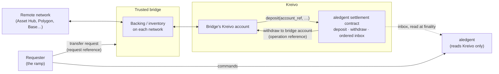

<!--
Copyright (c) 2026 Pagos Cube LLC
SPDX-License-Identifier: CC-BY-4.0
-->

# Requirements for Bloque's trusted bridge

> Copied from `bloque-app/aledgent` PR #100 (branch `bridge-requirements`, commit `ac85c4a`) on 2026-09-30.
> Informative source of the `BR-*` identifiers mapped in `notes/TRACEABILITY.md`. The original is authoritative.

**Status:** draft for review · **Date:** 2026-09-29 · **Owner:** the maintainers ·
**Audience:** the team designing the bridge

This note says what Bloque's **trusted bridge** must guarantee so that two systems can depend on it:
**aledgent**, Bloque's new ledger, and the planned **ramp**, the rewrite of Swaps. It does not design
the bridge. Every requirement below can be met in more than one way; the bridge team chooses how.

It is informative for aledgent: nothing here changes aledgent's `SPEC.md` or `PLAN.md`. Where a
requirement comes from one of aledgent's, the appendix says which.

---

## 1. What the bridge is, and who depends on it

The bridge moves value between **Kreivo** and **remote networks**: Kusama Asset Hub,
Polygon, Base and other EVM chains, in both directions. It is designed separately from aledgent and
from the ramp.

- **aledgent** keeps the book of balances. It has exactly one settlement network, Kreivo, and settles
  there through its own **settlement contract**. aledgent never talks to a remote network and never
  talks to the bridge.
- **The ramp** moves value between the outside world (banks, exchanges, other networks) and Kreivo. It
  does not mint and holds no issuance rights. Whenever it needs a remote network, it asks the bridge.
  It is the bridge's first **requester**; others may follow.

Today's bridge path is the Asset Hub ⇄ Kreivo transfer run by `substrate-rail`, called a "teleport" in
the code. It is in fact an XCM reserve transfer: Kreivo disables teleports with Asset Hub. Its failures
(§5) are the main source of the requirements below.

### Terms

| Term | Meaning here |
|---|---|
| **Requester** | A Bloque system that asks the bridge for a transfer: the ramp, or another. Never aledgent. |
| **Transfer** | One requested movement of value from a source (network, address) to a destination (network, address). |
| **Request reference** | The requester's identifier for a transfer (the ramp calls it a *leg reference*). Unique forever. Opaque to the bridge. |
| **Leg** | The part of a transfer on one network: the **source leg** takes value in, the **destination leg** delivers it. |
| **Coordinate** | What names an on-chain event uniquely and stably: network, block number *and* block hash, and position in the block. A transaction hash alone is not a coordinate. |
| **Observation** | A recorded on-chain fact: an event at a coordinate, with the network's own data and error text, and whether it was final when seen. Evidence, not a verdict. |
| **Finality** | The point after which a network cannot revise a recorded fact. |
| **Disposition** | What is known about a leg or a transfer: **executed**, **provably not executed**, or **unknown**. |
| **Backing** | Value the bridge holds locked or in reserve on one network for value that exists on another. |
| **Inventory** | Value the bridge holds in advance, on any network, to deliver from. |
| **Settlement contract** | aledgent's contract on Kreivo. It holds aledgent's position, takes **deposits** that carry an account reference, pays out **withdrawals**, and records both, in order, in an **inbox** anyone can read. |
| **Account reference** | 32 opaque bytes that name one account at aledgent. aledgent resolves it; nobody else can. |
| **Operation reference** | aledgent's 32-byte identifier for one of its own operations. It appears on every withdrawal the contract records. |

Requirement identifiers are `BR-<area>-<n>`. They are stable: never renumbered, never reused. They are
not the ramp draft's `REQ-BR-1…5`, which state the same boundary from the ramp's side. **MUST**,
**SHOULD** and **MAY** follow RFC 2119.

## 2. Where the bridge meets aledgent

**The bridge is a settlement counterparty on Kreivo, and only that.** aledgent sees an outside party
that sends value into its settlement contract or receives value from it. It sees nothing else of the
bridge. Concretely:

- **Into aledgent** (remote network → Kreivo → an account at aledgent): the Kreivo side ends in a call
  to the settlement contract's `deposit(account_ref, asset, amount)`, made by the Kreivo account that
  holds the value at that moment. That can be the bridge's own account, when the requester asked for
  delivery straight into aledgent, or the requester's, when the bridge delivered to it first. `deposit`
  is the only way value reaches the contract with a record of whose it is. A plain transfer or a
  cross-chain arrival at the contract's account leaves no inbox entry and shows up only as an unexplained
  difference in reconciliation.
- **Out of aledgent** (an account at aledgent → Kreivo → remote network): aledgent reserves the value,
  then its own adapter withdraws it to a Kreivo account the bridge names. The contract records that
  withdrawal in its inbox under aledgent's operation reference. For the bridge, that finalised
  withdrawal is the funding of a transfer.
- **Never:** a holder of aledgent's keys; an account or authority inside aledgent's book; a caller of
  aledgent's interfaces; a source of outcomes for aledgent. The contract's other entry point,
  `credit`, is reserved for other aledgent deployments; the bridge is not one.

aledgent credits an account only when the deposit is final on Kreivo, and debits it for good only when
the withdrawal is. The bridge cannot move either point. Whatever risk the bridge takes before a remote
network is final (a fast path, §3.4) stays with the bridge.

## 3. Requirements

Each row gives the requirement, its strength and a one-line reason. Where each comes from is in
Appendix A.

### 3.1 The Kreivo boundary

| ID | Requirement | | Why |
|---|---|---|---|
| BR-KR-1 | The bridge MUST reach aledgent only on Kreivo, by depositing into or receiving withdrawals from its settlement contract. It MUST NOT hold aledgent keys, accounts or authority, and MUST NOT report outcomes to aledgent. | MUST | aledgent has one settlement network and derives every outcome itself. |
| BR-KR-2 | A delivery into aledgent MUST be a `deposit` call carrying, unchanged, the account reference the requester supplied. It MUST NOT be a plain transfer or a cross-chain arrival at the contract's account. | MUST | Only `deposit` records whose value it is; anything else is an unexplained balance. |
| BR-KR-3 | The bridge MUST treat an account reference as opaque bytes: never parse, derive, alter or reuse it. | MUST | Only aledgent can resolve it; identifiers are assumed to leak. |
| BR-KR-4 | A transfer funded by an aledgent withdrawal MUST be bound to that withdrawal by its coordinate (and the operation reference it carries), supplied in the request. It MUST NOT be matched by amount, sender or time. | MUST | Matching by amount or time pays the wrong transfer, or pays twice. |

### 3.2 Outcomes and proof of non-execution

| ID | Requirement | | Why |
|---|---|---|---|
| BR-OUT-1 | For every transfer, and for each of its legs, the bridge MUST report one of three dispositions: executed, provably not executed, or unknown. | MUST | The requester and aledgent act differently on each. |
| BR-OUT-2 | The bridge MUST NOT turn "unknown" into either of the others. A timeout, a node or connection error, a dropped or banned transaction, an event it cannot decode, or a lagging node is unknown. "I could not look" is never "it did not happen". | MUST | Every "failed, then paid anyway" incident started here. |
| BR-OUT-3 | The bridge MUST report "not executed" only with a proof (BR-NX-1). Once it has, that transfer MUST be unable to execute, ever. | MUST | A failure told to a client and then paid out is a double payment. |
| BR-OUT-4 | The bridge MUST report observations, not verdicts: a coordinate on each network it touched, the network's own data and error text, and finality as observed. Accepting a request is not an observation of anything. | MUST | Nobody downstream can check a verdict; everyone can check a coordinate. |
| BR-OUT-5 | Included, final and complete MUST be three distinct conditions, each with its own time, in every status and report. | MUST | Merging them is how "sent" gets read as "arrived". |
| BR-OUT-6 | A transfer that executed or provably did not MUST stay that way. No later report may change it. | MUST | Terminal outcomes that move break every reconciliation downstream. |
| BR-OUT-7 | A delivered amount that differs from the requested amount MUST be a named condition that reports both. Fees MUST be declared per route before acceptance, never taken silently from the delivery. | MUST | A silent residue is a reconciliation break nobody can explain. |
| BR-OUT-8 | The bridge MUST check the execution result on every network it touches, not only inclusion. A partial execution (for example a cross-chain message that halts midway) MUST NOT be reported as executed in full. | MUST | Included is not executed; a halted message can move part of the value. |
| BR-NX-1 | Every transaction the bridge signs MUST make non-execution provable in bounded time. On Substrate networks: a mortal transaction whose era has ended at a final block, with the signer's nonce not consumed by it. On EVM networks, which have no expiry: the sender's nonce consumed at a final block by a different transaction. An on-chain refusal counts once it is final. | MUST | Without an expiry, non-execution can never be proven, only assumed. |
| BR-NX-2 | A proof of non-execution MUST be checkable by a third party from public chain data alone: network, signer, nonce, expiry and the final block that proves it. | MUST | A proof that needs the bridge's database is a claim. |
| BR-NX-3 | Silence, elapsed time, a node's "not found", or a transaction dropped from a pool MUST NOT count as proof. | MUST | A dropped transaction can be rebroadcast and included later. |
| BR-NX-4 | Each network's expiry SHOULD be short enough that an unknown leg becomes provable within the route's latency ceiling (§3.8). | SHOULD | The shorter the expiry, the shorter the time in review. |

### 3.3 Idempotency, correlation, ordering and exactly-once delivery

| ID | Requirement | | Why |
|---|---|---|---|
| BR-ID-1 | Every request MUST carry the requester's reference. A repeat with the same body MUST return the original transfer's status. A repeat with a different body MUST be refused. Neither starts a second transfer. | MUST | Retries after a timeout are normal; a second transfer is not. |
| BR-ID-2 | The request reference, or a fixed one-to-one digest of it, MUST be written on chain, on both networks, by the transactions of that transfer. Where a plain transfer cannot carry it, the bridge MUST use a mechanism that can, atomically with the value movement. Legs MUST be matched to transfers by this reference, never by position in a batch or by a value only one direction can compute. | MUST | Anyone holding the reference can find both legs without the bridge. |
| BR-ID-3 | Any identifier the bridge assigns MUST be distinct from the request reference and MUST NOT replace it. | MUST | Two keys, never conflated. |
| BR-ID-4 | Knowing a reference MUST NOT be enough to change a transfer. Correlating is not authorising. | MUST | References leak into logs, tickets and screenshots. |
| BR-EO-1 | The bridge MUST persist each exact signed transaction before submitting it. After a restart it MUST re-send those bytes or query their status, never sign a second transaction with the same intent. | MUST | Re-signing after a crash is the classic double execution. |
| BR-EO-2 | Each transfer MUST be delivered at most once, forever: across retries, restarts, key rotation, failover and upgrades. On-chain logic MUST refuse a second delivery or mint against a source leg already consumed. | MUST | At-most-once must survive the loss of the bridge's own database. |
| BR-EO-3 | Every final source leg MUST eventually be delivered or refunded (§3.5). Observation of each network MUST be complete over contiguous block ranges; the bridge MUST NOT move past a range it failed to read, and MUST record any skipped range as a visible gap and fill it from an archive. | MUST | Nodes keep recent history only (about 11 minutes on Kreivo's public RPC). |
| BR-EO-4 | Observations MUST be de-duplicated by coordinate, never by transaction hash. | MUST | A re-included transaction keeps its hash and would count twice. |
| BR-EO-5 | The bridge MUST expose its transfers as a sequenced log readable by position, so a requester can read everything since its last position without a subscription. | MUST | Push notifications get lost; a gapless log does not. |
| BR-EO-6 | The bridge MUST declare which transfers share a signing lane and whether it preserves order within one. One unknown transfer SHOULD NOT hold up unrelated transfers. | MUST / SHOULD | Nonce lanes serialise work; head-of-line blocking hides as latency. |
| BR-EO-7 | The bridge MAY group several transfers into one on-chain transaction, provided each keeps its own reference, its own recorded outcome and its own proof of non-execution. | MAY | Batching saves cost; it must not blur outcomes. |

### 3.4 Finality, and exposure before it

| ID | Requirement | | Why |
|---|---|---|---|
| BR-FIN-1 | The bridge MUST publish, per network, the finality rule it applies. It MUST be the network's own finality signal, never a count of confirmations: the relay-chain-finalised head for Kreivo and Asset Hub; the `finalized` block for Polygon, Base, other EVM chains and Ethereum. | MUST | Block counts are guesses; Kreivo has reorganised forks up to six blocks deep in testing. |
| BR-FIN-2 | A leg MUST count as final only when two facts hold: the network's final point has passed its block, and the block at that height is still the one observed (same hash). | MUST | Either fact alone admits an observation made before a fork resolved. |
| BR-FIN-3 | Until final, an observation MUST be re-checked every cycle. If it no longer matches, it MUST be withdrawn and reported as withdrawn, and anything waiting on it MUST stop. | MUST | A provisional fact that silently vanishes is how funds go missing. |
| BR-FIN-4 | By default, the bridge MUST NOT deliver on the destination network before the source leg is final. | MUST | Delivering first means someone carries the loss if the source reverts. |
| BR-FIN-5 | If a fast path is adopted (open question Q1), delivery before source finality MUST come only from the bridge's own inventory, never from backing. Its exposure MUST be capped per transfer, per window and in total, reported continuously, and be the bridge's loss if the source reverts: never recovered from the beneficiary's account at aledgent and never reported as the transfer failing. | MUST | aledgent's credit at Kreivo finality cannot be undone by the bridge. |
| BR-FIN-6 | Every read that decides a disposition MUST be made at a final block, never at the best block. Before declaring a source leg unknown, the bridge SHOULD check the destination: a final arrival proves the source executed. | MUST / SHOULD | Unfinalised reads have failed good operations; the destination often settles the doubt. |

### 3.5 Refunds

| ID | Requirement | | Why |
|---|---|---|---|
| BR-RF-1 | A refund MUST happen only when the destination leg is provably not executed (BR-NX-1) and that proof is final. Never on a timer, never on an unknown. | MUST | A refund while delivery can still land pays twice. |
| BR-RF-2 | Where to refund MUST be given by the requester in the original request. The bridge MUST NOT choose it after the fact. A refund into aledgent is a `deposit` with the account reference supplied (BR-KR-2). | MUST | Refund destinations chosen by hand are where out-of-band fixes start. |
| BR-RF-3 | A refund MUST be a transfer of its own, with a reference derived deterministically from the original, under every requirement here. The original's record MUST point to it. | MUST | A refund is value moving; it gets the same guarantees. |
| BR-RF-4 | An unknown leg that reaches its deadline MUST go to a review queue with an owner and a service level. It MUST NOT be refunded, retried as a new transaction, or failed. | MUST | Stuck is a bounded condition; a wrong refund is not. |

### 3.6 Observability

| ID | Requirement | | Why |
|---|---|---|---|
| BR-OBS-1 | Given only a request reference, anyone MUST be able to find the transfer's transactions on each network and check its disposition from public chain data, without the bridge's database. | MUST | Status that only the bridge can read is status nobody can audit. |
| BR-OBS-2 | The bridge MUST answer a status query by request reference and by coordinate. Notifications MUST be at-least-once, authenticated and de-duplicable by a stable key; no requester may need one to arrive. | MUST | Requesters must never depend on a webhook arriving. |
| BR-OBS-3 | Every state change MUST record the block number, block hash and block time it rests on, and the time the bridge saw it. No recorded time may be overwritten or recomputed. | MUST | Today's workflow clock can be rewritten, so latency cannot be measured. |
| BR-OBS-4 | For any transfer, the bridge MUST be able to state from durable state alone, after any restart: what it was asked, what each network did, and what it told the requester. | MUST | Support and reconciliation both start from these three answers. |
| BR-OBS-5 | The following MUST be observable continuously: the age of the oldest non-final transfer per route; count and age of unknown transfers; observation lag and open gaps per network; backing divergence per asset; inventory and fee balances per network; undelivered notifications. | MUST | The oldest stuck transfer is the one metric that finds every class of stall. |

### 3.7 Limits, backpressure, liquidity and inventory

| ID | Requirement | | Why |
|---|---|---|---|
| BR-LIM-1 | The bridge MUST declare, per route (asset, source network, destination network), in machine-readable form: minimum and maximum per transfer, window limits, cut-offs and current capacity, including any minimum imposed downstream. | MUST | Requesters must refuse before value moves, not after. |
| BR-LIM-2 | The bridge MUST refuse at request time anything it can already tell will not execute, with a named reason, before any value moves. | MUST | A limit found after the source leg executed strands value. |
| BR-LIM-3 | After acceptance, a shortfall in inventory or in a fee balance MUST be a named, parked condition that resumes by itself when the balance recovers, with one alert per position. It MUST NOT be a failure or trigger a refund. | MUST | A missing fee token is not evidence that a transfer failed. |
| BR-LIM-4 | When the bridge cannot keep up, it MUST refuse new requests with a named, retryable condition rather than accept work it will not finish on time. | MUST | Hidden queues turn into missed deadlines. |
| BR-LIQ-1 | For every bridged asset, at every final point, the bridge MUST be able to show: backing on the source side = supply on the other side + value in flight, to the smallest unit. Any divergence MUST page a human and pause the affected route. | MUST | Zero divergence is the only tolerance at which a mismatch can't hide. |
| BR-LIQ-2 | Value in flight MUST be a named quantity per asset, listing the transfers that make it up. | MUST | "In transit" must be itemised, not a residual. |
| BR-LIQ-3 | Every address holding backing, inventory or fee balances MUST be published, per network and asset. Value MUST move in or out of them only by transfers or declared rebalances, each with a reference. | MUST | Published addresses let anyone recompute backing from chain data. |
| BR-LIQ-4 | The bridge MUST mint or release on one network only against a final, unconsumed source leg with the same reference and amount. On-chain mint authority MUST be bounded by backing. | MUST | Unbacked supply is the one failure a bridge cannot recover from. |
| BR-LIQ-5 | Value that arrives at a bridge address without a matching request MUST be recorded as an unassociated arrival with an owner. It MUST NOT be absorbed into inventory or dropped. | MUST | Stray deposits are someone's money. |
| BR-LIQ-6 | The bridge SHOULD publish a signed statement of backing, supply and value in flight on a stated cadence, naming the block on each network. The statement MUST say it is a signed claim, not a proof of solvency. | SHOULD | A claim you can check against chains beats a claim you have to trust. |
| BR-LIQ-7 | The bridge MAY rebalance inventory between networks in batches rather than per transfer, provided each rebalance is a referenced transfer (BR-LIQ-3) and reconciles to zero (BR-LIQ-1). | MAY | Batched inventory keeps Kreivo usage proportional to net flow. |

### 3.8 Latency

**Where aledgent's part ends.** aledgent's completion budget (30 s at p99 as the ceiling, 19 s at p99 as
the target) covers aledgent alone, and its finality is always local. For value leaving aledgent, that
budget ends at the hand-off: the withdrawal is final on Kreivo and the outcome has been relayed to the
requester. Whatever happens after that belongs to the bridge, under the bridge's own budgets, measured
separately. aledgent's numbers do not apply to the bridge.

**Completion** of a bridge transfer runs from the final block of its source leg to the final block of
its destination leg. Both come from chain data. The requester's own steps are not part of it. An
end-to-end swap is not a bridge transfer and must not be used to measure one, because it includes third
parties' legs that can take days.

| ID | Requirement | | Why |
|---|---|---|---|
| BR-LAT-1 | The bridge MUST publish a completion budget for every route (asset, source network, destination network): a p99 ceiling and a p99 target, set by its designers, before the route carries value. Every transfer MUST be measured against its own route's budget, and separately from aledgent's. | MUST | Remote finality differs by minutes between networks. The bridge owns its own clock. |
| BR-LAT-2 | Latency MUST be computed only from write-once, on-chain milestone timestamps: source leg final, destination leg included and destination leg final. Each MUST be recorded once, with the network, block number, block hash and block time, and never overwritten. No workflow or process clock may stand in for them. | MUST | A clock that can be rewritten cannot measure anything. |
| BR-LAT-3 | Every transfer MUST count. A transfer that is still open counts at its current age, and one with a missing milestone counts as a miss. Latency MUST be recomputable from chain data alone. | MUST | Excluding the slow or the unmeasured is how a p99 lies. |
| BR-LAT-4 | Latency SHOULD be reported per closed week, as an absolute count of misses alongside the percentage and the share of transfers measured. | SHOULD | Open buckets move, and percentages swing in low-volume weeks. |

### 3.9 Key custody, governance and privacy

| ID | Requirement | | Why |
|---|---|---|---|
| BR-KEY-1 | Signing keys MUST live in a KMS or HSM. Key material MUST NOT be readable from a process environment, and MUST NOT appear in any configuration, log, URL or error. | MUST | Keys in environment variables leak with the first crash dump. |
| BR-KEY-2 | A process that holds bridge state MUST NOT hold a key. The signer MUST sign only transactions that match a recorded request, and log every signature. | MUST | A bug in the state machine must not be able to sign. |
| BR-KEY-3 | Every key MUST be bounded on chain: an outflow cap per asset and window, enforced by the chain, not by the bridge's code. | MUST | A stolen key must have a known maximum loss. |
| BR-KEY-4 | Keys MUST be separate per network and per role (delivery, pause, upgrade), and rotatable without stranding transfers in flight. | MUST | One key per purpose limits what one compromise reaches. |
| BR-KEY-5 | Deliveries above a stated size and every administrative action SHOULD need several independent signers. | SHOULD | Large movements deserve a second pair of eyes. |
| BR-KEY-6 | A key or account from a test environment MUST NOT hold any authority over production accounts, and production keys MUST NOT sign on test networks. | MUST | Cross-environment authority is invisible until it is used. |
| BR-GOV-1 | The bridge MUST be pausable per route, per asset, per direction and globally. A pause MUST stop new work only. Transfers in flight MUST keep being observed and completed, never failed or refunded because of the pause. | MUST | A pause that fails transfers turns an incident into a second one. |
| BR-GOV-2 | Pausing SHOULD need one authorised party; unpausing and raising limits SHOULD need several. | SHOULD | Stopping must be fast; resuming must be deliberate. |
| BR-GOV-3 | Whoever can upgrade on-chain code that holds backing MUST be named, and upgrades MUST pass a published governance process with a delay before taking effect. | MUST | Upgrade authority is authority over all the backing. |
| BR-GOV-4 | Upgrading off-chain components MUST NOT lose or duplicate transfers in flight. | MUST | Deploys happen during business hours. |
| BR-GOV-5 | Every administrative or manual action MUST be recorded with its actor and justification in an append-only record. There MUST be no path that moves value or edits a status outside the ordinary transfer path: a manual resolution attaches evidence (a coordinate) and runs the ordinary steps, and one that moves value needs a second approver. | MUST | Hand-edited statuses are how the book and the chain drift apart. |
| BR-PRV-1 | Personal data MUST NOT appear on any network: not in a reference, memo, remark, calldata or event. | MUST | Chains are public and permanent. |
| BR-PRV-2 | On-chain references MUST NOT be sequential or derived from user identifiers. | MUST | A guessable reference links chain activity to a person. |
| BR-PRV-3 | A request MUST NOT need personal data. Eligibility checks belong to the requester. | MUST | The bridge cannot leak what it never holds. |

### 3.10 Incident behaviour

| ID | Requirement | | Why |
|---|---|---|---|
| BR-INC-1 | At start-up, the bridge MUST check that each network it reaches is the one it expects (genesis hash or chain id), and fail closed on a mismatch. | MUST | Talking to the wrong network is silent until it isn't. |
| BR-INC-2 | On a condition it cannot explain (backing divergence, a finality stall, an observation gap, a reorganisation deeper than expected, a signature it did not record) the bridge MUST pause the affected routes automatically, keep observing, and page a human. | MUST | Fail closed for new work, keep watching the old. |
| BR-INC-3 | During an incident, transfers in flight MUST be reported as unknown or delayed, never as failed, and MUST NOT be refunded. | MUST | Incidents are when "failed" is most tempting and most wrong. |
| BR-INC-4 | A signature the bridge did not record MUST be treated as a key compromise: pause, rotate, report. | MUST | Only a compromised key signs what nobody asked for. |
| BR-INC-5 | Requesters SHOULD be told once per condition (a route paused, a network stalled), not once per transfer. | SHOULD | Per-transfer alerts bury the cause. |
| BR-INC-6 | Each incident class in §5 SHOULD have a runbook exercised before the bridge carries value. | SHOULD | The first run of a runbook should not be the real one. |

## 4. Open questions for the owner

| ID | Question |
|---|---|
| Q1 | **Fast path.** Will the bridge deliver before the source leg is final? If so: which routes, what exposure cap, who funds the inventory, and who absorbs a reverted source? (Ramp draft `OQ-2`; BR-FIN-5.) |
| Q2 | *Answered (owner, 2026-09-29).* aledgent's 30 s / 19 s budget does not apply to the bridge. aledgent's completion ends at the hand-off, when the withdrawal is final on Kreivo and the outcome has been relayed to the requester. The bridge's designers set a budget for each route, and it is measured separately (BR-LAT-1, BR-LAT-2). |
| Q3 | **Pass-through or inventory.** Does each ramp order move value through Kreivo, or does the ramp hold inventory and rebalance through the bridge in batches? This decides whether aledgent's "no settlement record per operation" holds for Bloque's own traffic. |
| Q4 | **Direct delivery into aledgent.** May the bridge call `deposit` on aledgent's contract itself (BR-KR-2), or must it always deliver to the requester's Kreivo account first? |
| Q5 | **Refund destination.** Where does a refund go: the original source, or the requester's account at aledgent? (Ramp draft `OQ-8`; BR-RF-2 needs an answer either way.) |
| Q6 | **Who owns the review queue** for unknown transfers, and with what service level? |
| Q7 | **Mint authority on Kreivo.** Which bridged assets does the bridge mint on Kreivo, and under whose governance is that authority bounded (BR-LIQ-4, BR-GOV-3)? |

## 5. Incidents these requirements answer

Each row is a class of failure seen on today's path, the evidence for it, and the requirements that
would have prevented it. The evidence is Bloque's internal incident records, not published here.

| # | What happened | Evidence | Prevented by |
|---|---|---|---|
| I-1 | **Failure reported, then paid.** Ten cash-outs reached success after a failure signal, 19 s to 40 h later. A partner refunded its users on our notices and asked Bloque to absorb the cost for five. Seven orders carry both "failed" and "success". | Bloque's internal incident records | BR-OUT-2, BR-OUT-3, BR-OUT-6, BR-INC-3 |
| I-2 | **Non-execution never provable.** Every transaction was signed without an expiry, so "not yet" and "never" looked the same forever. A nonce released on a timer was reissued and destroyed another customer's account creation. | Bloque's internal incident records | BR-NX-1, BR-NX-3, BR-RF-1 |
| I-3 | **Re-signing on silence.** The first design took a fresh nonce and signed again when a submission went quiet: a double execution whenever the first one had landed. | Bloque's internal incident records | BR-EO-1, BR-EO-2 |
| I-4 | **"Confirmed" when the message left.** Kreivo → Asset Hub transfers were marked confirmed on dispatch. The next step failed 12–15 s later; the funds arrived 36–48 s after dispatch. | Bloque's internal incident records | BR-OUT-4, BR-OUT-5, BR-FIN-4 |
| I-5 | **A shortfall treated as failure.** An asset balance shortfall was classed as terminal, leaving two customers debited and unpaid. Separately, a fee account ran dry unnoticed for two months and left 18 accounts stuck. | Bloque's internal incident records | BR-LIM-3, BR-LIQ-3, BR-OBS-5 |
| I-6 | **Skipped blocks.** The cross-chain follower read only the newest final block, and finality advances in bursts. An indexer miss hid a bridge delivery: a 499.70 DUSD payout was booked as failed while the chain paid it, for 12 hours. | Bloque's internal incident records | BR-EO-3, BR-EO-5 |
| I-7 | **"Could not look" read as "did not happen".** An RPC rotation dropped the watcher's connection, and a transfer that had succeeded was quarantined as not arrived. Undecodable events were reported as failed, which triggers a refund. | Bloque's internal incident records | BR-OUT-2, BR-NX-3 |
| I-8 | **Inclusion taken for execution.** On the Kreivo side the cross-chain message's local outcome is logged, never checked; a partial execution can pass as success. | Bloque's internal incident records | BR-OUT-8 |
| I-9 | **Decisions on unfinalised reads.** A confirmation from the best block raced a check at the final block; 93 accounts stuck. An ambiguous source was not resolved by a destination arrival that proved it. | Bloque's internal incident records | BR-FIN-2, BR-FIN-6 |
| I-10 | **One stuck transfer stops everything.** A lost observation held a nonce; the signing queue behind it stalled for 4.5 hours. | Bloque's internal incident records | BR-EO-6, BR-INC-2 |
| I-11 | **Silent outcomes.** 13 of 14 quarantined operations left no record the ledger could see; success on chain produced no notice at all. | Bloque's internal incident records | BR-OBS-2, BR-OBS-4, BR-RF-4 |
| I-12 | **Timestamps that can be rewritten.** The workflow clock is rewritten when a step is re-paused by hand: the same latency query gave 100 % and about 0 % an hour apart. No block number is stored. A status timestamp stopped being written from July 2026, and about 20 % of rows carry 1970-01-01. | Bloque's internal incident records | BR-OBS-3, BR-LAT-2, BR-LAT-3 |
| I-13 | **Amount residue.** A hold was taken for the order amount and the chain moved a slightly different one; the difference sat unseen for five weeks. | Bloque's internal incident records | BR-OUT-7 |
| I-14 | **Correlation that cannot be computed.** The Asset Hub → Kreivo identifier is composed by the runtime and unknown in advance; operations are matched to events by position. | Bloque's internal incident records | BR-ID-2 |
| I-15 | **Limits found after value moved, fixed by hand.** A withdrawal below an exchange's minimum failed after earlier legs executed; the payout was completed out of band and the records repaired by inserting rows. | Bloque's internal incident records | BR-LIM-1, BR-LIM-2, BR-GOV-5 |
| I-16 | **Keys beside state.** The earlier bridge actor signed with node keys; aledgent's own signer still sits in the book's process. | Bloque's internal incident records | BR-KEY-1, BR-KEY-2 |

---

## Appendix A. Traceability

aledgent identifiers are from its `SPEC.md` v0.3.3 and `PLAN.md` v0.1.0. `REQ-*` there are
requirements, `INV-*` invariants, `NFR-*` non-functional requirements, `DEC-*` plan decisions and `F-*`
features. Ramp identifiers are from the Swaps draft (`swaps-vos/SPEC.md` v0.0.2) and are prefixed
"ramp" where the name alone is ambiguous. The ramp's `REQ-PV-*` are its provider requirements, not aledgent's privacy ones. Incidents are numbered as in §5.

| ID | aledgent | Ramp draft | Incidents |
|---|---|---|---|
| BR-KR-1 | `INV-25`, `INV-11`, §3 settlement counterparty, `REQ-SA-8`, `DEC-17`, `DEC-18` | `REQ-BR-1`, ramp `INV-1`, `INV-2` | — |
| BR-KR-2 | `REQ-SL-7`, `INV-9`, `F-026` (deposit; NOTES decision 22) | `REQ-LB-3` | — |
| BR-KR-3 | `REQ-SL-7`, `REQ-PV-7` | — | — |
| BR-KR-4 | `REQ-SL-8`, `REQ-SI-3`, `INV-14` | `REQ-ID-4` | I-6, I-14 |
| BR-OUT-1 | `REQ-SA-4` | `REQ-BR-4`, `REQ-PV-5` | I-1 |
| BR-OUT-2 | `REQ-SA-4`, `REQ-OP-6`, `REQ-SO-4` | `REQ-PV-5` | I-1, I-7 |
| BR-OUT-3 | `REQ-OP-9`, `INV-21` | `REQ-FL-5` | I-1, I-2 |
| BR-OUT-4 | `INV-11`, `REQ-IN-2`, `REQ-SA-3`, `REQ-SI-1` | `REQ-BR-3` | I-4 |
| BR-OUT-5 | `REQ-IN-7` | `REQ-OR-4` | I-4 |
| BR-OUT-6 | `REQ-OP-4`, `INV-21` | `REQ-OR-3` | I-1 |
| BR-OUT-7 | `REQ-OP-2`, `INV-14`, `ERR-AmountMismatch` | `REQ-LG-2`, `REQ-OR-2` | I-13 |
| BR-OUT-8 | `REQ-SO-3`, `REQ-IN-3` | `REQ-PV-4` | I-8 |
| BR-NX-1 | `REQ-SL-4`, `REQ-OP-9` | `REQ-FL-3` | I-2 |
| BR-NX-2 | `REQ-PR-4`, `REQ-SA-5` | — | I-2 |
| BR-NX-3 | `REQ-OP-6` | `REQ-DL-2` | I-2, I-7 |
| BR-NX-4 | `REQ-OP-5`, `REQ-OP-8` | `REQ-DL-1` | I-2 |
| BR-ID-1 | `REQ-OP-10`, `REQ-OP-11` | `REQ-BR-2`, `REQ-ID-2` | — |
| BR-ID-2 | `REQ-SL-8`, `REQ-SO-3` | `REQ-PV-2` | I-14 |
| BR-ID-3 | `REQ-OP-10` | `REQ-ID-1` | — |
| BR-ID-4 | `REQ-PV-7` | `REQ-ID-4` | — |
| BR-EO-1 | `REQ-SA-6`, `REQ-SO-7` | `REQ-PV-3` | I-3 |
| BR-EO-2 | `INV-12`, `INV-18` | `INV-7` | I-3 |
| BR-EO-3 | `REQ-SA-7`, `REQ-IN-5` | — | I-6 |
| BR-EO-4 | `REQ-IN-1`, `INV-12` | `REQ-ID-3` | — |
| BR-EO-5 | `REQ-SL-9` | `REQ-PV-8` | I-6 |
| BR-EO-6 | `REQ-SO-8`, `NFR-11` | `REQ-OR-7` | I-10 |
| BR-EO-7 | `REQ-SO-3`, `F-026` (one outcome per call in a batch) | — | I-14 |
| BR-FIN-1 | `REQ-SL-3` | `OQ-9` | I-9 |
| BR-FIN-2 | `REQ-IN-3` | — | I-9 |
| BR-FIN-3 | `REQ-IN-4` | — | — |
| BR-FIN-4 | `INV-10`, `REQ-OP-1` | `REQ-LG-1`, ramp `INV-4` | I-4 |
| BR-FIN-5 | `INV-10`, `REQ-RC-2` | `OQ-2` | — |
| BR-FIN-6 | `REQ-IN-3`, `REQ-SL-3` | — | I-9 |
| BR-RF-1 | `REQ-OP-9`, `ERR-ReleaseUnsafe` | `REQ-FL-5`, `REQ-LG-3` | I-1, I-2 |
| BR-RF-2 | `REQ-SL-7` | `OQ-8` | I-15 |
| BR-RF-3 | `REQ-OP-3` | `REQ-FL-3` | — |
| BR-RF-4 | `REQ-OP-6`, `REQ-OP-7`, `INV-15` | `REQ-FL-4`, `REQ-MR-5` | I-11 |
| BR-OBS-1 | `REQ-SL-8`, `REQ-PR-4` | — | I-11 |
| BR-OBS-2 | `REQ-SI-5`, `CTR-EVT` | `REQ-PV-8`, `REQ-OB-2` | I-5, I-11 |
| BR-OBS-3 | `OQ-36`, `NFR-11` | `REQ-OB-1` | I-12 |
| BR-OBS-4 | `REQ-SA-5` | `REQ-PV-6` | I-11 |
| BR-OBS-5 | `NFR-11`, `REQ-OP-8` | `REQ-OB-3` | I-5, I-10 |
| BR-LIM-1 | `REQ-SA-1` | `REQ-BR-5`, `REQ-PV-1` | I-15 |
| BR-LIM-2 | `REQ-SA-1`, `ERR-UnsupportedLeg` | `REQ-FL-1` | I-15 |
| BR-LIM-3 | `REQ-SN-2` | `REQ-FL-2`, `REQ-BR-5` | I-5 |
| BR-LIM-4 | `REQ-CS-7` | `REQ-FL-1` | I-10 |
| BR-LIQ-1 | `NFR-9`, `REQ-PR-5`, `INV-5` | `REQ-OB-5` | — |
| BR-LIQ-2 | `NFR-9` | `REQ-OB-5` | — |
| BR-LIQ-3 | `REQ-SN-2`, `REQ-PR-5` | `REQ-PV-10`, ramp `INV-9` | I-5 |
| BR-LIQ-4 | `INV-10`, `REQ-AS-6` | ramp `OQ-1` | — |
| BR-LIQ-5 | `INV-9` | `REQ-DL-4` | — |
| BR-LIQ-6 | `REQ-PR-3`, `REQ-PR-6` | — | — |
| BR-LIQ-7 | `REQ-SL-5` | ramp `OQ-2` | — |
| BR-LAT-1 | Owner's ruling of 2026-09-29: aledgent's budget (amendment 0007) ends at the hand-off | `OQ-11` | — |
| BR-LAT-2 | `REQ-IN-7`, `NFR-11`, `OQ-36` | `REQ-OB-3` | I-12 |
| BR-LAT-3 | `NFR-11` | `REQ-OB-3` | I-12 |
| BR-LAT-4 | — (owner's KPI reporting rules) | — | I-12 |
| BR-KEY-1 | `NFR-8`, `REQ-AU-8` | `REQ-PV-9` | I-16 |
| BR-KEY-2 | `NFR-8`, `REQ-SA-8`, `DEC-18` | — | I-16 |
| BR-KEY-3 | `NFR-8`, `F-026` (withdrawal bounds) | — | — |
| BR-KEY-4 | `INV-22` | — | — |
| BR-KEY-5 | `REQ-RC-2` | `REQ-MR-3` | — |
| BR-KEY-6 | `NFR-8`, `REQ-SA-2` | — | — |
| BR-GOV-1 | `REQ-OP-6` | — | — |
| BR-GOV-2 | `REQ-RC-2` | `REQ-MR-3` | — |
| BR-GOV-3 | `DEC-17`, `F-026` (upgrade authority) | — | — |
| BR-GOV-4 | `NFR-4`, `NFR-5`, `REQ-RC-3` | — | — |
| BR-GOV-5 | `REQ-AT-3`, §13 non-goals, `REQ-RC-1` | `REQ-MR-1`–`REQ-MR-4` | I-15 |
| BR-PRV-1 | `REQ-PV-3`, `INV-17`, `REQ-PR-2` | — | — |
| BR-PRV-2 | `REQ-PV-7` | — | — |
| BR-PRV-3 | §13 (identity out of scope) | `OQ-5` | — |
| BR-INC-1 | `REQ-SA-2` | — | — |
| BR-INC-2 | `REQ-PR-5`, `NFR-9` | `REQ-OB-4` | I-10 |
| BR-INC-3 | `REQ-OP-6`, `REQ-SO-4` | `REQ-FL-4` | I-1 |
| BR-INC-4 | `NFR-8` | — | — |
| BR-INC-5 | — | `REQ-OB-4` | — |
| BR-INC-6 | `NFR-10` | — | — |
